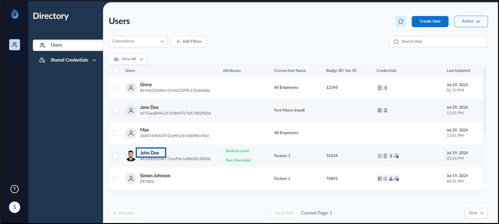
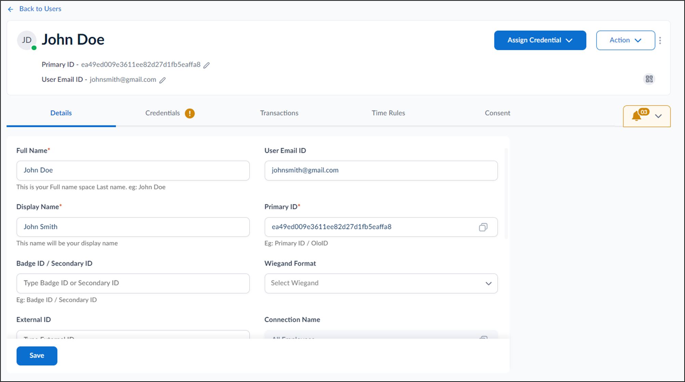
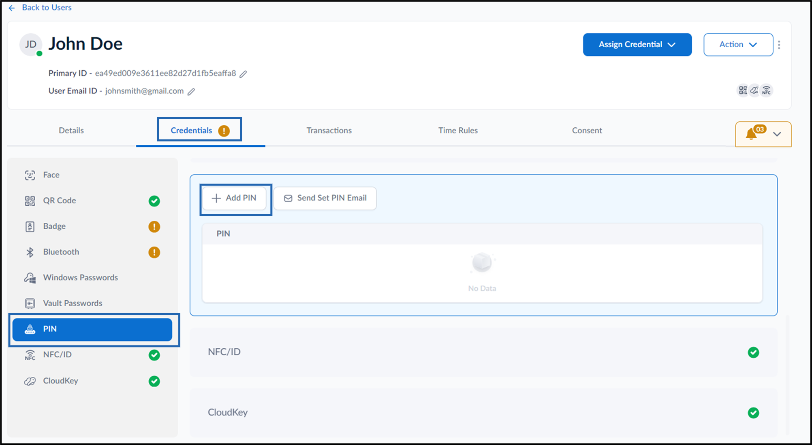
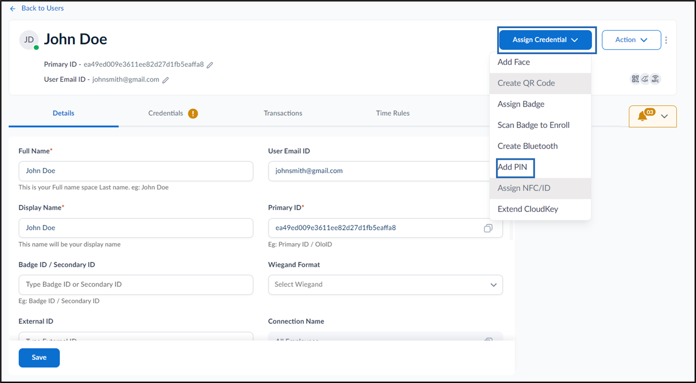
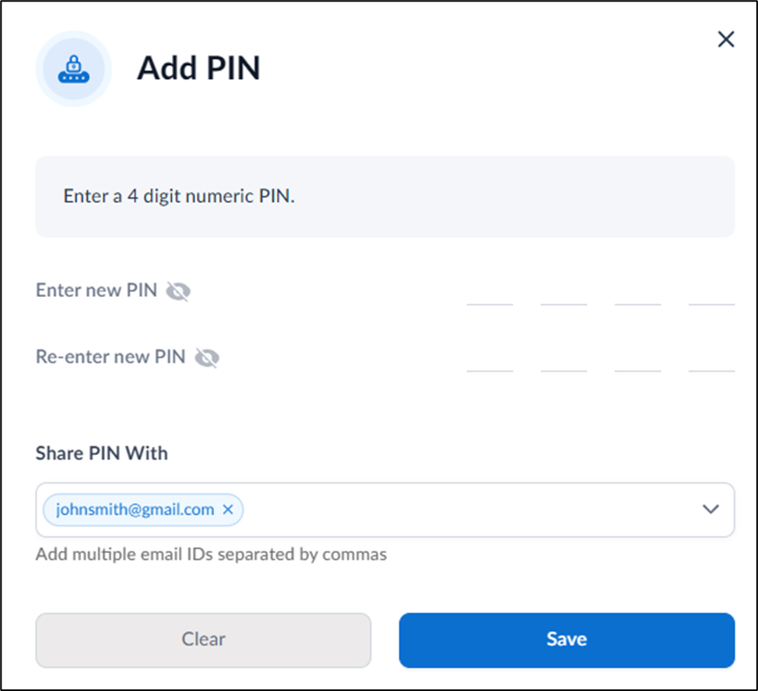
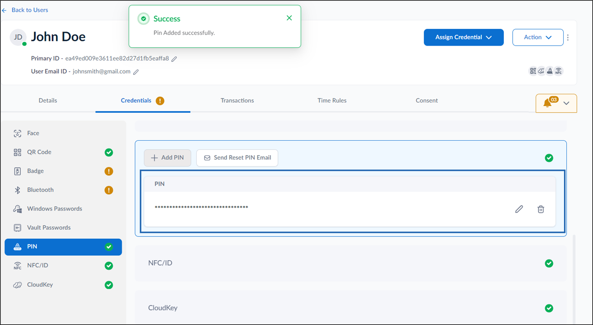

{/* Source: Intercom article 9674277 - https://oloid.help/en/articles/9674277-supervisor-portal-how-to-add-pin-as-credential-to-users */}
{/* Generated by intercom_to_mintlify.py - re-running overwrites this file. */}

Steps to create PIN:

1. Log in to the **Supervisor Portal.**
   The **Users** page is displayed.
2. Click **username** to edit.

   

   The user details page is displayed.

   

3. Do one of the following:
   1. Go to **Credentials** > **PIN** > **Add PIN**.

      

   2. Go to **Assign Credential** > **Add PIN**.

      

      The **Add PIN** pop-up box is displayed.

      

4. On the pop-up box, do the following:
   1. Enter **new PIN**.

      <Note>
        **Note:** You must enter numbers.
      </Note>

   2. Re-enter **new PIN**.
   3. Under **Share PIN With** enter email address you want to share the **pin** with.
   4. Click **Save**.

      

      The PIN is created and listed on the **PIN** tab.

## Video Tutorial

Watch the video[How to add PIN as credential to Users in the Supervisor Portal- Video Tutorial](/platform/supervisor-portal/videos/how-to-add-pin-as-credential-to-users-in-the-supervisor-portal-video)
