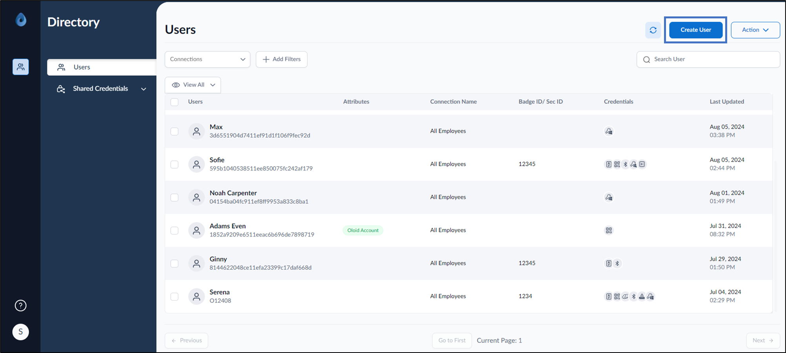
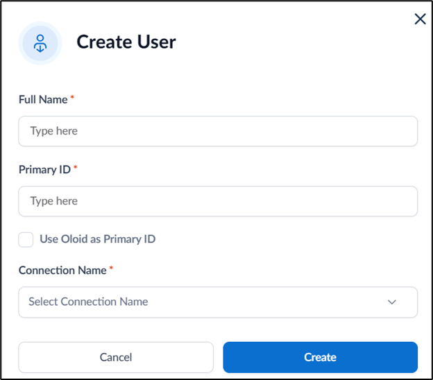
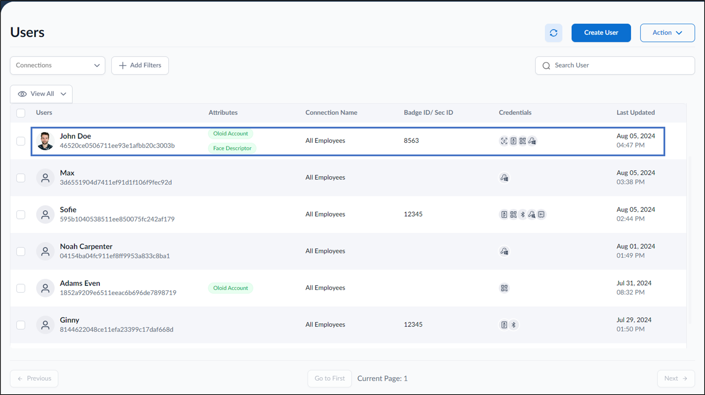

{/* Source: Intercom article 9669198 - https://oloid.help/en/articles/9669198-supervisor-portal-how-to-add-user */}
{/* Generated by intercom_to_mintlify.py - re-running overwrites this file. */}

Steps to add user:

1. Log in to the **Supervisor Portal.**
   The Users page is displayed.
2. Click **Create User** from the top right corner.

   

   The **Create User** pop-up box is displayed.

   

3. On the pop-up box, do the following:
   1. Enter **Full Name** of the user.
   2. Enter **Primary ID**.
   3. Select **Use OloID as Primary ID** to use OloID as your primary ID.
   4. Select **Connection** from the **Connection** list.
   5. Click **Create**.
      The new user is added and listed on the **Users** page.

      
