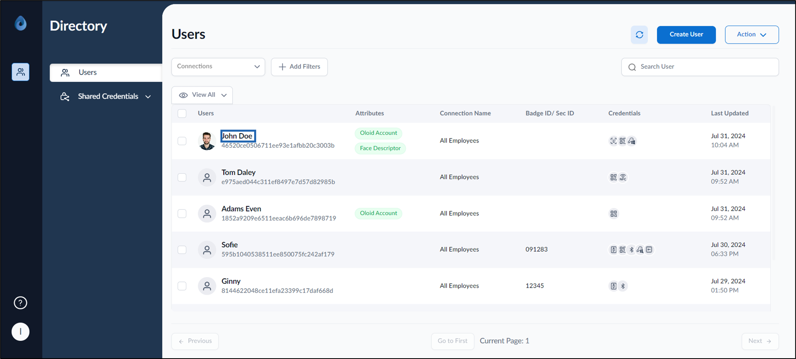
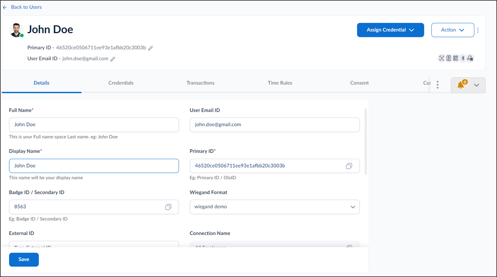
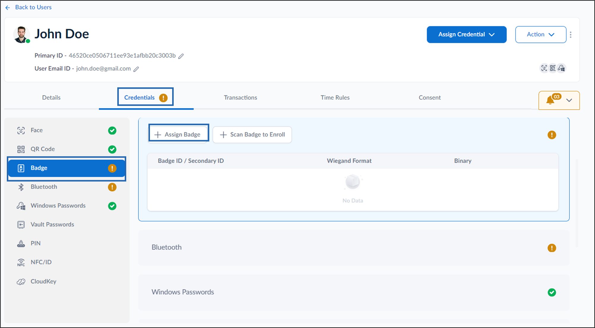
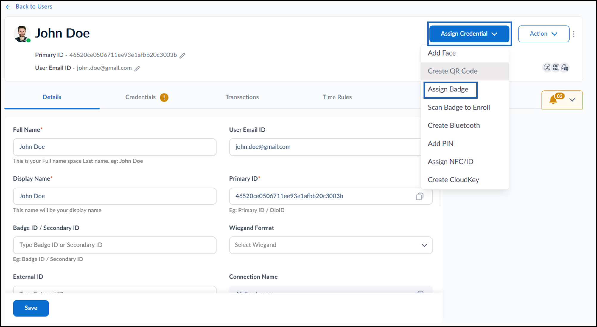
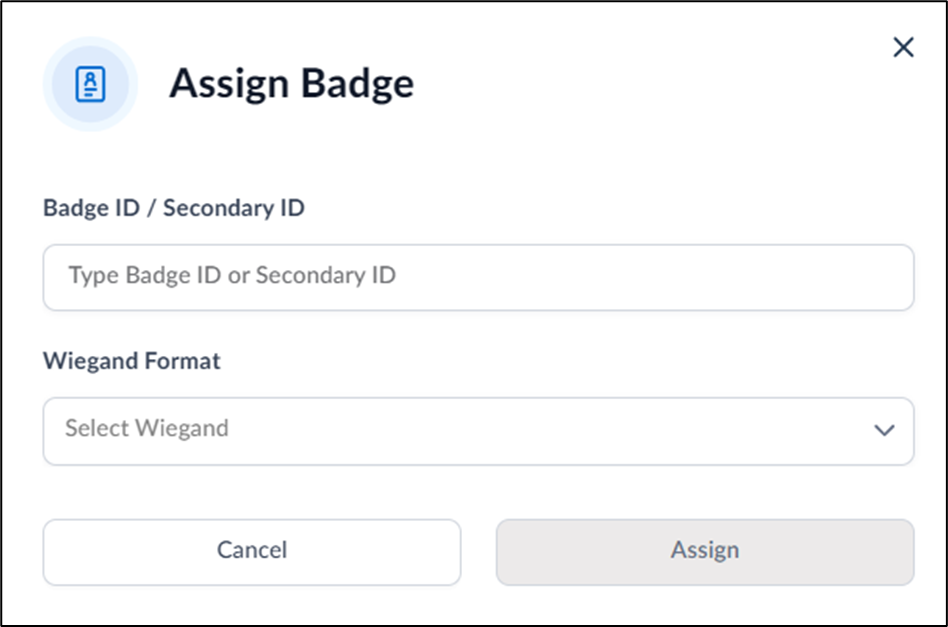
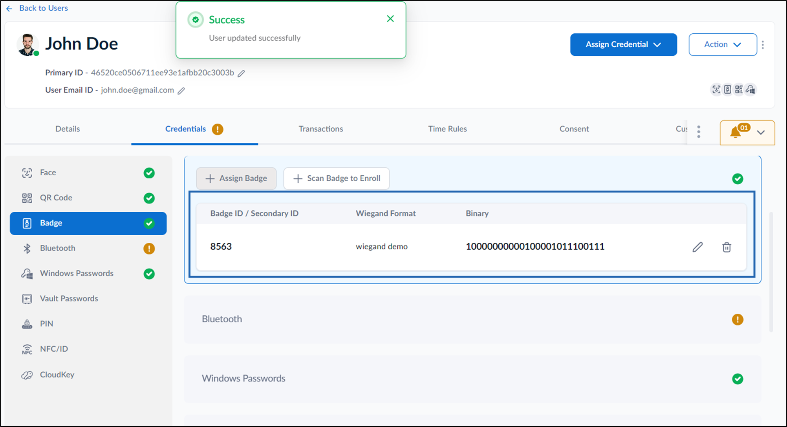

{/* Source: Intercom article 9679401 - https://oloid.help/en/articles/9679401-supervisor-portal-how-to-assign-badge-id-as-credential-to-users */}
{/* Generated by intercom_to_mintlify.py - re-running overwrites this file. */}

Steps to Assign Badge:

1. Log in to the **Supervisor Portal.**
   The Users page is displayed.
2. Click **username** to edit.

   

   The User details page is displayed.

   

3. Do one of the following:
   1. Go to **Credentials** > **Badge** > **+ Assign Badge**.

      

   2. Go to **Assign Credential** > **Assign Badge**.

      

      The **Assign Badge** pop-up box is displayed.
4. On the pop up box, enter **Badge ID** or **Secondary ID**, then select **Wiegand Format**.

   

Click **Assign**.

The badge ID is assigned and listed on the **Badge** tab.

## Video Tutorial

5. Watch the video [How to assign Badge ID as credential to Users in the Supervisor Portal - Video Tutorial](/platform/supervisor-portal/videos/how-to-assign-badge-id-as-credential-to-users-in-the-supervisor)
