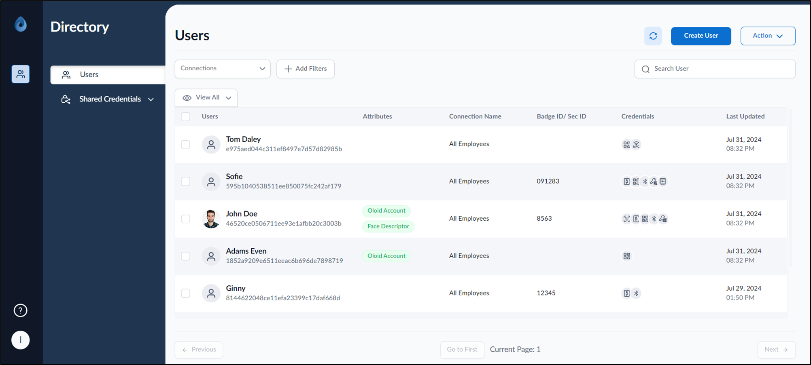
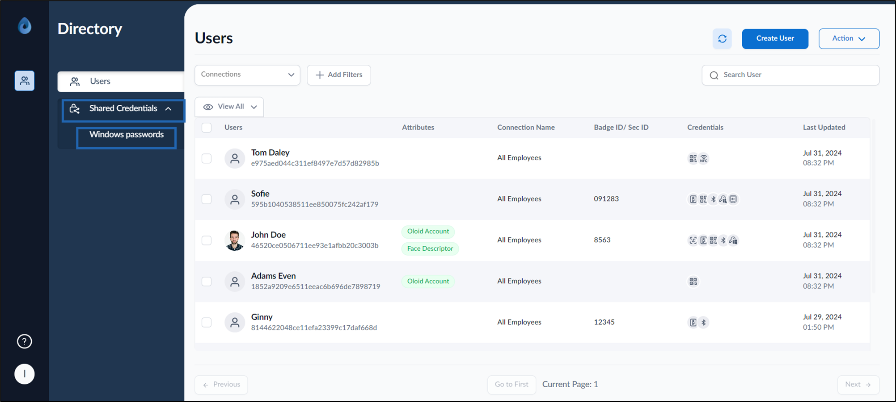
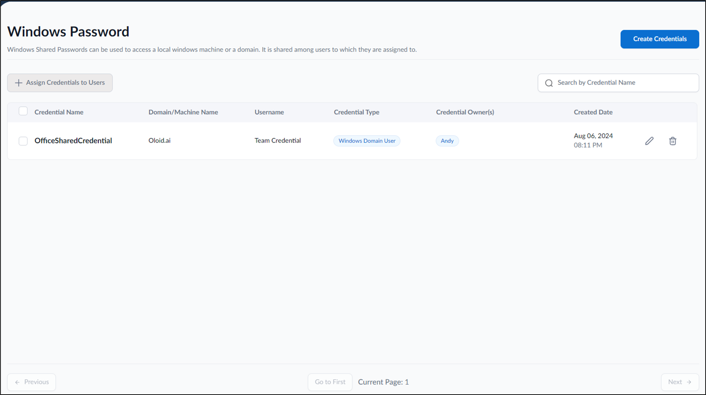
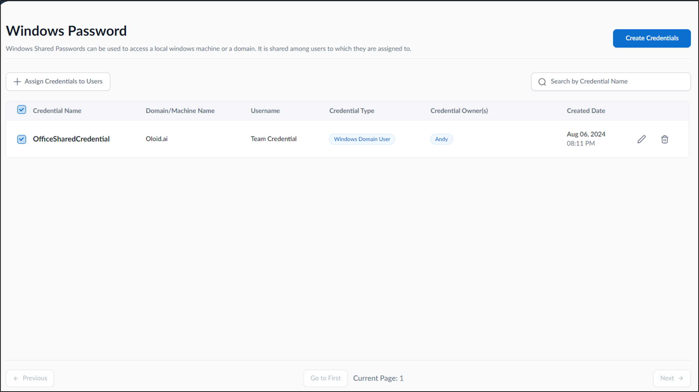
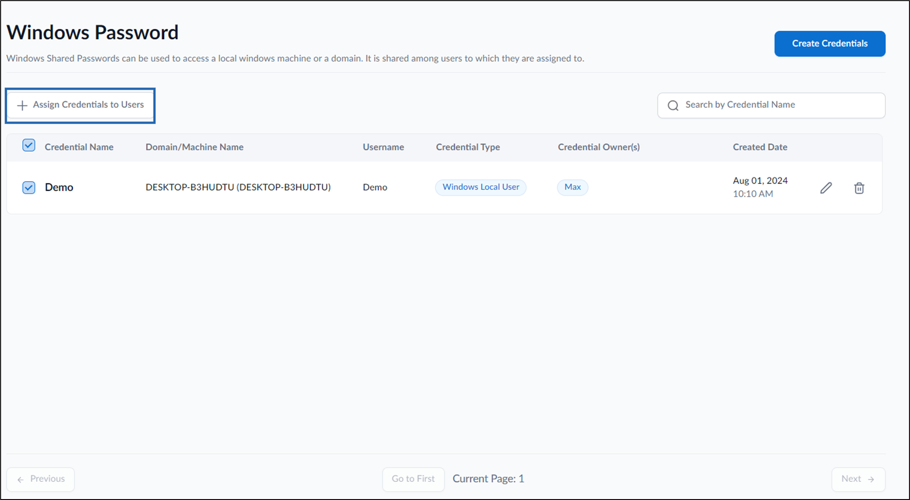
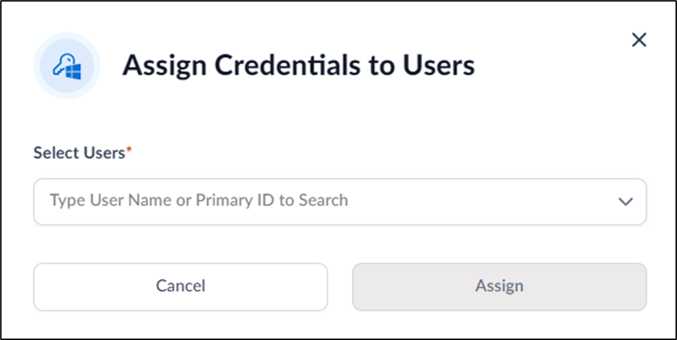
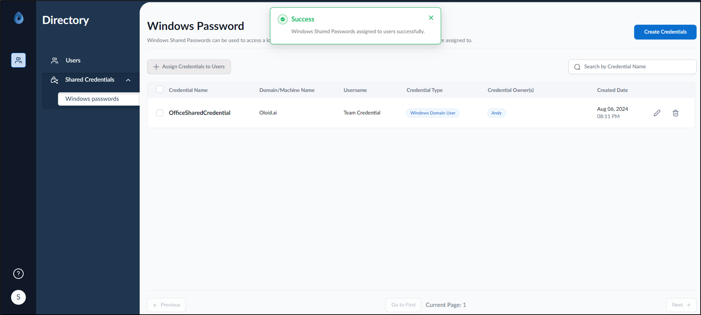

{/* Source: Intercom article 9684697 - https://oloid.help/en/articles/9684697-supervisor-portal-how-to-assign-shared-credential-to-multiple-users */}
{/* Generated by intercom_to_mintlify.py - re-running overwrites this file. */}

Steps to assign Shared Credential:

1. Log in to the **Supervisor Portal.**
   The Users page is displayed.

   

2. Click **Shared Credentials > Windows Passwords** on the left menu panel.

   

   The **Windows Password** page is displayed.

   

3. Select credential name(s) to assign users.

   

4. Select **+ Assign Credentials to Users**.

   

   The **Assign Credentials to Users** pop-up box is displayed.

   

5. On the pop-up box, select username(s) in the **Select Users** dropdown list.

Select **Assign**.

The shared password is successfully assigned among the selected users.

## Video Tutorial

6. Watch the video[How to assign shared credential to multiple users in the Supervisor Portal- Video Tutorial](/platform/supervisor-portal/videos/how-to-assign-shared-credential-to-multiple-users-in-the-supervisor)
