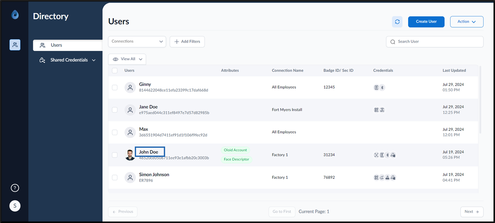
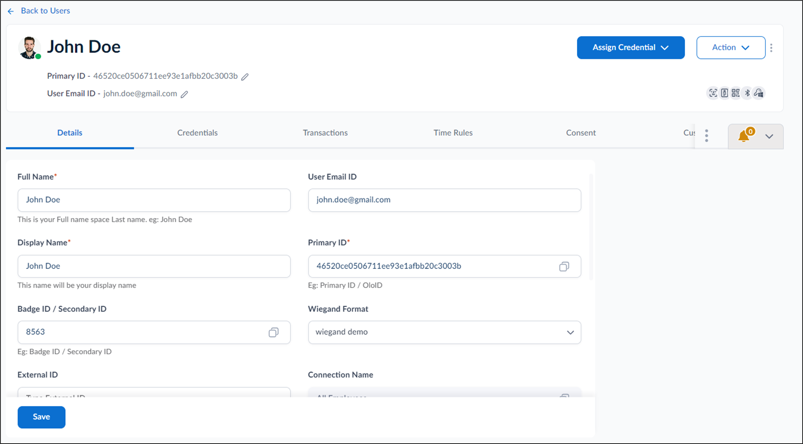
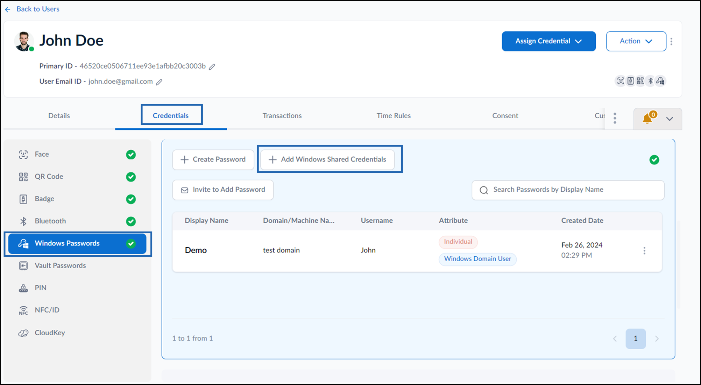
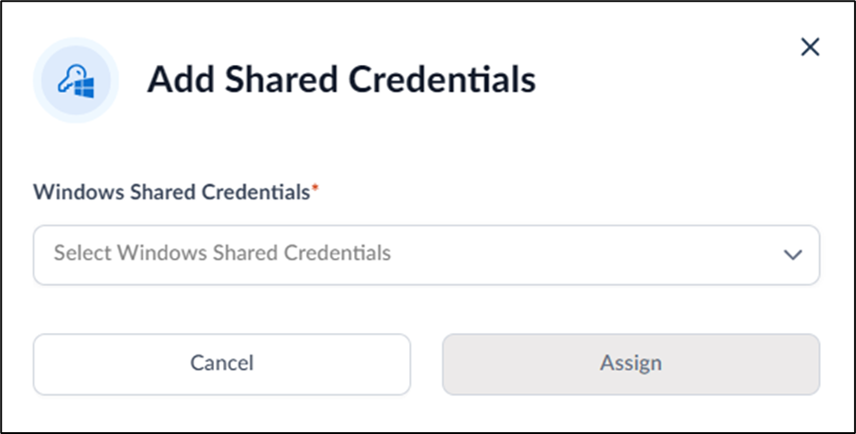
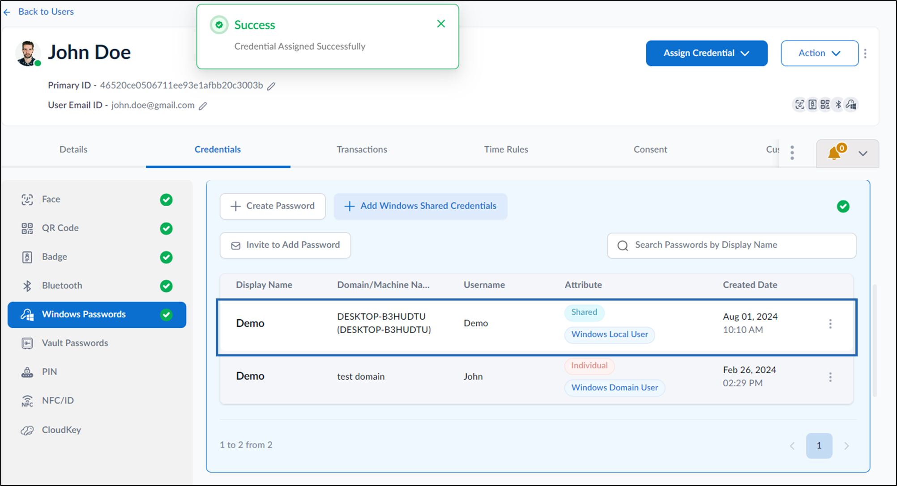

{/* Source: Intercom article 9684618 - https://oloid.help/en/articles/9684618-supervisor-portal-how-to-assign-shared-credential-to-user */}
{/* Generated by intercom_to_mintlify.py - re-running overwrites this file. */}

### Introduction

Shared Credentials are passwords that can be used to access a local windows machine or a domain. It is shared among the users to which they are assigned.

Steps to assign Shared Credential:

1. Log in to the **Supervisor Portal.**
   The **Users** page is displayed.
2. Click **username** to edit.

   

3. The user details page is displayed.

   

4. Go to **Credentials** > **Windows Passwords** tab > **+ Add Windows Shared Credentials**.

   

   The **Add Shared Credentials** pop-up box is displayed.

   

5. On the pop-up box, select shared credential(s) from **Select Shared Credentials** drop-down list.
6. Select **Assign**.
   The shared credential is successfully assigned to the user.

   

## Video Tutorial

Watch the video [How to assign shared credential to user in the Supervisor Portal- Video Tutorial](/platform/supervisor-portal/videos/how-to-assign-shared-credential-to-user-in-the-supervisor-portal)
