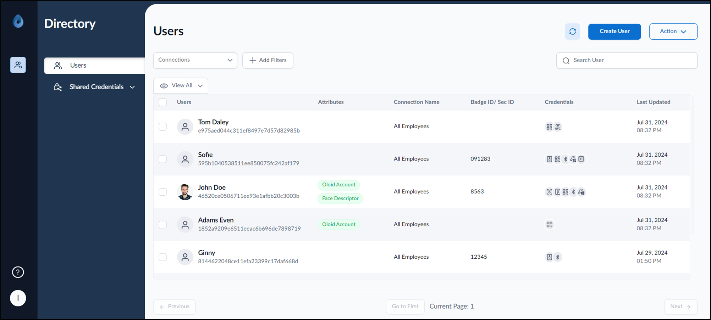
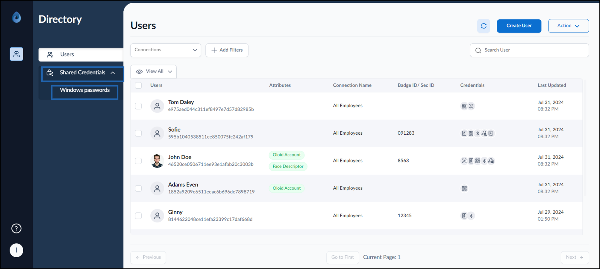
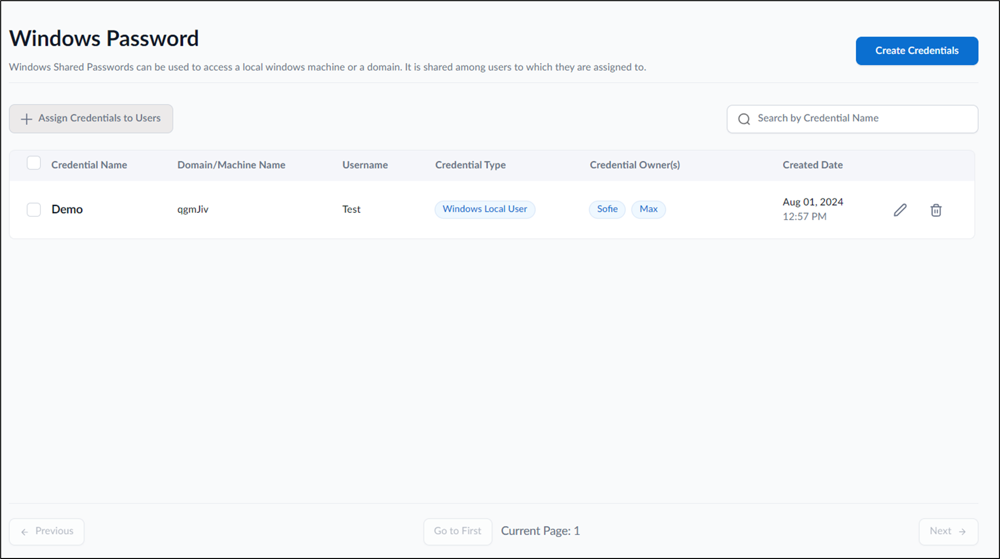
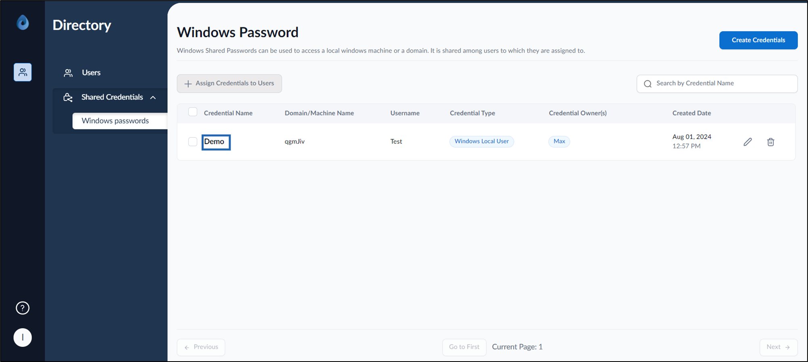
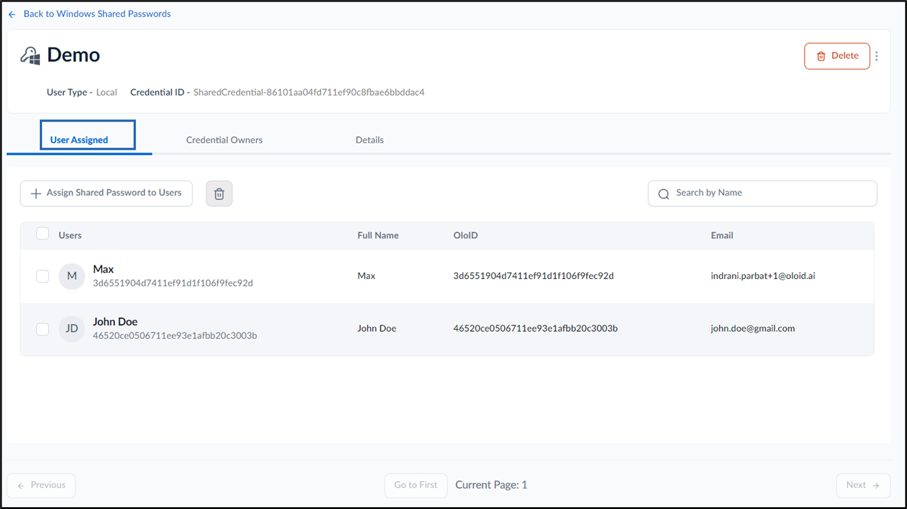
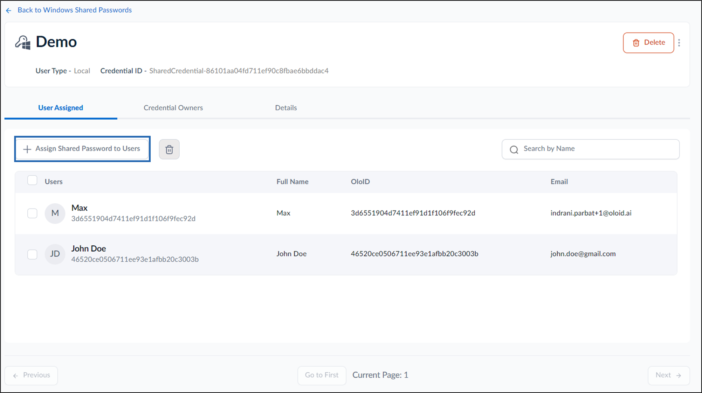
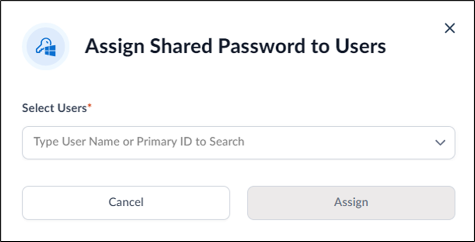
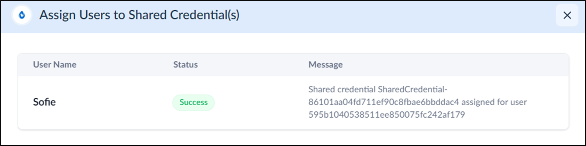
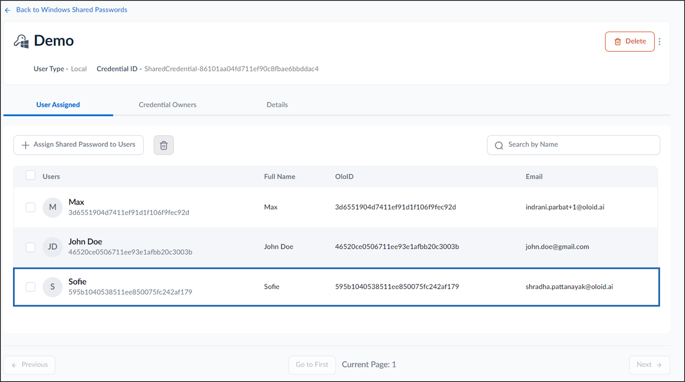

{/* Source: Intercom article 9684906 - https://oloid.help/en/articles/9684906-supervisor-portal-how-to-associate-users-with-shared-credentials */}
{/* Generated by intercom_to_mintlify.py - re-running overwrites this file. */}

Steps to assign Shared Credential:

1. Log in to the **Supervisor Portal.**
   The Users page is displayed.

   

2. Click **Shared Credentials** > **Windows Passwords** on the left menu panel.

   

   The Windows Passwords page is displayed.

   

3. Select credential name to edit.

   

   The credential details page is displayed.

   

4. Select **User Assigned** tab **> + Assign Shared Password to Users**.

   

   The **Assign Shared Password to Users** pop-up box is displayed.

   

5. On the pop-up box, enter user name(s) in the **Users** dropdown list.
6. Select **Assign**.
   The shared password is successfully assigned and listed on the credential details page.

   

   

## Video Tutorial

Watch the video[How to associate users with shared credentials in the Supervisor Portal- Video Tutorial](/platform/supervisor-portal/videos/how-to-associate-users-with-shared-credentials-in-the-supervisor)
