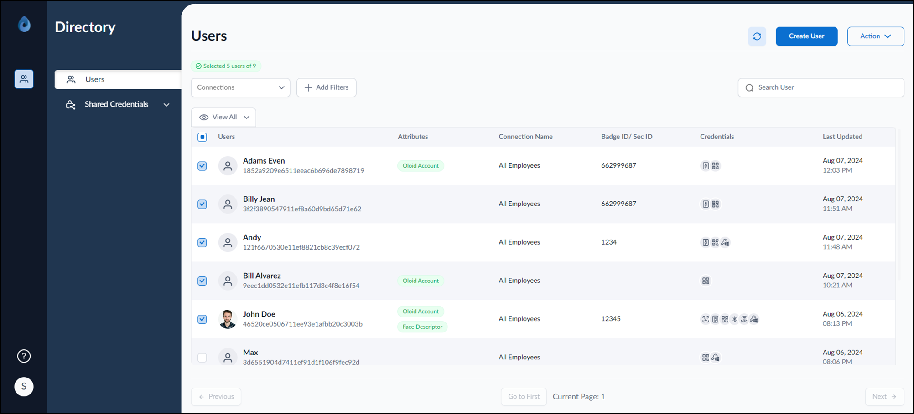
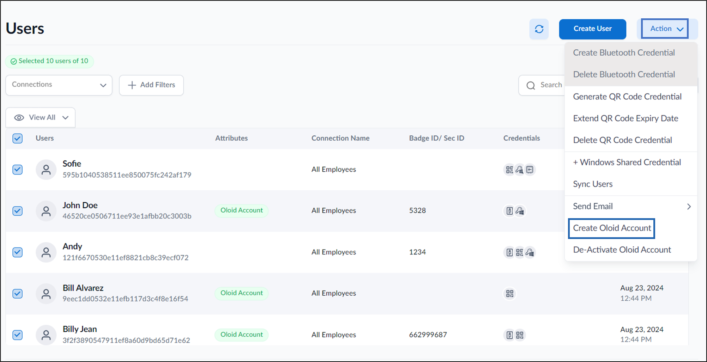
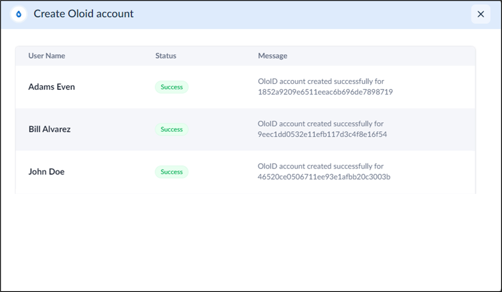

{/* Source: Intercom article 9711943 - https://oloid.help/en/articles/9711943-supervisor-portal-how-to-create-oloid-account-for-multiple-users */}
{/* Generated by intercom_to_mintlify.py - re-running overwrites this file. */}

Steps to create Oloid Account:

1. Log in to the **Supervisor Portal**.
   The **Users** page is displayed.
2. Select user(s) to create Oloid Account.

   

3. Go to **Action > Create Oloid Account**.

   

   The Oloid account is created for the selected users.

   

## Video Tutorial

Watch the video[How to create Oloid Account for multiple users in Supervisor Portal - Video Tutorial](https://app.intercom.com/a/apps/e4gi378c/knowledge-hub/folder/1552584?activeContentId=12427186&activeContentType=article&editorMode=view&folderId=1552584)
