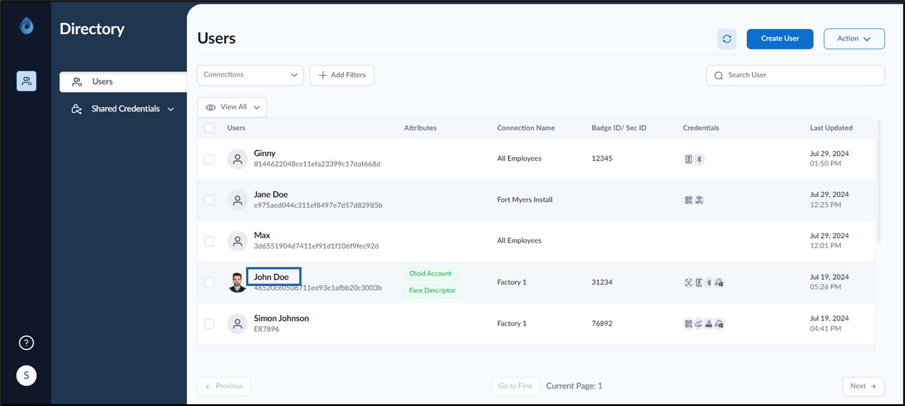
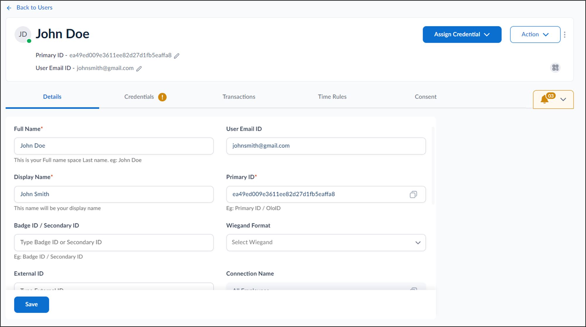
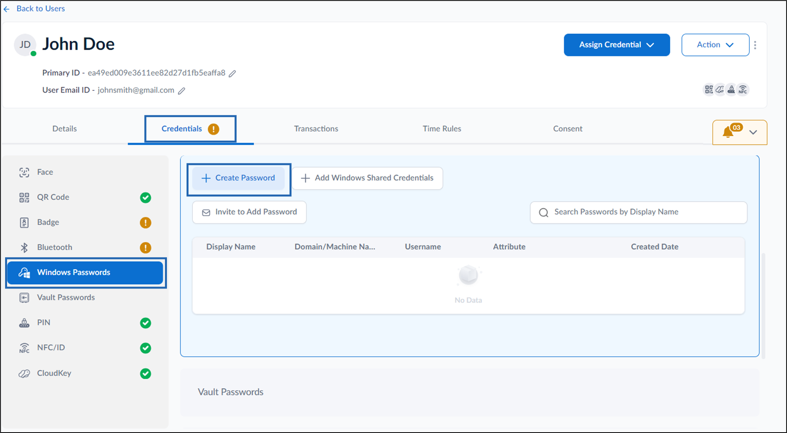
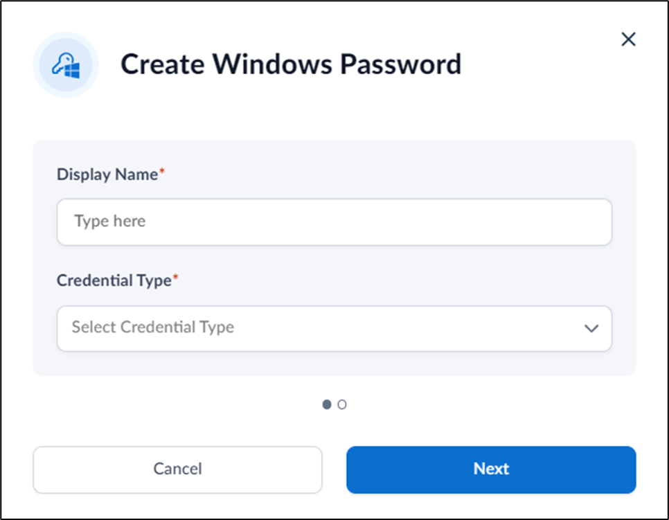
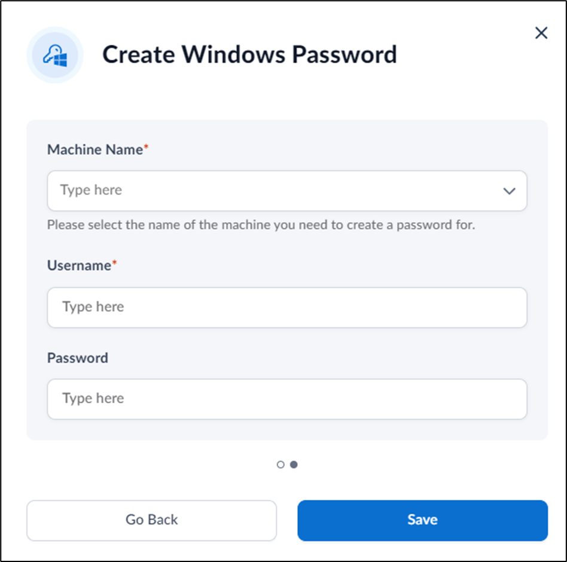
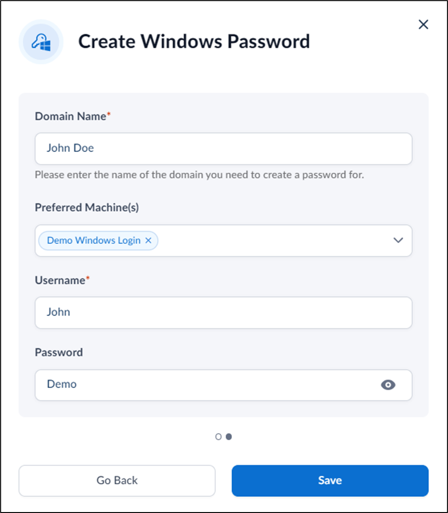
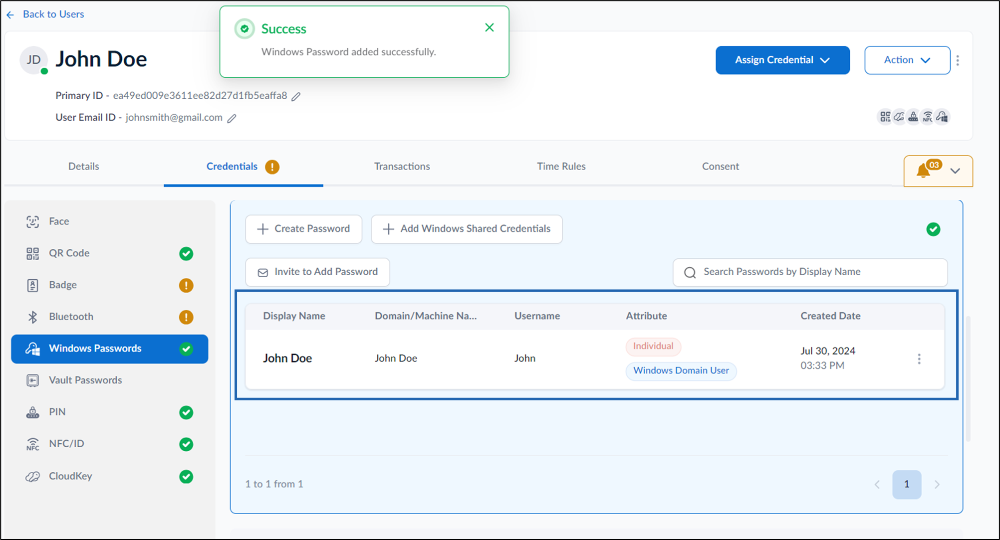

{/* Source: Intercom article 9674358 - https://oloid.help/en/articles/9674358-supervisor-portal-how-to-create-password-for-windows-login */}
{/* Generated by intercom_to_mintlify.py - re-running overwrites this file. */}

This document comprises the following:

- [Create Password for local windows machine](#create-password-for-local-windows-machine)
- [Create Password for domain](#create-password-for-domain)

## Create Password for local windows machine

To create Password:

1. Log in to the **Supervisor Portal.**
   The Users page is displayed.
2. Click **username** to edit.

   

   The User details page is displayed.

   

3. Go to **Credentials** > **Windows Password** tab > **+ Create Password**.

   

   The **Create Windows Password** pop-up box is displayed.

   

4. Do the following:
   1. Enter **Display Name** that displays on the Windows Login page.
   2. Select **Windows Local User** type from **Credential Type** dropdown list.
   3. Click **Next.**

      

   4. Enter **Machine Name**.

      <Note>
        **Note:** Enter your Windows device name.
      </Note>

   5. Enter **Username** of your Windows Login.

      <Note>
        **Note:** Windows account name.
      </Note>

   6. Enter **Password** of your Windows Login.
   7. Click **Save**.

The password is created and listed in the **Password** tab.

## Create Password for domain

1. Log in to the **Supervisor Portal.**
   The **Users** page is displayed.
2. Click **username** to edit.

   

   The User details page is displayed.

   

3. Go to **Credentials** > **Passwords** tab > **Create Password**.

   

   The **Create Windows Password** pop-up box is displayed.

   

4. Do the following:
   1. Enter **Display Name** that displays on the Windows Login page.
   2. Select **Windows Domain User** type from **Credential Type** dropdown list.
   3. Click **Next.**

      

   4. Enter **Domain Name**.
   5. Select **Preferred Machine** from the **Preferred Machine(s)** list.
   6. Enter **Username** of your Windows Login.

      <Note>
        **Note:** Windows account name.
      </Note>

   7. Enter **Password** of your Windows Login.
   8. Click **Save**.

      

      The password is created and listed in the **Password** tab.
