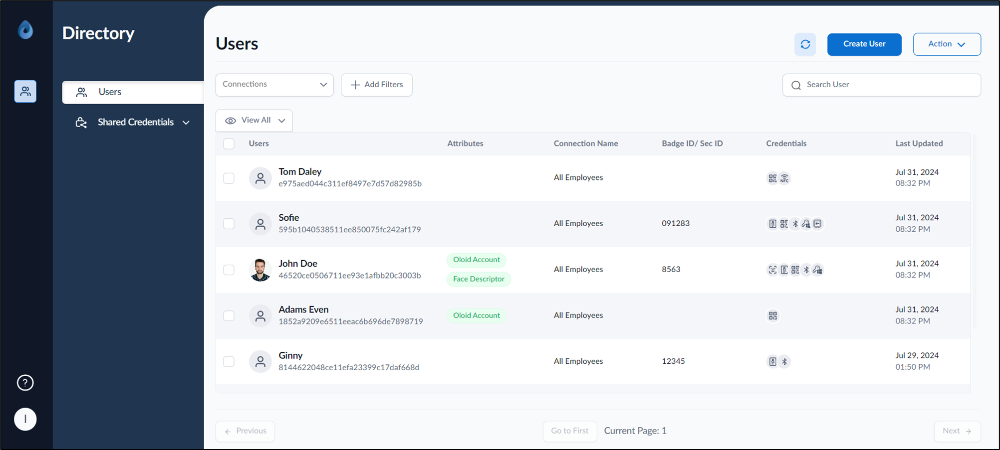
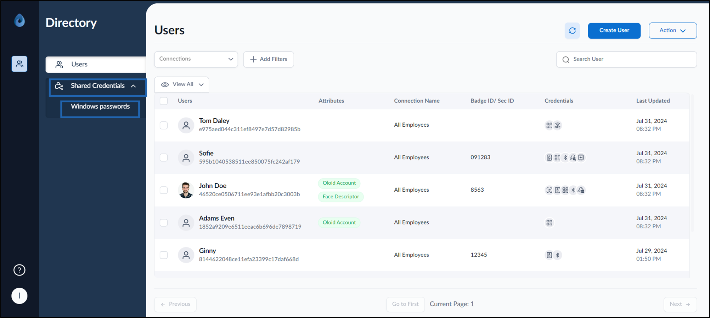
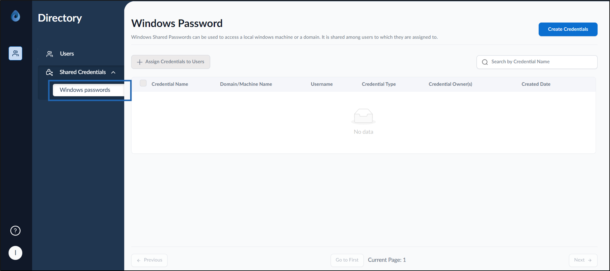
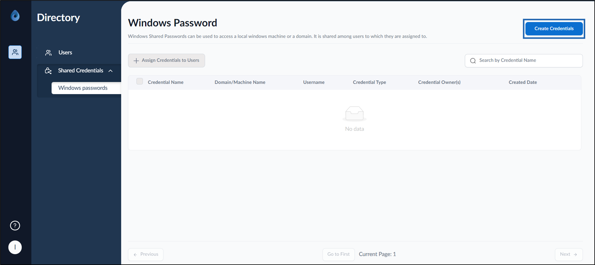
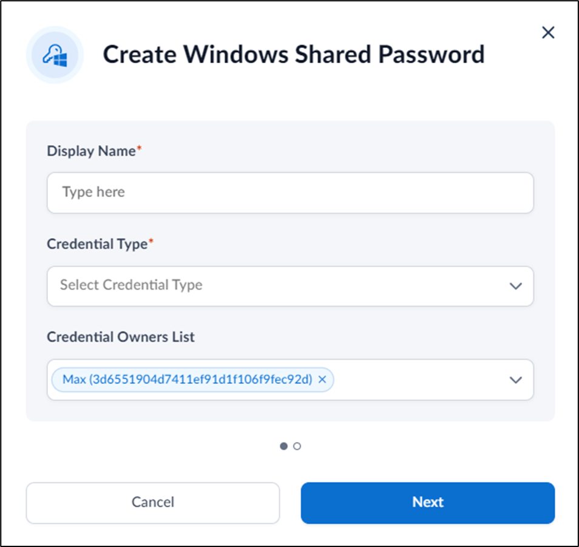
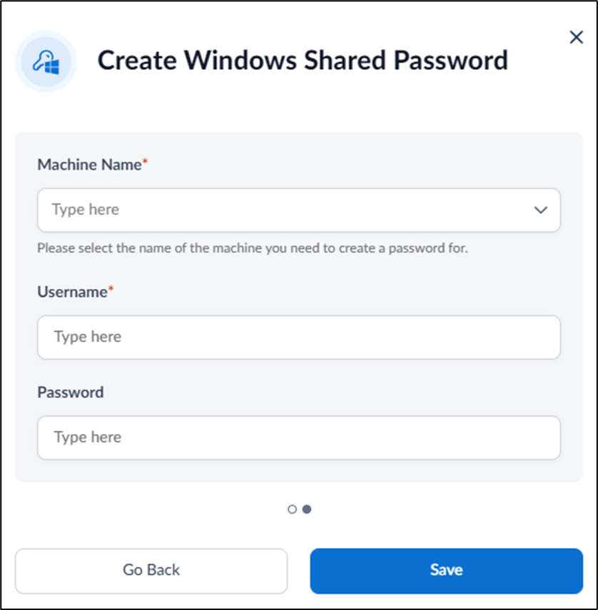
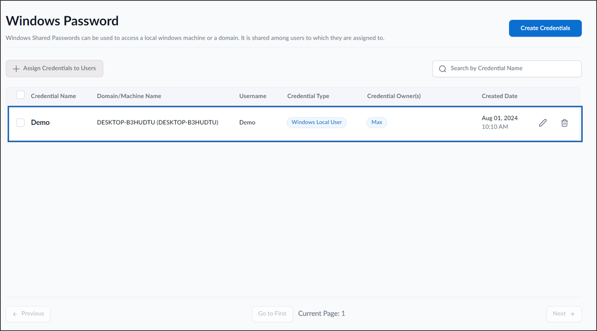
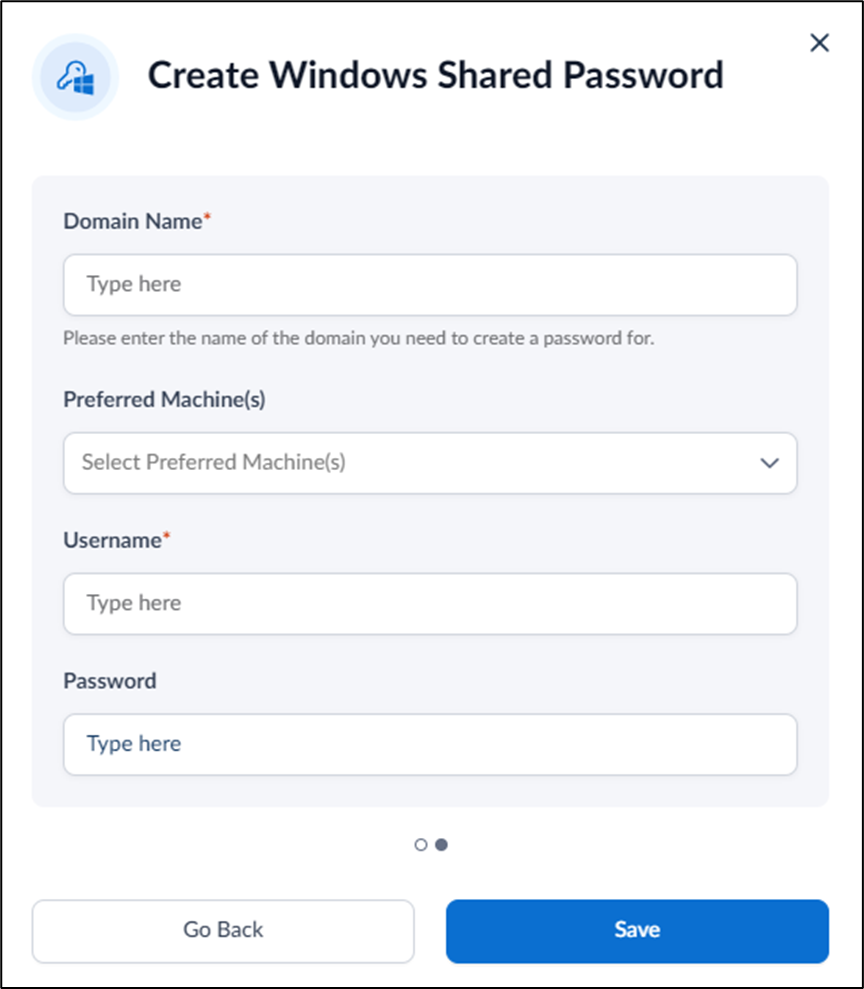
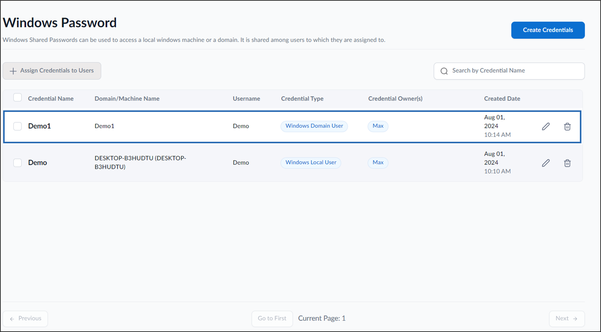

{/* Source: Intercom article 9680203 - https://oloid.help/en/articles/9680203-supervisor-portal-how-to-create-shared-credentials-for-windows-login */}
{/* Generated by intercom_to_mintlify.py - re-running overwrites this file. */}

## Introduction

Shared Credentials are passwords that can be used to access a local windows machine or a domain. It is shared among users to which they are assigned to.

This document comprises the following:

- [Create shared credential for local windows machine](#create-shared-credential-for-local-windows-machine)
- [Create shared credential for domain](#create-shared-credential-for-domain)

### Create shared credential for local windows machine

To create Shared Credential:

1. Log in to the **Supervisor Portal.**
   The Users page is displayed.

   

2. Click **Shared Credentials** > **Windows Passwords** on the left menu panel.

   

   The Windows Passwords page is displayed.

   

3. On the top right, click **Create Credentials**.

   

   The **Create Windows Shared Password** pop-box is displayed.
4. Do the following:

   

   1. Enter **Display Name** that displays on the Windows Login page.
   2. Select credential type as **Local User** from **Credential Type** dropdown.
   3. Select **Credential Owner List** from the dropdown list.
   4. Select **Next**.

      

   5. Enter **Machine Name**.

      <Note>
        **Note:** Enter your Windows device name.
      </Note>

   6. Enter **Username** of your Windows Login.
   7. Enter **Password** of your Windows Login.
   8. Click **Save**.
      The credential is created and listed on the **Shared Credentials** page.

      

### Create shared credential for domain

To create Shared Credential:

1. Log in to the **Supervisor Portal.**

   

   The Users page is displayed.
2. Click **Shared Credentials** > **Windows Passwords** on the left panel.

   

3. The Windows Passwords page is displayed.

   

4. On the top right, click **Create Credentials**.

   

   The **Create Windows Shared Password** pop-box is displayed.
5. On the pop-up box do the following:

   

   1. Enter **Display Name**.
   2. Select user type as **Domain User** from **User Type** dropdown.
   3. Enter user name then select **Credential Owner** from the dropdown list.
   4. Select **Next**.

      

   5. Enter **Domain Name**.
   6. Select **Preferred Machine(s)**.
   7. Enter **Username** of your Windows Login.
   8. Enter **Password** of your Windows Login.
   9. Click **Save**.
      The credential is created and listed on the **Shared Credentials** page.

      

**Related Document**
[Supervisor Portal - How to assign shared credential to user](/platform/supervisor-portal/supervisor-portal-how-to-assign-shared-credential-to-user)

## Video Tutorial

   Watch the video [How to create shared credentials for Windows login in Supervisor Portal- Video Tutorial](/platform/supervisor-portal/videos/how-to-create-shared-credentials-for-windows-login-in-supervisor)
