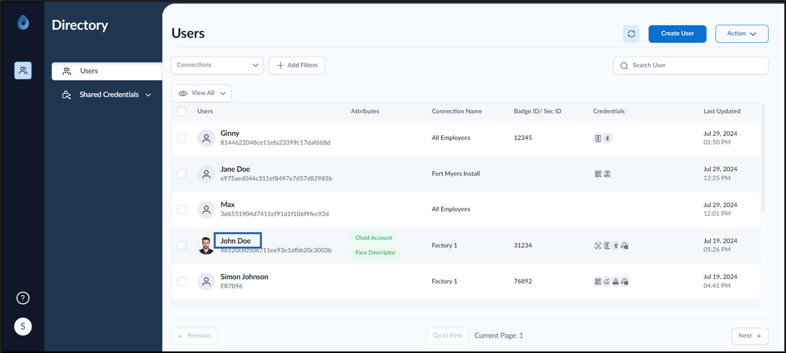
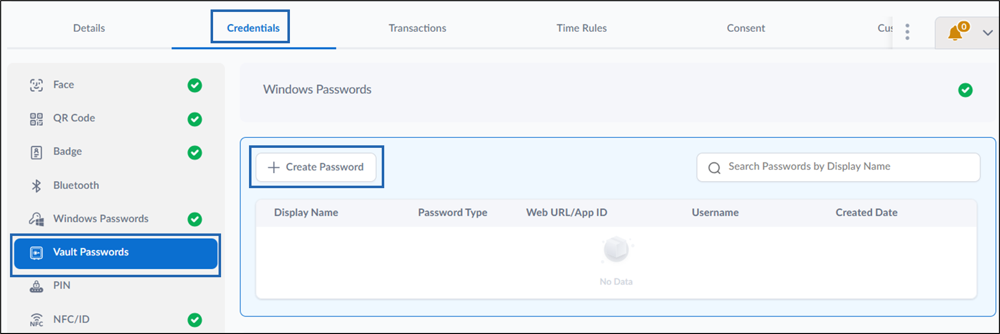
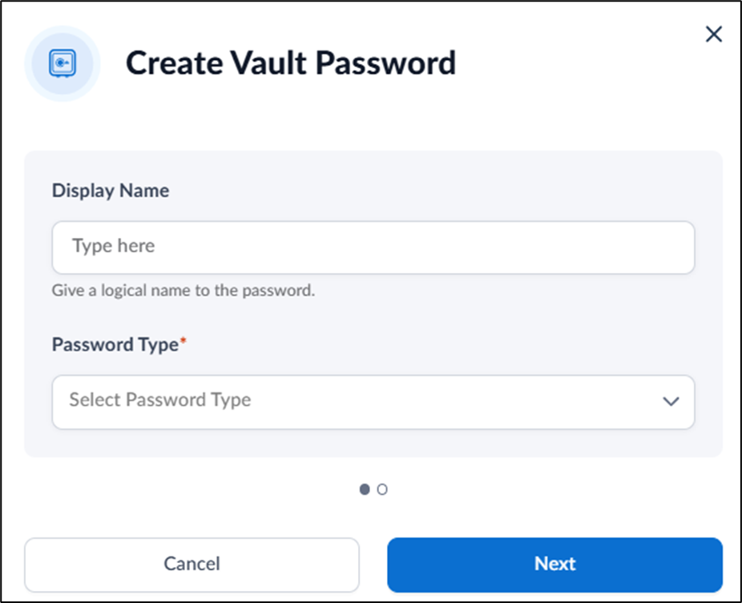
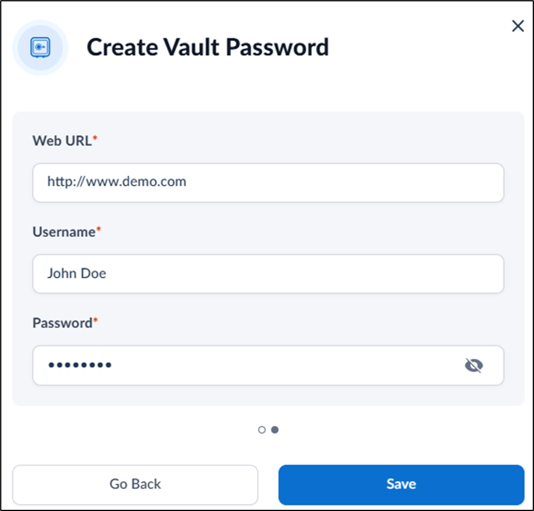
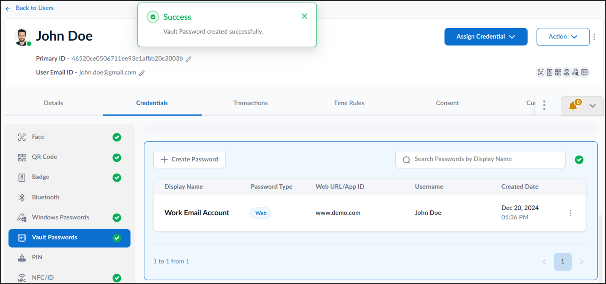

{/* Source: Intercom article 10304522 - https://oloid.help/en/articles/10304522-supervisor-portal-how-to-create-vault-password */}
{/* Generated by intercom_to_mintlify.py - re-running overwrites this file. */}

Steps to create Vault Password:

1. Log in to the **Supervisor Portal.**
   The **Users** page is displayed.
2. Click the **username** to edit.

   

   The user details page is displayed.
3. Go to **Credentials** > **Vault Passwords** tab > **+ Create Password**.

   

   The **Create Vault Password** pop-up box is displayed.

   

4. Do the following:
   1. Enter **Display Name** that helps you identify this password. (Optional)
   2. Select **Web** type from **Password Type** dropdown list.
   3. Click **Next.**

      

   4. Enter **Web URL**.
   5. Enter **Username**.
   6. Enter **Password**.
   7. Click **Save.**
      The password is created and listed in the **Vault Passwords** tab.

      
