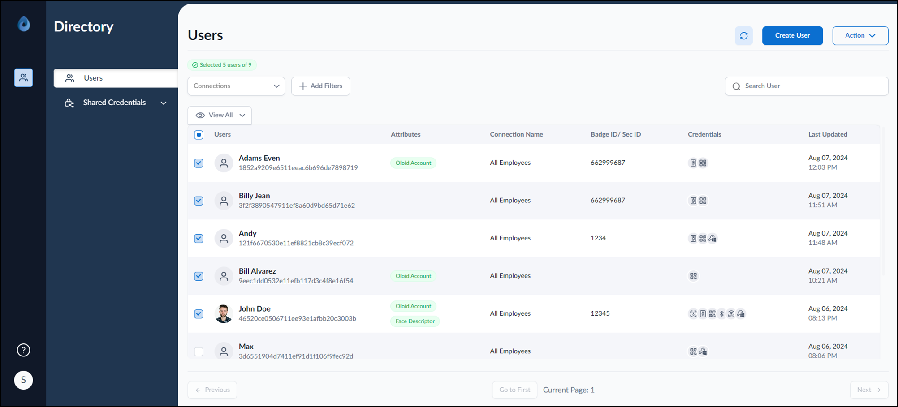
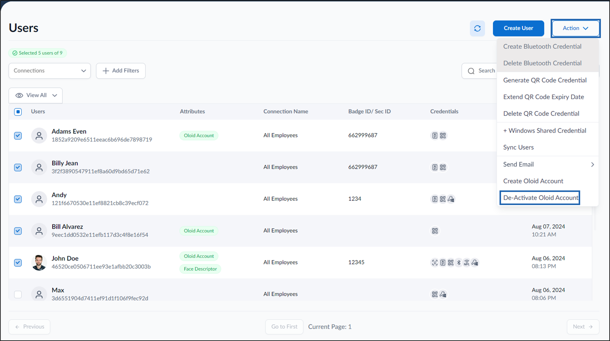
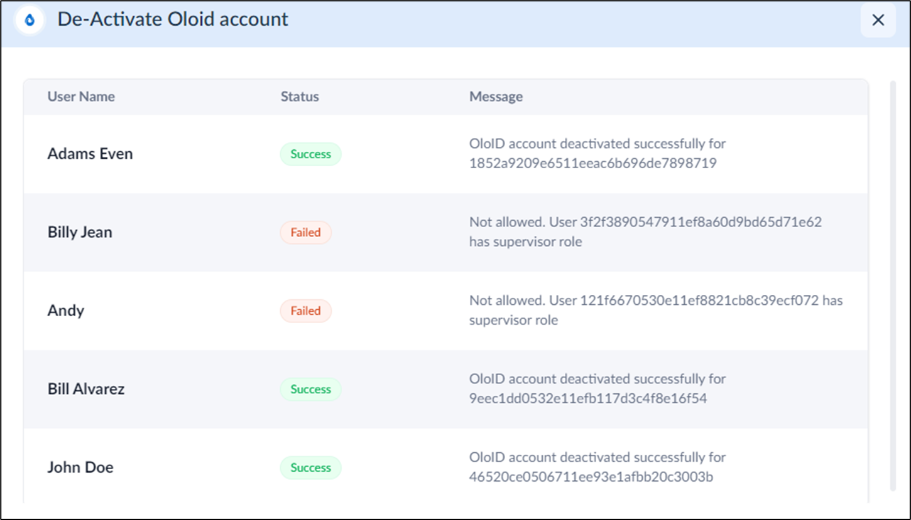

{/* Source: Intercom article 9711899 - https://oloid.help/en/articles/9711899-supervisor-portal-how-to-deactivate-oloid-account-for-multiple-users */}
{/* Generated by intercom_to_mintlify.py - re-running overwrites this file. */}

Steps to de-activate Oloid Account:

1. Log in to the **Supervisor Portal**.
   The **Users** page is displayed.
2. Select user(s) to de-activate Oloid Account.

   

3. Go to **Action > De-Activate Oloid Account**.

   

   The Oloid account is deactivated for the selected users.

   
