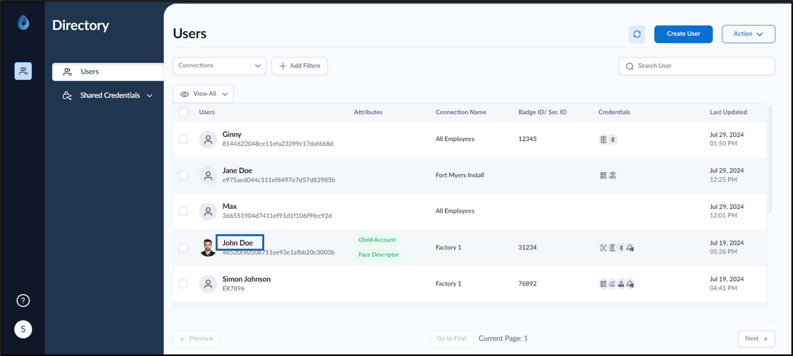
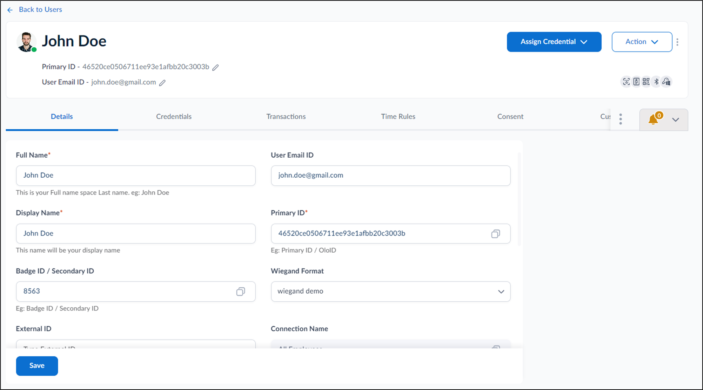
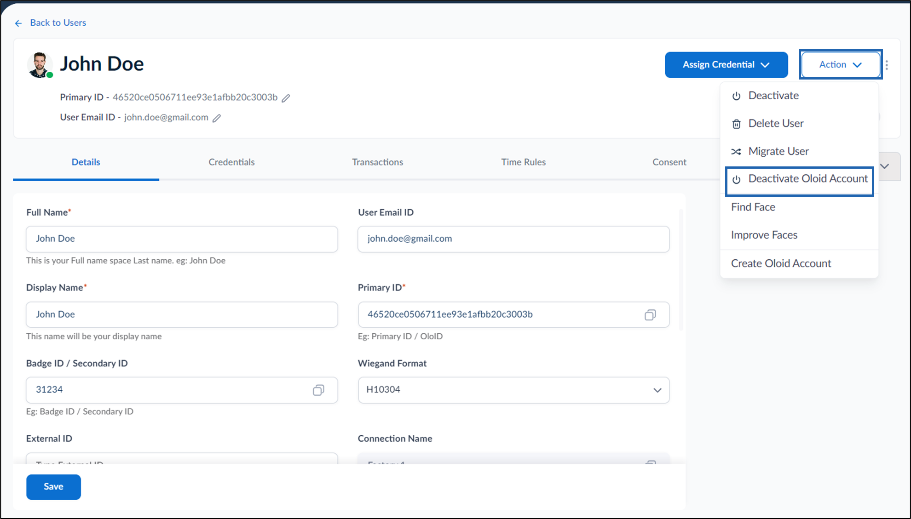
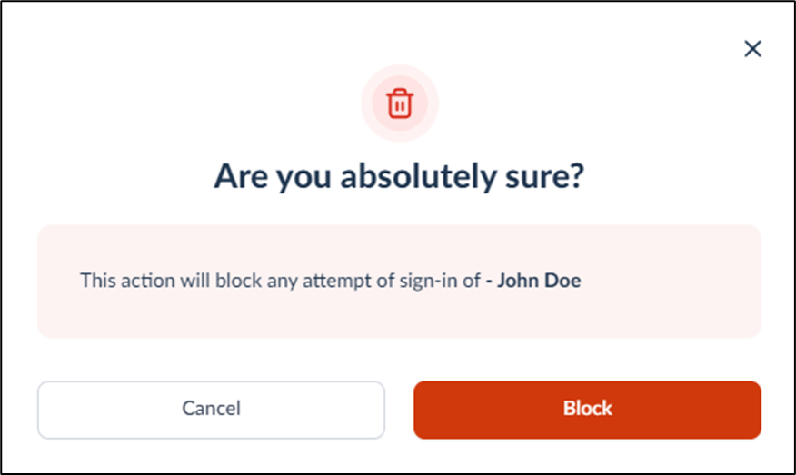

{/* Source: Intercom article 9674152 - https://oloid.help/en/articles/9674152-supervisor-portal-how-to-deactivate-oloid-account-of-a-user */}
{/* Generated by intercom_to_mintlify.py - re-running overwrites this file. */}

Steps to deactivate OloID Account of an User:

1. Log in to the **Supervisor Portal**.
   The **Users** page is displayed.
2. Click username to edit.

   

   The user details page is displayed.

   

3. On the top-right, go to **Action** > **Deactivate Oloid Account**.

   

   A confirmation pop-up box is displayed.

   

4. Select **Block**.
   The user's Oloid account is removed successfully.

   <Note>
     **Note:** To recover your account you must create Oloid account.
   </Note>

   For more information, see **How to create OloID account.**
