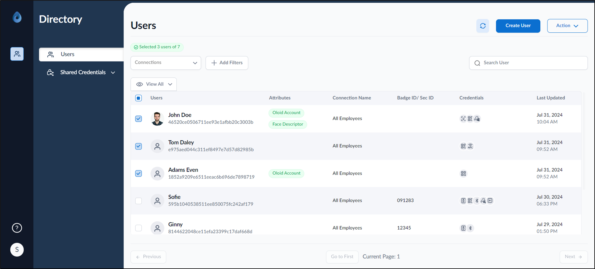
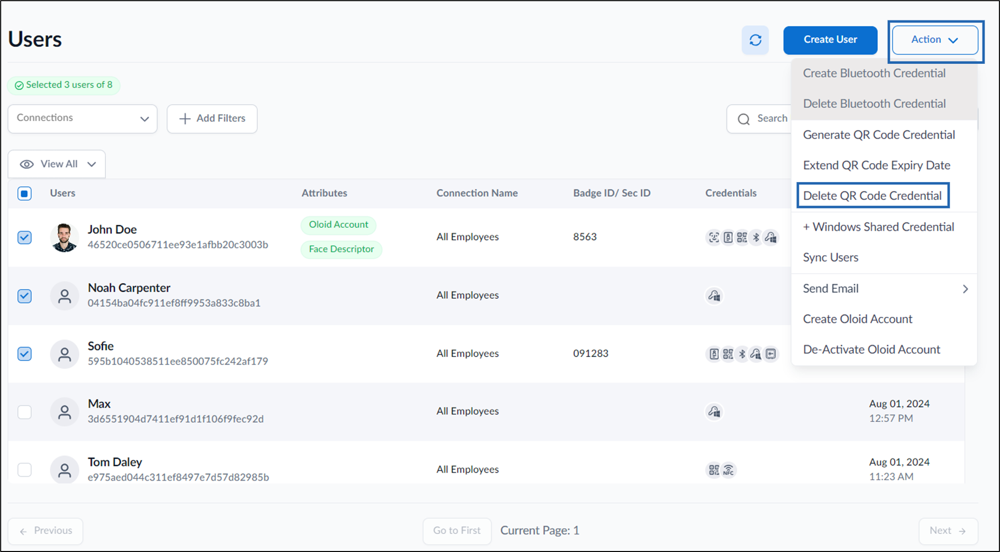
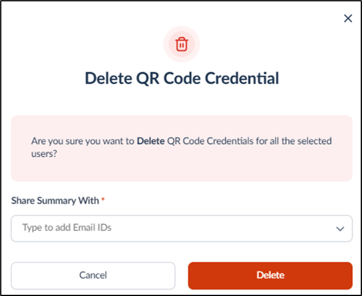

{/* Source: Intercom article 9674161 - https://oloid.help/en/articles/9674161-supervisor-portal-how-to-delete-qr-code-for-multiple-users */}
{/* Generated by intercom_to_mintlify.py - re-running overwrites this file. */}

Steps to delete QR Code of user(s):

1. Log in to the **Supervisor Portal**.
   The **Users** page is displayed.
2. Select user(s) to delete QR Code.

   

3. Go to **Action > Delete QR Code Credential**.

   

   The **Delete QR Code Credential** pop-up box is displayed.

   

4. On the pop-up box, do the following:
   1. Under **Share Summary With** field enter the email ID(s) with whom you want to share the QR Code summary.
   2. Click **Delete**.
      The QR Code credential is successfully deleted for the users. The QR Code summary of these users is shared over email ID(s).

## Video Tutorial

Watch the video [How to delete QR Code for multiple users in the Supervisor Portal- Video Tutorial](/platform/supervisor-portal/videos/how-to-delete-qr-code-for-multiple-users-in-the-supervisor-portal)
