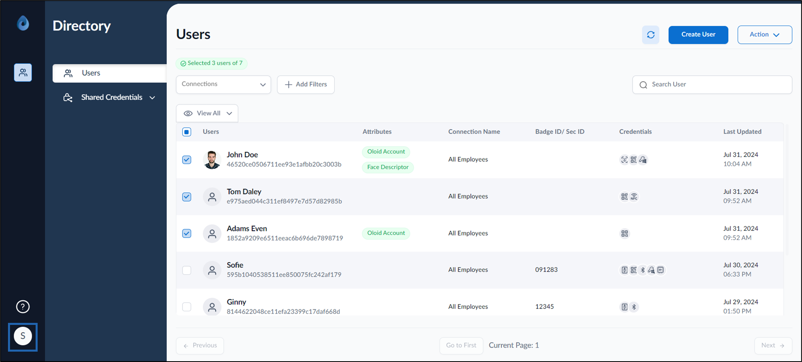
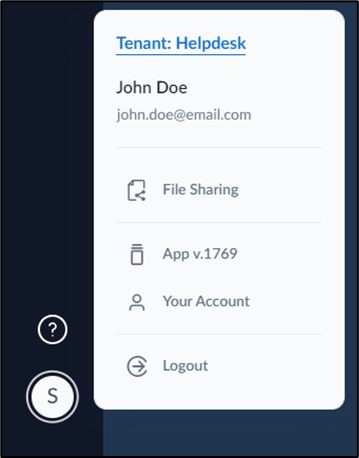
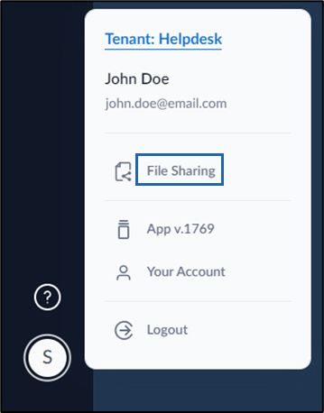
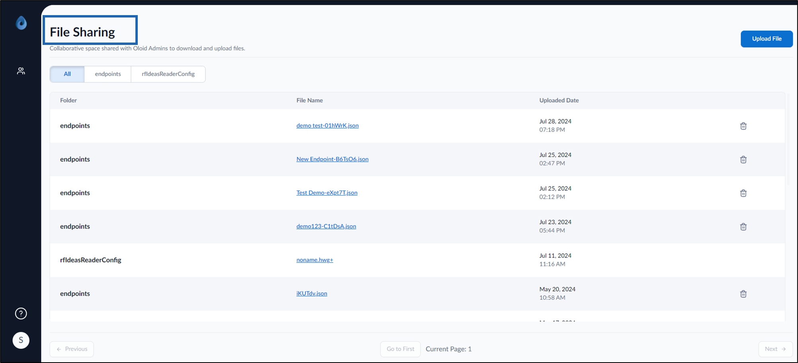
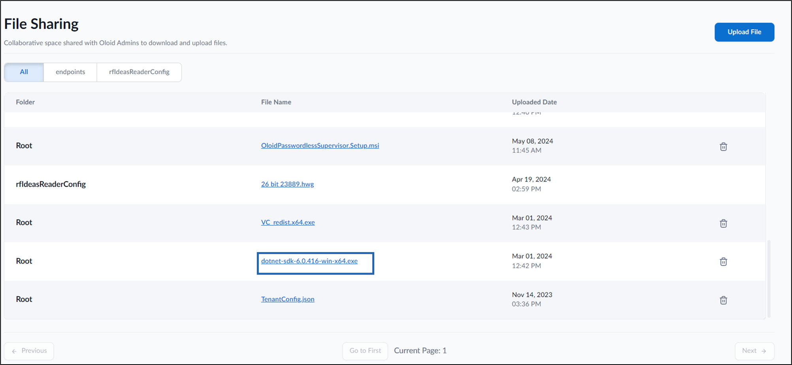

{/* Source: Intercom article 9690938 - https://oloid.help/en/articles/9690938-supervisor-portal-how-to-download-file-using-file-sharing-option */}
{/* Generated by intercom_to_mintlify.py - re-running overwrites this file. */}

Steps to download the files:

1. Log in to the **Supervisor Portal**.
2. On the homepage of the portal, click **User profile icon** on the bottom left corner of the menu panel.

   

   The user profile menu is displayed.

   

3. Select **File Sharing**.

   

   The **File Sharing** page is displayed.

   

4. Select the preferred file to download.

   

   The file is downloaded.
