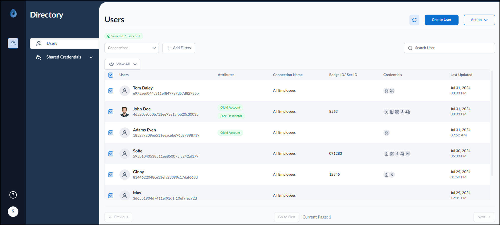
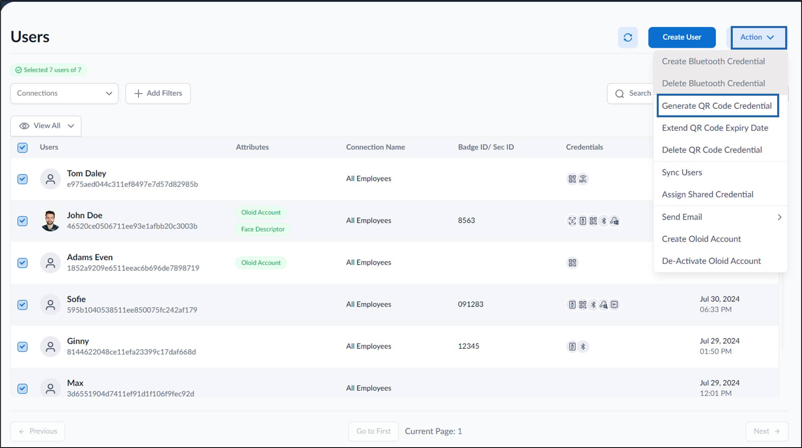
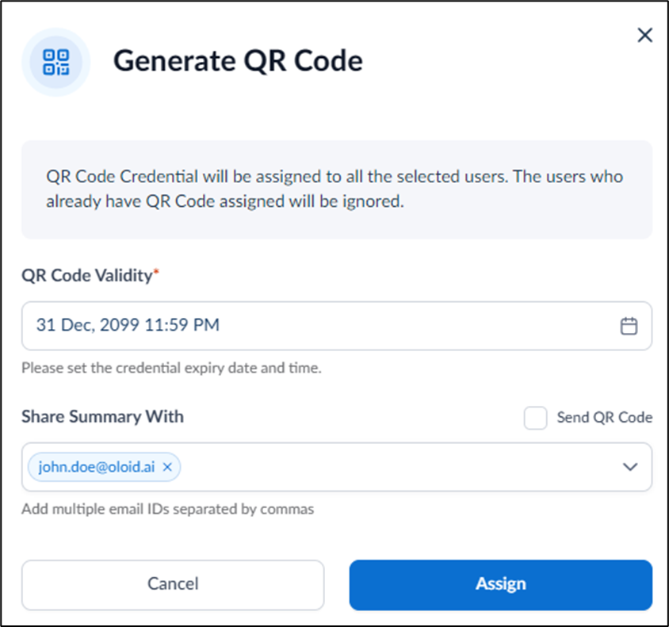

{/* Source: Intercom article 9673768 - https://oloid.help/en/articles/9673768-supervisor-portal-how-to-generate-qr-code-for-multiple-users */}
{/* Generated by intercom_to_mintlify.py - re-running overwrites this file. */}

Steps to generate QR Code :

1. Log in to the **Supervisor Portal**.
   The **Users** page is displayed.
2. Select user(s) to generate QR Code.

   

3. Go to **Action > Generate QR Code Credential**.

   

   The **Generate QR Code** pop-up box is displayed.

   

4. Do the following:
   1. Under **QR Code Validity** field adjust the date and time from the calendar icon.
   2. Under **Share Summary With** field enter the email ID(s) with whom you would like to share the QR Code summary.
   3. Select **Send QR Code** to share QR Code with selected users (Optional).
   4. Click **Assign**.
      The QR Code credential is successfully assigned to the selected users. The QR Code summary of these users is shared over email ID(s).

## Video Tutorial

Watch the video[How to generate QR Code for multiple users in the Supervisor Portal- Video Tutorial](/platform/supervisor-portal/videos/how-to-generate-qr-code-for-multiple-users-in-the-supervisor-portal)
