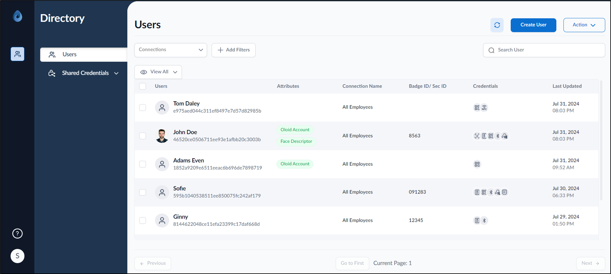
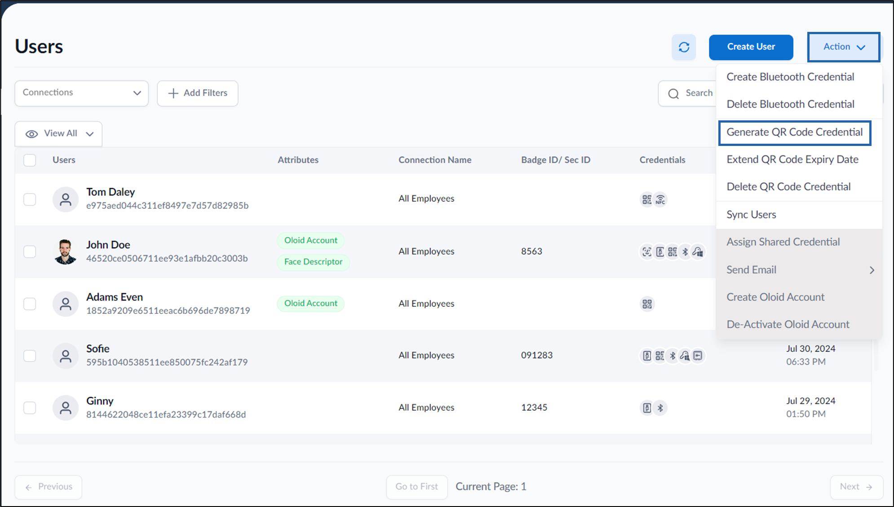
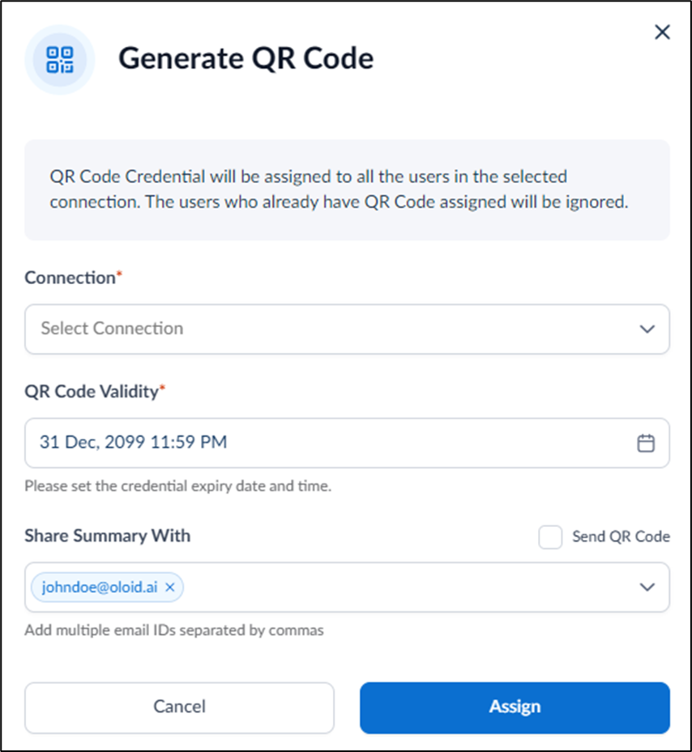

{/* Source: Intercom article 9673763 - https://oloid.help/en/articles/9673763-supervisor-portal-how-to-generate-qr-code-of-users-in-a-connection */}
{/* Generated by intercom_to_mintlify.py - re-running overwrites this file. */}

Steps to generate QR Code of users in a Connection:

1. Log in to the **Supervisor Portal**.
   The **Users** page is displayed.

   

2. Go to **Action** > **Generate QR Code Credential**.

   

   The **Generate QR Code** pop-up box is displayed.

   

3. On the pop-up box, do the following:
   1. Select a preferred connection from the **Connection** dropdown list.
   2. Under **QR Code Validity** field adjust the date and time from the calendar icon.
   3. Select **Send QR Code** to share QR Code with selected users (Optional).
   4. Under **Share Summary With** field enter the email ID(s) with whom you want to share the QR Code summary (Optional).
   5. Click **Assign**.

The QR Code credentials are successfully assigned to users in the selected connection. The QR Code summary of these users is shared over email ID(s) and is available for download in the attachments.

## Video Tutorial

   Watch the video[How to generate QR Code of Users in a Connection in the Supervisor Portal- Video Tutorial](/platform/supervisor-portal/videos/how-to-generate-qr-code-of-users-in-a-connection-in-the-supervisor)
