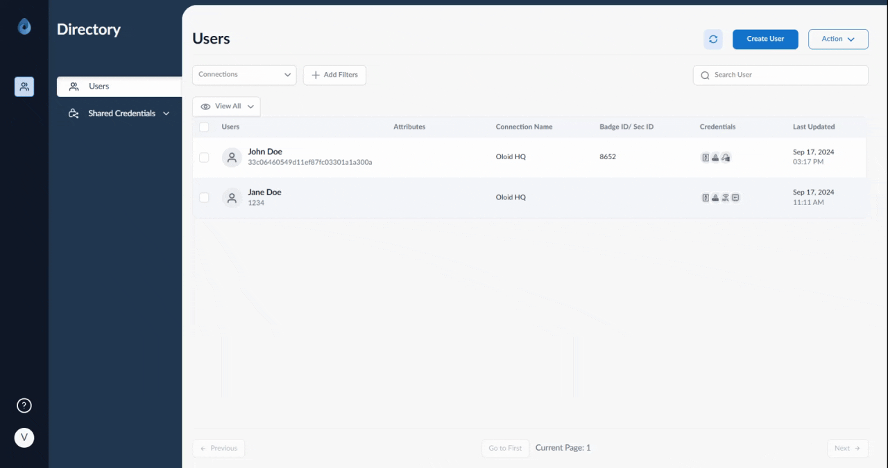
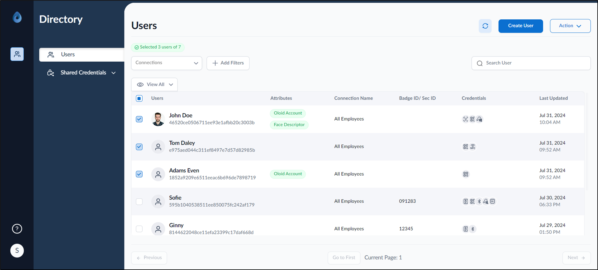
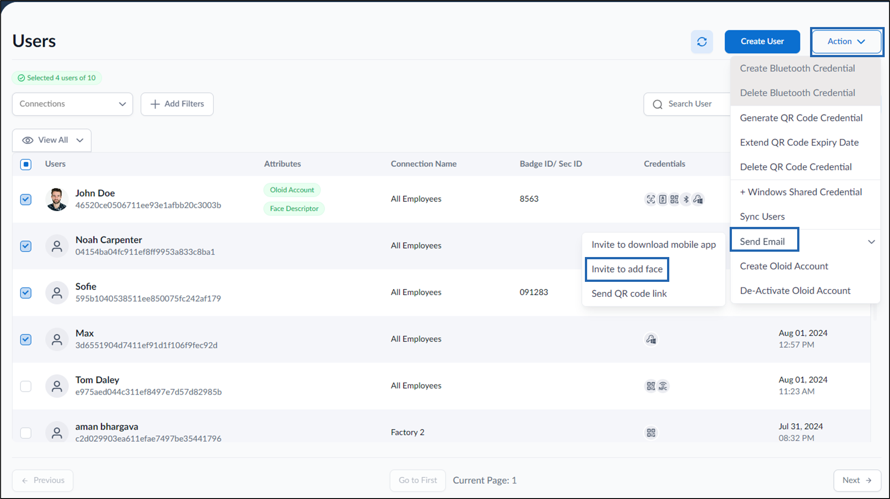
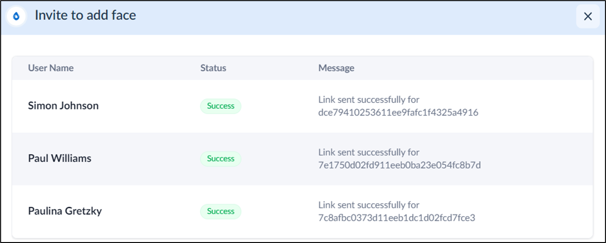

{/* Source: Intercom article 9674132 - https://oloid.help/en/articles/9674132-supervisor-portal-how-to-invite-multiple-users-to-add-face */}
{/* Generated by intercom_to_mintlify.py - re-running overwrites this file. */}

Steps to invite multiple users to add Face

1. Log in to the **Supervisor Portal**.
   The **Users** page is displayed.
2. Select user(s).

   

3. On top right, Click **Action** > **Send email** > **Invite to add face**.

   

   An email invite link is sent to the users to upload their face.

   

To upload face using the invite link, see [How to add face using the invite link](/platform/user-portal/oloid-user-portal-how-to-add-a-face-using-invite-link).
