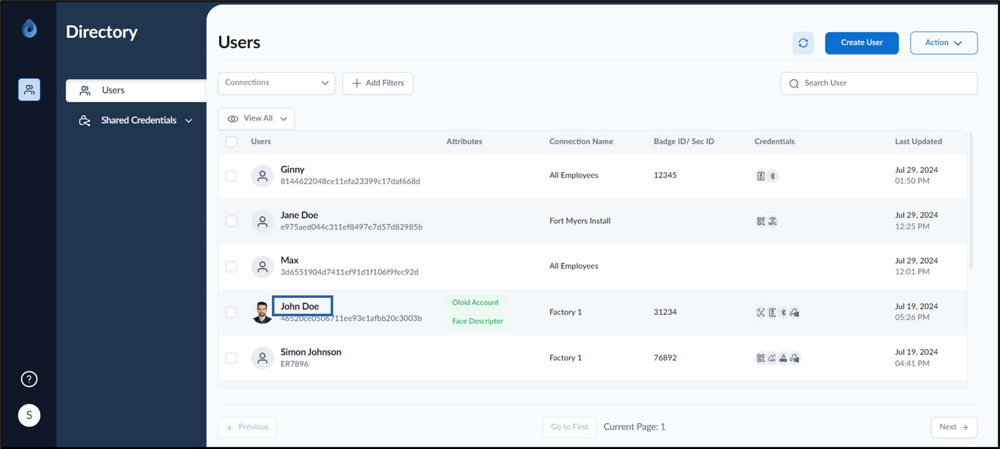
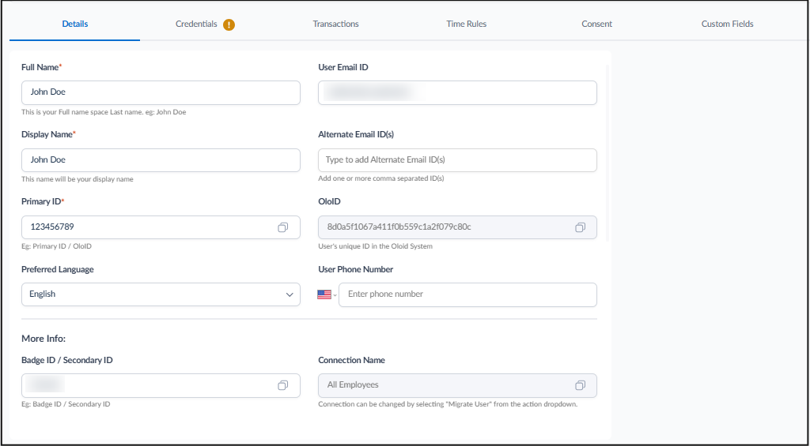
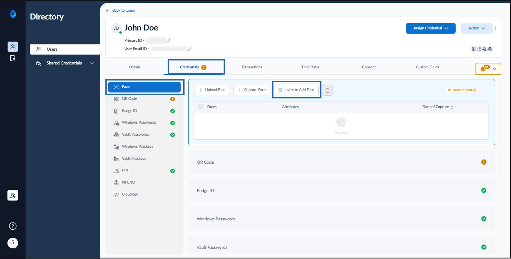
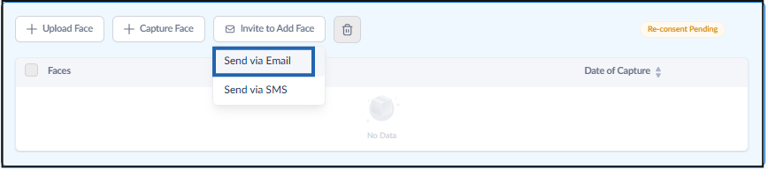
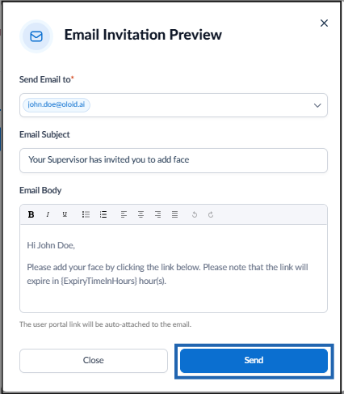
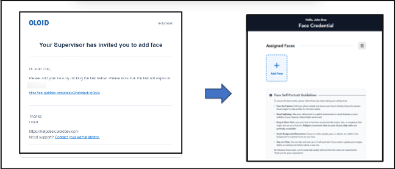
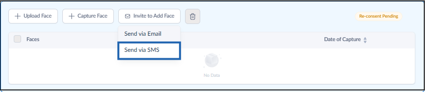
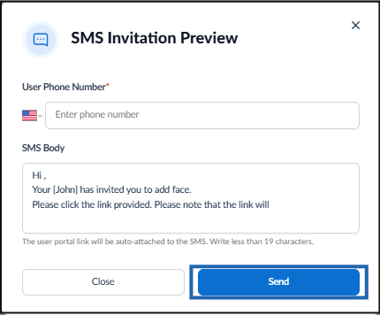
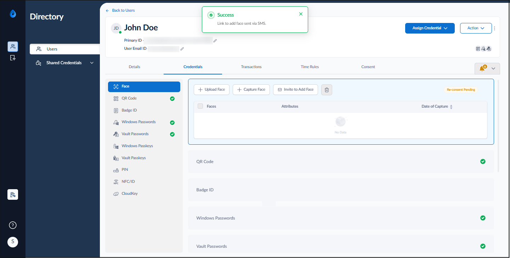
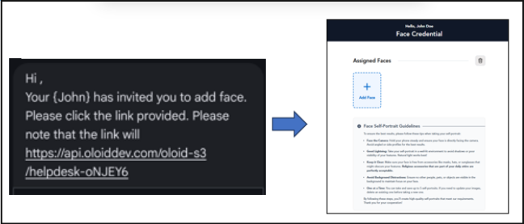

{/* Source: Intercom article 9673759 - https://oloid.help/en/articles/9673759-supervisor-portal-how-to-invite-to-add-face */}
{/* Generated by intercom_to_mintlify.py - re-running overwrites this file. */}

## Introduction

This document provides instructions on how to invite users to add their face through the Supervisor Portal. Supervisor can send face enrollment invitations to users via email or SMS using a secure invitation link.

## Prerequisites

- You must have Supervisor access to Supervisor Portal.
- User must be added. To add, refer [Supervisor Portal - How to add user](/platform/supervisor-portal/supervisor-portal-how-to-add-user)

## Steps to Invite to Add Face

1. Log in to the **Supervisor Portal**.
   The **Users** page is displayed.
2. Click **username** to edit.

   

   The user details page is displayed.

   

3. Go to **Credentials** > **Face** > **Invite to Add Face**

   

4. Do one of the following:
   1. [Send an invitation via Email.](#send-an-invitation-via-email)
      OR
   2. [Send an invitation via SMS.](#send-an-invitation-via-sms)

### Send an Invitation via Email

This section explains how to invite users to upload their face by sending an invitation link via email.

1. Select **Send via Email** optionfrom the drop-down list.

   

   Email Invitation Preview pop-up box is displayed.
2. Do the following
   1. Enter your Email ID.

      <Note>
        **Note:** By default, your email address is added. You can add more email addresses if needed.
      </Note>

   2. Enter Email Subject. (Optional)
   3. Enter Email Body. (Optional)
   4. Click **Send**.

      

      The Email to add face is sent successfully

      

      <Note>
        **Note:** The user must enroll their face within the set duration, or the link will expire.
      </Note>

      

### Send an Invitation via SMS

This section explains how to invite users to upload their face by sending an invitation link via SMS.

1. Click **Send via SMS**.

   

   The **SMS Invitation Preview** pop-up box is displayed.
2. Do the following.
   1. Enter the **User's Phone Number** in the **Enter Phone Number** field.

      <Note>
        **Note:** Select the country icon to change the country code prefix.
      </Note>

   2. Edit **SMS Body** field. (Optional)
   3. Click **Send**.

      

An SMS with invite link is sent successfully to the user to upload their face.

<Note>
  **Note:** The user can enroll the face by clicking on the provided link.
</Note>

To upload face using the invite link, refer **[How to add face using the invite link](/platform/user-portal/oloid-user-portal-how-to-add-a-face-using-invite-link)**[.](/platform/user-portal/oloid-user-portal-how-to-add-a-face-using-invite-link)

---

##### Video Tutorial

Watch the video [How to invite to add Face in the Supervisor Portal - Video Tutorial](/platform/supervisor-portal/videos/how-to-invite-to-add-face-in-the-supervisor-portal-video-tutorial)
