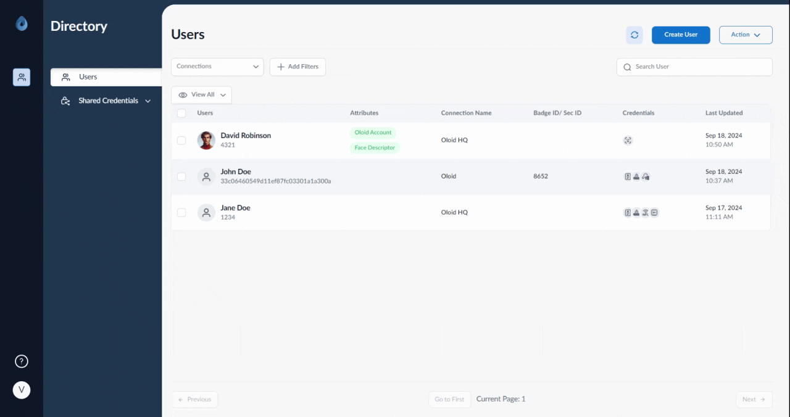
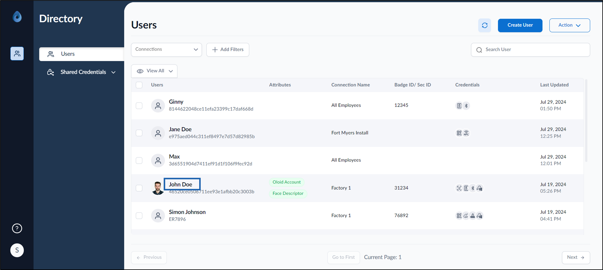
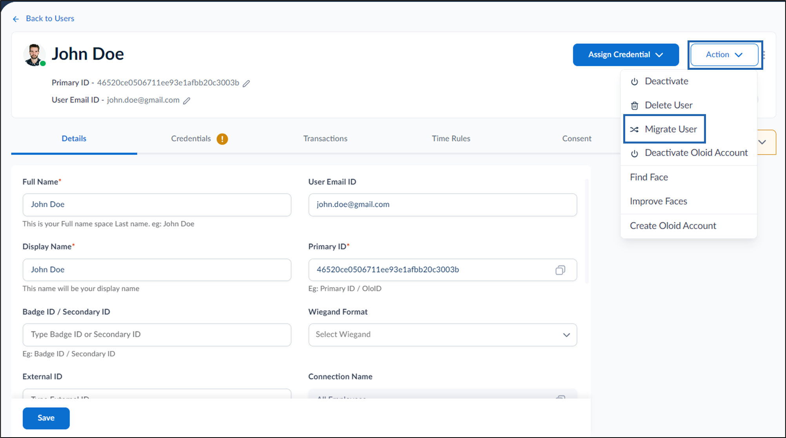
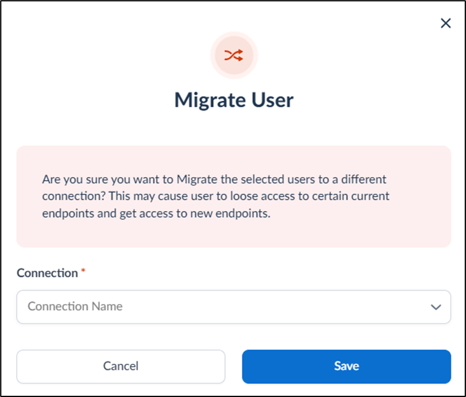

{/* Source: Intercom article 9674164 - https://oloid.help/en/articles/9674164-supervisor-portal-how-to-migrate-user-to-a-different-connection */}
{/* Generated by intercom_to_mintlify.py - re-running overwrites this file. */}

Steps to Migrate User to a different Connection:

1. Log in to the **Supervisor Portal**.
   The **Users** page is displayed.
2. Click username to edit.

   

   The User details page is displayed.
3. Go to **Action** > Select **Migrate User**.

   

   The **Migrate User** pop-up box is displayed.

   

4. Select connection to map from **Connection** dropdown.
5. Click **Save**.

The user is migrated and mapped to the new connection. The updated connection for the user is displayed on the Users page.
