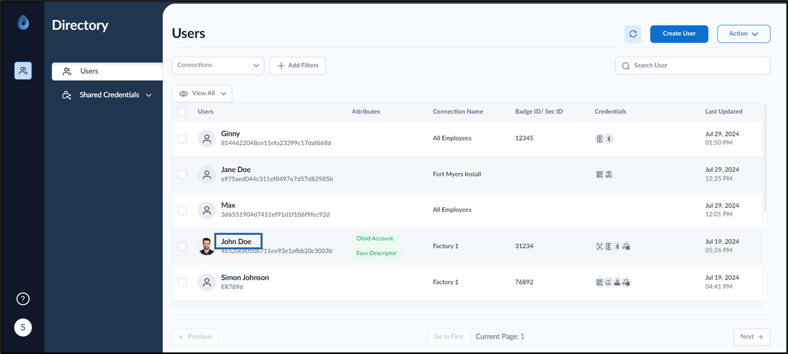
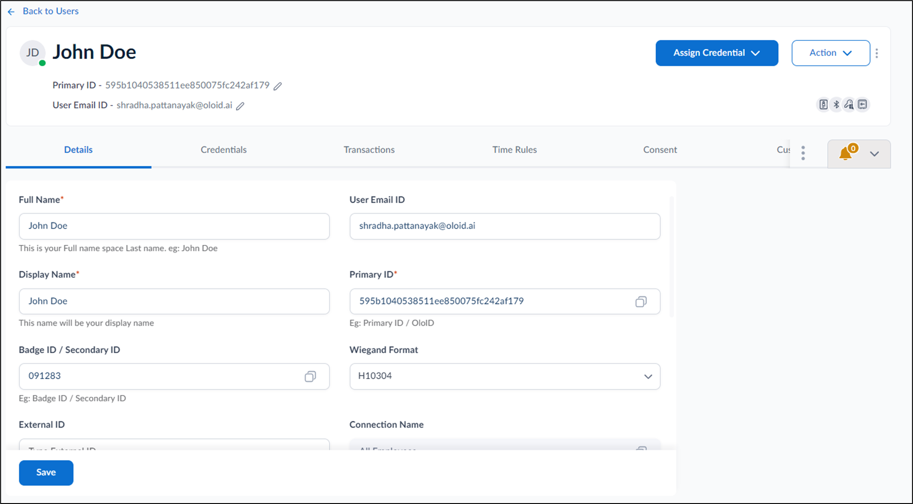
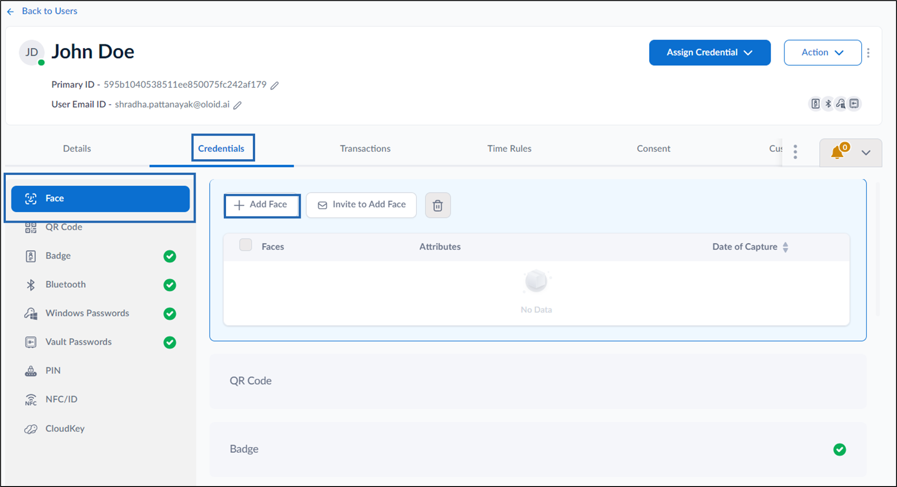
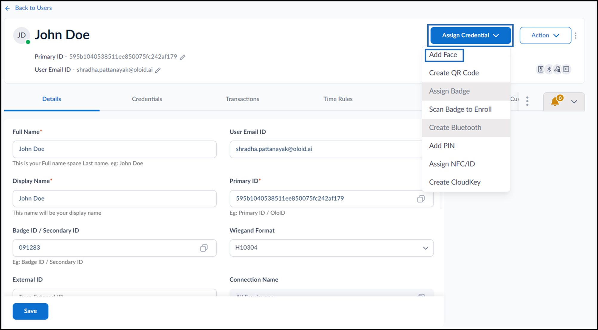
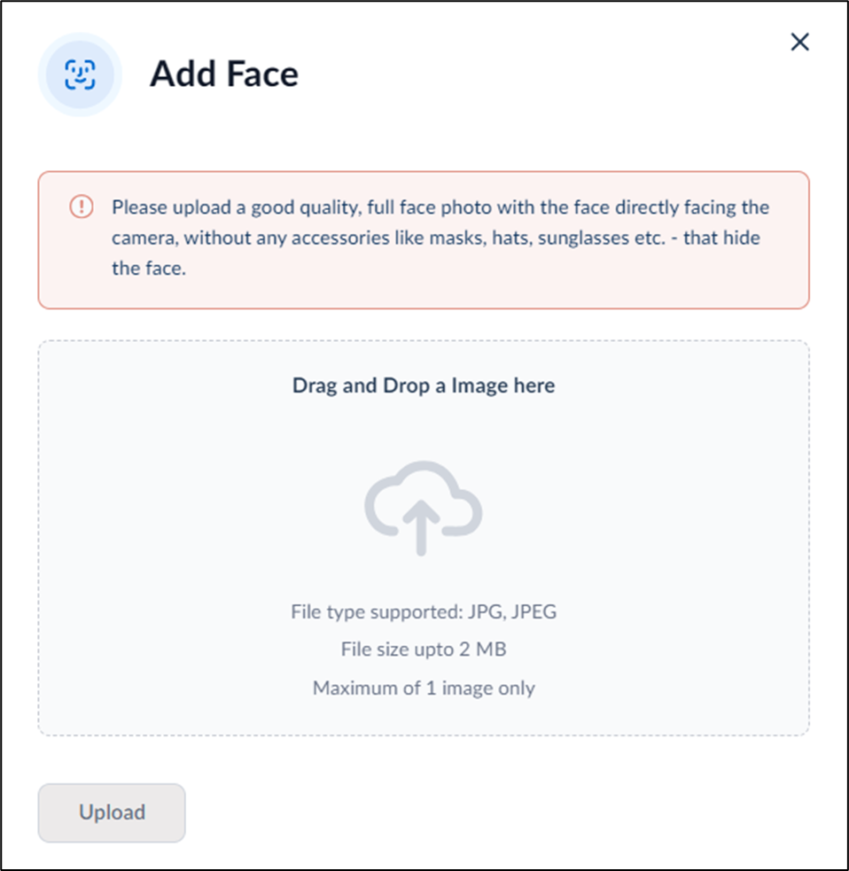
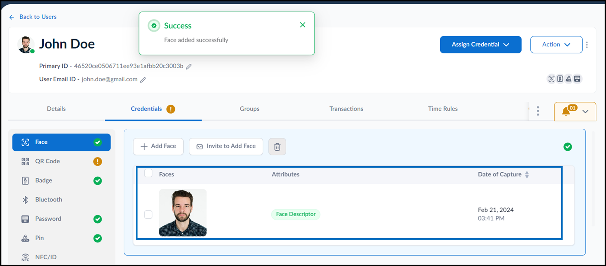

{/* Source: Intercom article 9669583 - https://oloid.help/en/articles/9669583-supervisor-portal-how-to-onboard-face-of-a-single-user */}
{/* Generated by intercom_to_mintlify.py - re-running overwrites this file. */}

Steps to add face of a single user:

1. Log in to the **Supervisor Portal.**
   The **Users** page is displayed.
2. Click **username** to edit.

   

   Theuser details page is displayed.

   

3. Do one of the following:
   1. Go to **Credentials** > **Face** > + **Add Face**.

      

   2. Go to **Assign Credential** > **Add Face**.

      

      The pop-up box to upload image is displayed.

      

4. Click or Drag and Drop the image to be uploaded.

Click **Upload**.

The image is uploaded and listed on the **Face** tab.

<Note>
  **Note:** You can add a maximum of five faces per user.
</Note>

## Video Tutorial

5. Watch the video [How to onboard face of a single user in the Supervisor Portal- Video Tutorial](/platform/supervisor-portal/videos/how-to-onboard-face-of-a-single-user-in-the-supervisor-portal-video)
