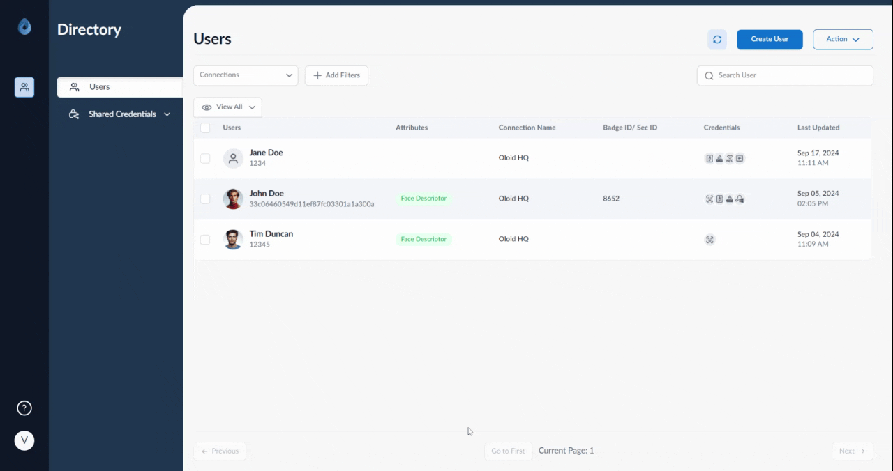
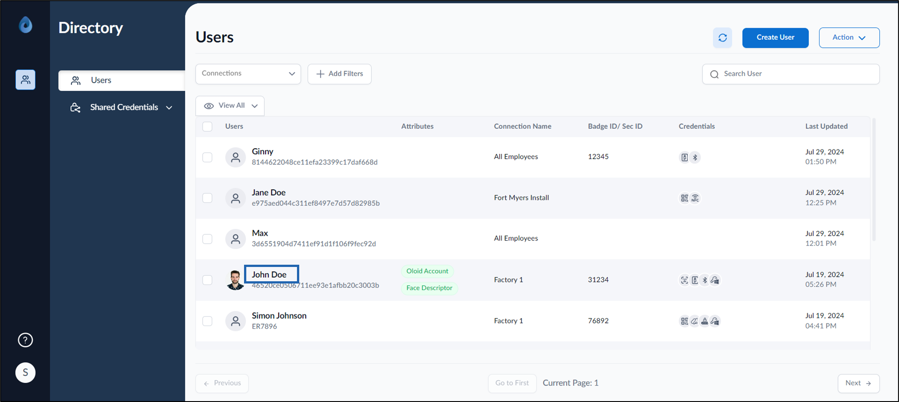
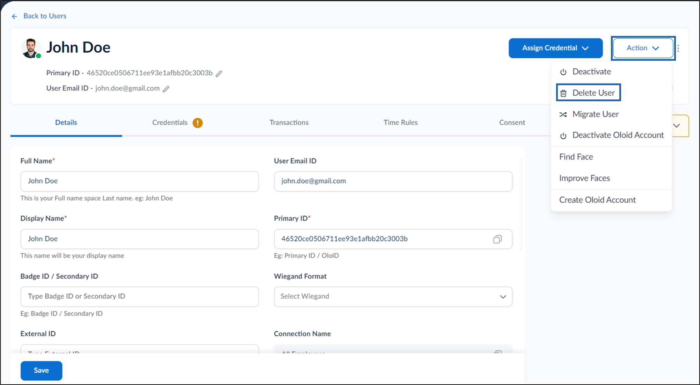
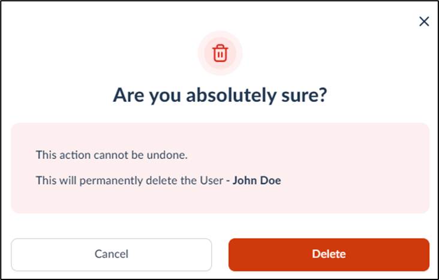

{/* Source: Intercom article 9674187 - https://oloid.help/en/articles/9674187-supervisor-portal-how-to-remove-user */}
{/* Generated by intercom_to_mintlify.py - re-running overwrites this file. */}

The tenant admin must grant the supervisor permission to add or delete users.

Steps to remove user:

1. Log in to the **Supervisor Portal**.
   The **Users** page is displayed.
2. Click username to edit.

   

   The user details page is displayed.
3. On the top-right, go to **Action** > **Delete User**.

   

   A confirmation pop-up box is displayed.

   

4. Click **Delete**.
   The user is permanently deleted from the Supervisor Portal.

## Related Document

[How to activate Supervisor Privilege](/platform/tenant-admin-portal/tenant-admin-portal-how-to-configure-supervisor-privilege)
