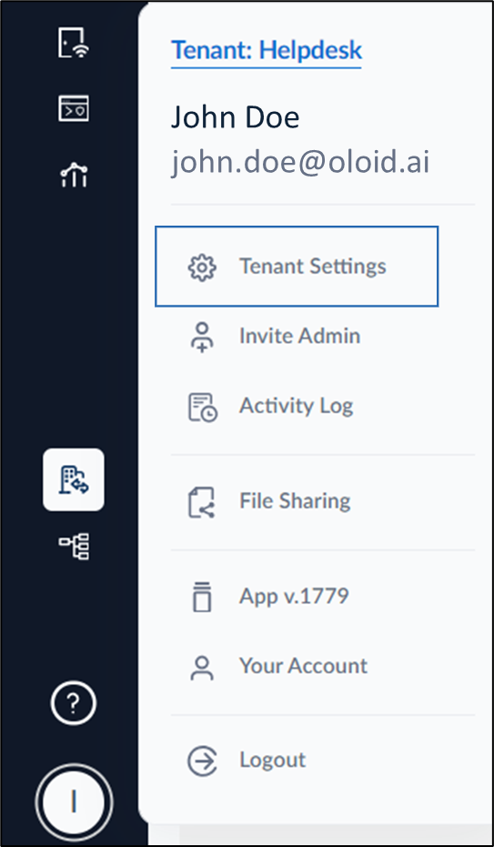
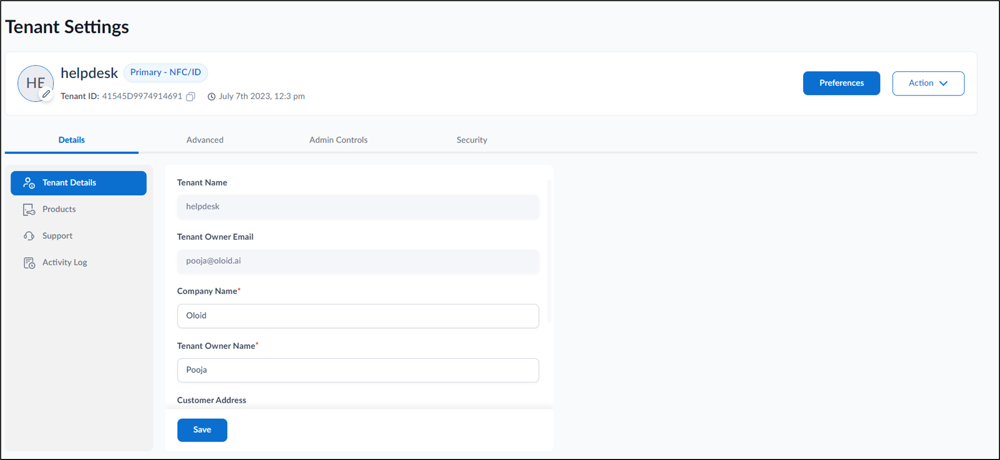
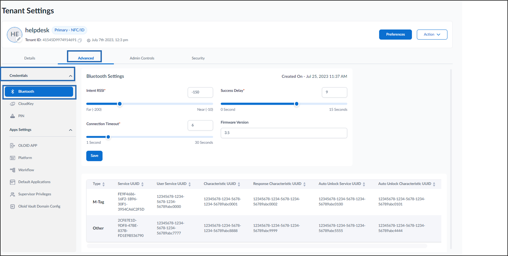
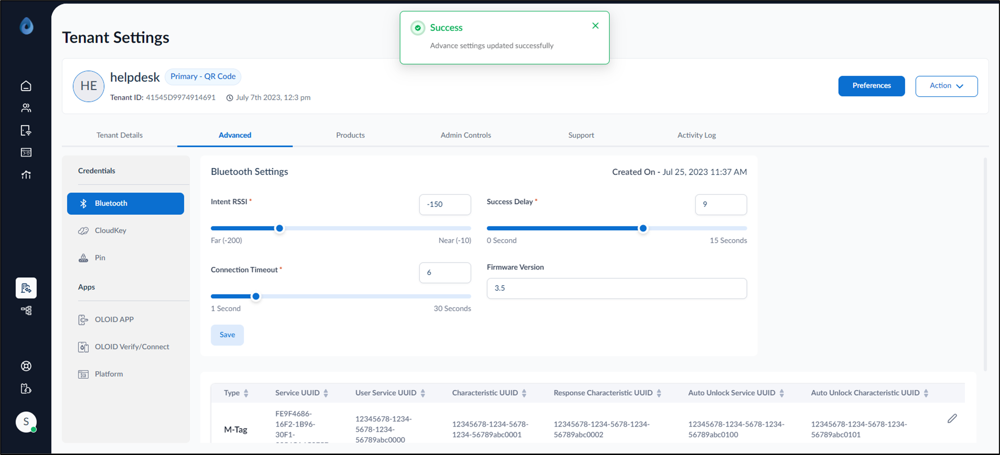

{/* Source: Intercom article 8777811 - https://oloid.help/en/articles/8777811-archived-how-to-configure-bluetooth-for-m-tag */}
{/* Generated by intercom_to_mintlify.py - re-running overwrites this file. */}

Steps to configure the Bluetooth credential:

1. Log in to the **Oloid Portal**.
2. On the homepage, click **user profile icon.**

   

   The user profile menu is displayed.
3. Select **Tenant Settings**.

   

   The tenant Settings page is displayed.

   

4. Go to **Advanced** tab > **Credentials** > **Bluetooth**.

   

5. On the Bluetooth Settings, do the following:

   <Note>
     **Note:** These are one-time settings and all the default settings are recommended.
   </Note>

   1. To adjust the Bluetooth range, modify the **Intent RSSI**.
   1. To set the time duration between two successful transactions, modify the **Success Delay**.
   2. To specify the maximum duration when attempting to establish a connection, modify **Connection Timeout**.
   3. Click **Save**.
      The Advance settings are updated successfully.

      
