{/* Source: Intercom article 8423861 - https://oloid.help/en/articles/8423861-creating-passwords-and-shared-credentials-for-users-in-oloid-platform-user-guide */}
{/* Generated by intercom_to_mintlify.py - re-running overwrites this file. */}

## TOC

**[Introduction](#introduction)**

**[Pre-requisite](#pre-requisite)**

**[Accessing Oloid Portal](#accessing-oloid-portal)**

- [To set new Password](#to-set-new-password)
- [To Access Oloid Portal](#to-access-oloid-portal)

**[Create and Manage Users](#create-and-manage-users)**

- [To Create a User](#to-create-a-user)
- [To Import Users](#to-import-users)

**[Create and Invite Tenant Admin](#create-and-invite-tenant-admin)**

- [To invite Tenant Admin](#to-invite-tenant-admin)
- [To Create and Invite Tenant Admin](#to-create-and-invite-tenant-admin)

**[Create and Manage Credentials](#create-and-manage-credentials)**

- [To Create Password](#to-create-password)
- [To Edit Password](#to-edit-password)
- [To Delete Password](#to-delete-password)
- [To Create Pin](#to-create-pin)
- [To Add Badge](#to-add-badge)

**[Create and Manage Shared Credentials](#create-and-manage-shared-credentials)**

- [To Create Shared Credential](#to-create-shared-credential)
- [To Edit Shared Credential](#to-edit-shared-credential)
- [To Delete Shared Credential](#to-delete-shared-credential)

## Introduction

This document provides step-by-step instructions to create password and shared credential for users in the Oloid Portal.

## Pre-requisite

You must be a user in the Oloid Portal.

## Accessing Oloid Portal

To access Oloid Portal, you should be a tenant admin. Once the tenant admin account is created, you will receive the URL and credentials (username and temporary password) for the portal on your registered email id.

### To set new Password

1. Launch your browser.
2. Enter the URL provided for you in the browser’s address bar. Then, press **Enter** on your keyboard.
3. Enter your login information in the appropriate fields.

   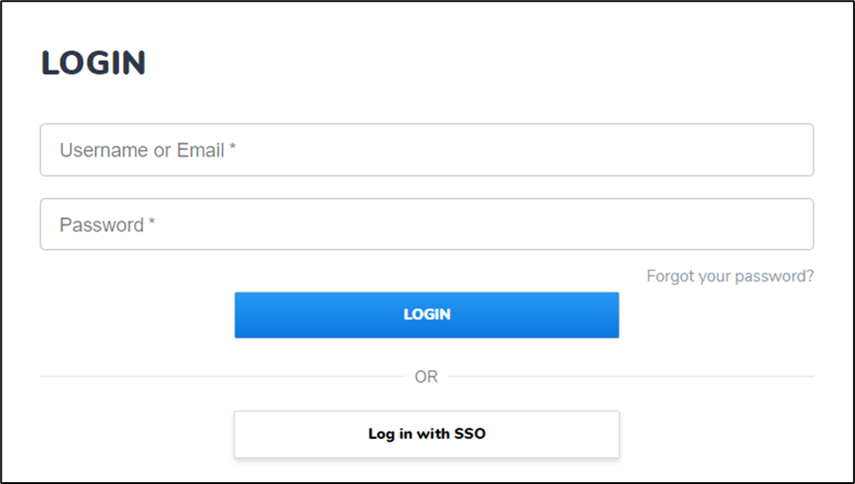

4. Click **LOGIN**.
   The **Set New Password** screen is displayed.

   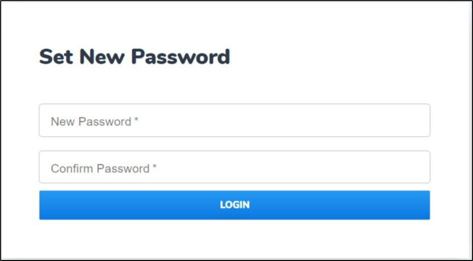

5. Enter New Password.

   <Note>
     **Note:** Password must contain at least one uppercase, one lowercase letter, one number, no consecutive or sequence characters The password should not contain any part of username.
   </Note>

6. Enter Confirm Password.
7. Click **LOGIN**.
   The Oloid Portal is displayed.

### To Access Oloid Portal

**Pre-requisite**: You should be a user with Oloid Portal.

1. Launch your browser.
2. Enter the URL provided for you in the browser’s address bar. Then, press **Enter** on your keyboard.
3. Enter your login information in the appropriate fields.

   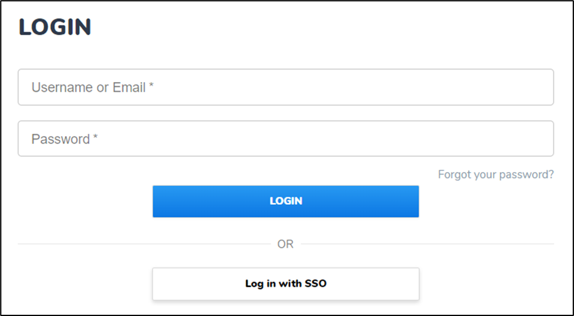

4. Click **LOGIN**.
   The Oloid Portal is displayed.

   <Note>
     **Note:** Oloid uses **SSO login** and also allows you to log in to the portal with your Google, Microsoft, Okta, or with your Email account.
   </Note>

## Create and Manage Users

Tenant Admin is granted rights to manage and access the users related to the tenant.

### To Create a User

For detailed instructions, see [How to add user](/platform/tenant-admin-portal/tenant-admin-portal-how-to-create-user).

### To Import Users

For detailed instructions, see [How to add users in bulk](/platform/tenant-admin-portal/tenant-admin-portal-how-to-add-users-in-bulk).

## Create and Invite Tenant Admin

A Tenant Admin has complete access to Oloid Portal and all the Oloid connected devices. You must be an Oloid user to be a Tenant Admin.

### To invite Tenant Admin

For detailed instructions, see [How to invite Tenant Admin](/platform/tenant-admin-portal/how-to-invite-a-tenant-admin).

### To Create and Invite Tenant admin

For detailed instructions, see [How to add and invite Tenant Admin](/platform/tenant-admin-portal/how-to-add-and-invite-a-tenant-admin).

## Create and Manage Credentials

Credentials allow a user to access and authenticate themselves on the Oloid Portal.

### To Create Password

1. Log in to the **Oloid Portal**.
2. On the home page of the portal, click **Directory** on the left menu panel.

   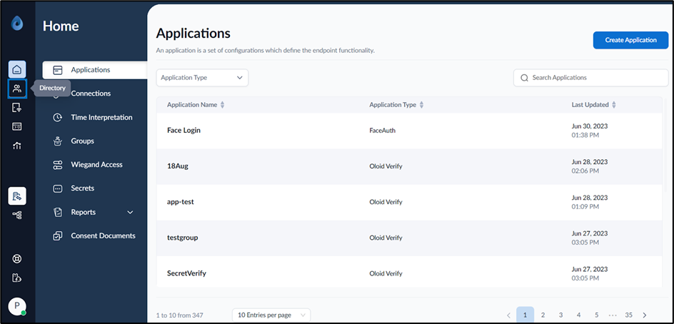

   The **Users** page is displayed.
3. Click **User Name** to edit.

   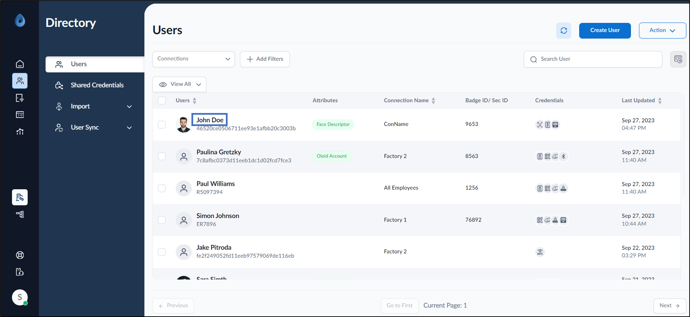

   The User details page is displayed.
4. Go to **Credentials** > **Passwords** tab > **CREATE PASSWORD**.

   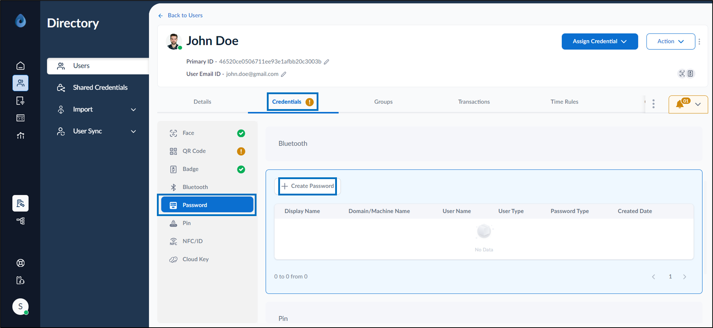

   The **Create Password** pop-up box is displayed.

   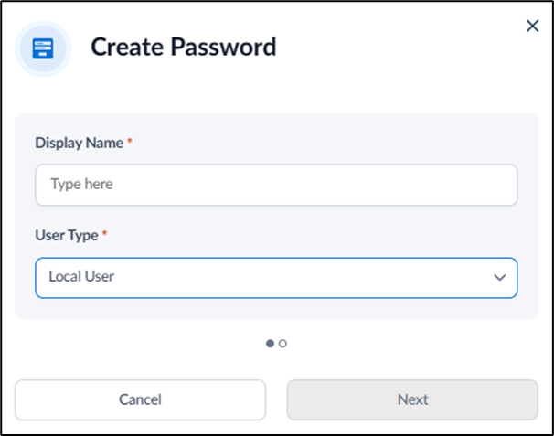

5. On the pop-up box, do the following:
   1. Enter **Display Name** that displays on the Windows Login page.
   2. Select a user type from **User Type** dropdown list.
   3. Enter **Machine Name**.
   4. Enter **Username** of your Windows Login.
   5. Enter **Password** of your Windows Login.
   6. Click **Save**.
      The password is created and listed in the **Passwords** tab.

      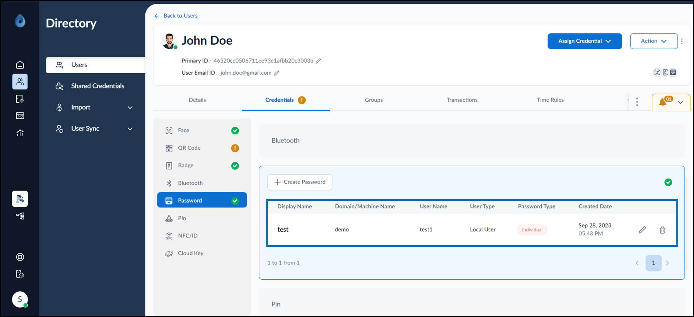

### To Edit Password

1. Go to the **Users** page.
2. Click **User Name** to edit.

   

   The User details page is displayed.
3. Go to **Credentials** > **Passwords** tab.
4. Click **edit** icon for a particular user.

   

   The **Edit Password** pop-up box is displayed.

   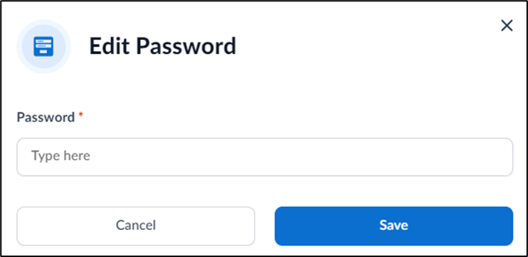

5. Enter the new password in the **Password** field.

   <Note>
     **Note:** You should update the password only when you update the Windows password.
   </Note>

6. Click **Update**.
   The password is updated successfully.

### To Delete Password

1. Go to the **Users** page.
2. Click **Display Name** to edit.

   

   The User details page is displayed.
3. Go to **Credentials** > **Passwords** tab.
4. Click **delete** icon for a particular user.

   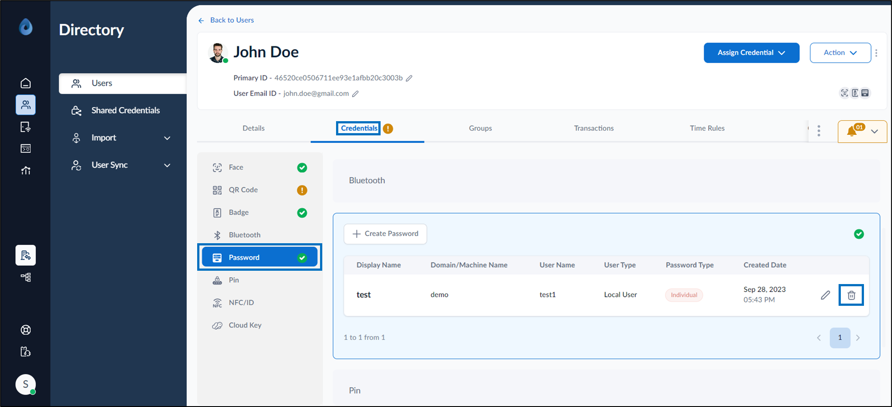

   A confirmation pop-up box is displayed.

   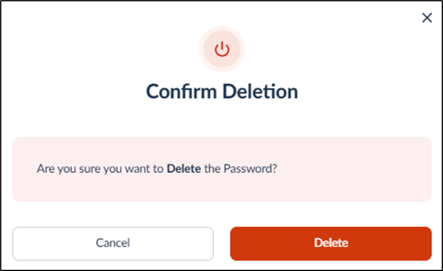

5. Select **DELETE**.
   The user is successfully deleted.

### To Create Pin

For detailed instructions, see [How to add Pin as credential to users](/platform/tenant-admin-portal/tenant-admin-portal-how-to-add-pin-credential-for-user).

### To Add Badge

For detailed instructions, see **[How to assign Badge ID as credential to users](/platform/tenant-admin-portal/how-to-assign-badge-id-as-credential-to-users).**

## Create and Manage Shared Credentials

Shared Credentials are passwords that can be used to access a local windows machine or a domain. It is shared among users to which they are assigned to.

### To Create shared Credential

1. Log in to the **Oloid Portal**.
2. On the home page of the portal, click **Directory** on the left menu panel.

   

   The **Users** page is displayed.
3. Click **Shared Credentials** on the left menu panel.

   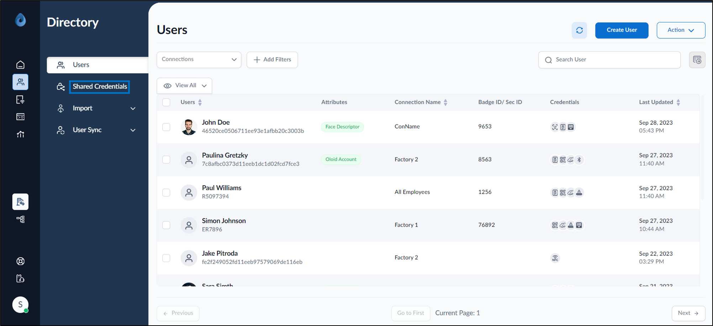

   The **Shared Credentials** page is displayed.
4. On the top right, click **Create Credentials**.

   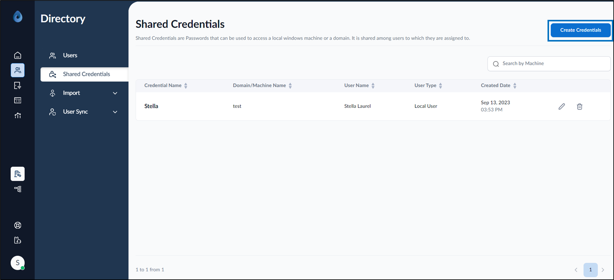

   The **Create Shared Credential** pop-box is displayed.

   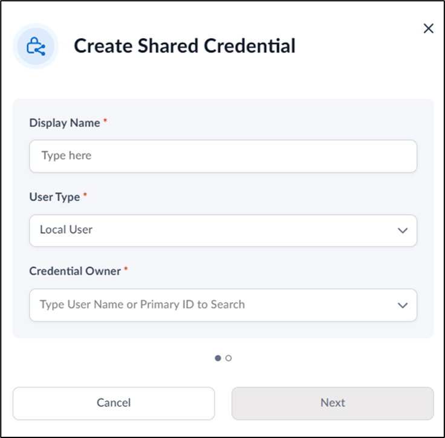

5. On the pop-up box do the following:
   1. Enter **Display Name** that displays on the Windows Login page.
   2. Select user type from **User Type** dropdown.
   3. Enter user name then select **Credential Owner** from the dropdown list.
   4. Select **Next**.
   5. Enter **Machine Name**.
   6. Enter **Username** of your Windows Login.
   7. Enter **Password** of your Windows Login.
   8. Click **Save**.
      The credential is created and listed on the **Shared Credentials** page.

      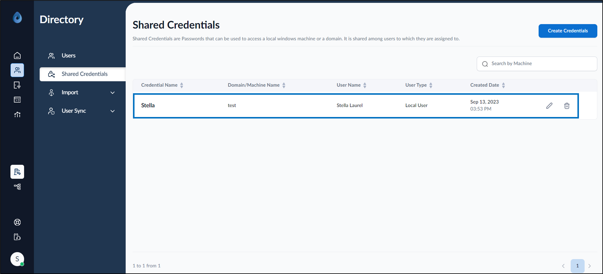

### To Edit Shared Credential

1. Go to the **Users** page.
2. Click **Shared Credentials** on the left menu panel.

   

   The Shared Credentials page is displayed.
3. Click **edit** icon for a particular user.

   

   The **Edit Password** pop-up box is displayed.

   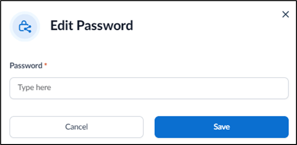

4. Enter the new password in the **Password** field.

   <Note>
     **Note:** You should update the password only when you update the Windows password.
   </Note>

5. Click **Update**.
   The password is updated successfully.

### To Delete Shared Credential

1. Go to the **Users** page.
2. Click **Shared Credentials** on the left menu panel.
   The **Shared Credentials** page is displayed.
3. Click **delete** icon for a particular user.

   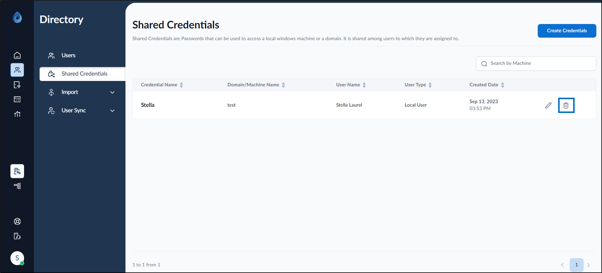

   A confirmation pop-up box is displayed.

   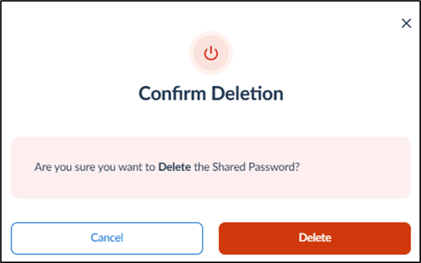

4. Select **DELETE**.
   The credential is removed from the **Shared Credentials** page.
