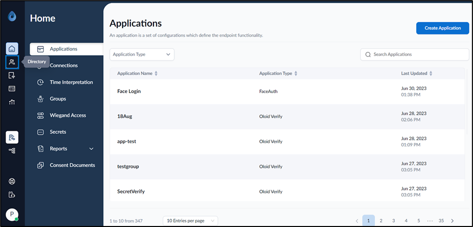
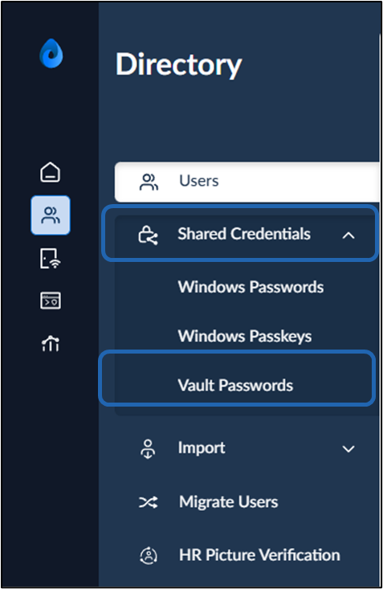
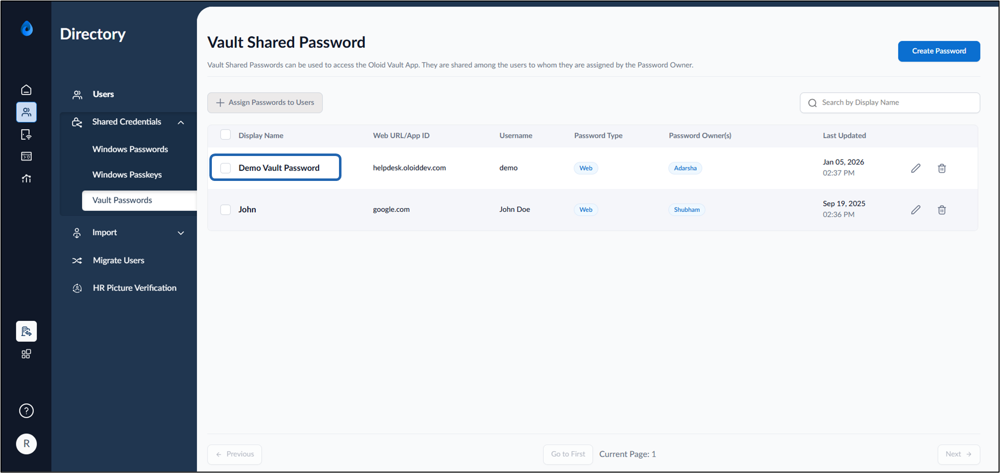
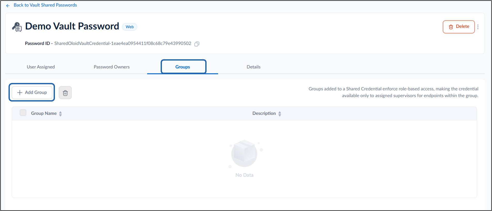
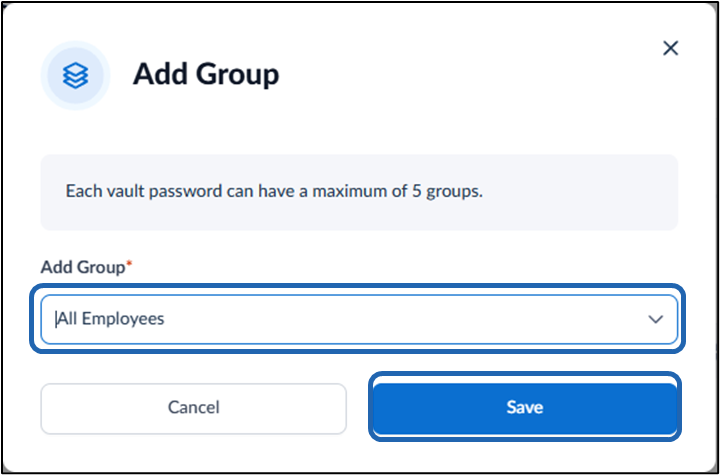
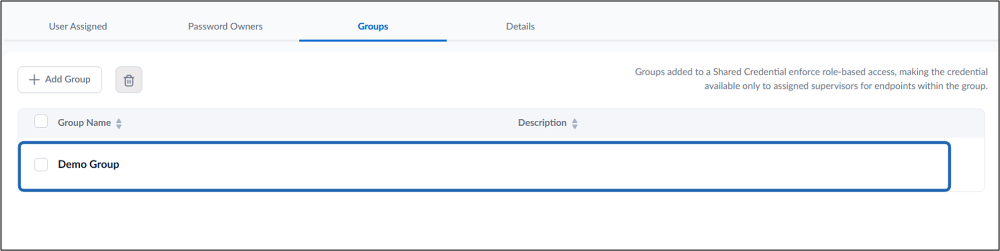

{/* Source: Intercom article 15053887 - https://oloid.help/en/articles/15053887-how-to-add-a-group-to-vault-shared-passwords-in-the-tenant-admin-portal */}
{/* Generated by intercom_to_mintlify.py - re-running overwrites this file. */}

## Introduction

Adding a **Group** to a Vault Shared Password allows the Tenant Admin to grant access to shared credentials for multiple users at once. All users within the selected group will inherit access to the shared password based on the configured authentication workflows.

## Prerequisites

- You must have access to a Tenant Admin account.
- Vault shared password must be created. For more, refer: [Chrome Vault - How to Create Shared Password in the Tenant Admin Portal](/platforms/web/vault/chrome/oloid-vault-chrome-chromium-how-to-create-shared-password-in-the)

## Steps to Add Group to Vault Shared Password

1. Log in to the **Tenant Admin Portal**.
2. On the home page of the portal, click **Directory** on the left menu panel.

   

   The **Users** page is displayed.
3. Select **Shared Credentials > Vault Password** on the left menu panel.

   

   The **Vault Shared Password** page is displayed.
4. Select the preferred Vault Shared Password name to edit.

   

   The Vault Shared Password details page is displayed.
5. Select **Groups** tab > click **+ Add Group**

   

   The Add Group pop-up box is displayed.

   

6. Select Group from dropdown list.
7. Click **Save**.

   <Note>
     **Note:** A maximum of five groups can be added to each vault shared password.
   </Note>

The Group is successfully added to the Vault Shared Password.

The group users will be able to login using the shared password.
