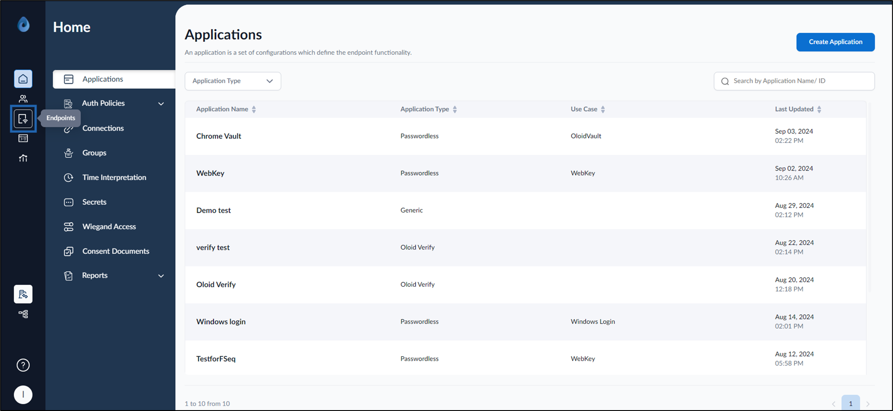
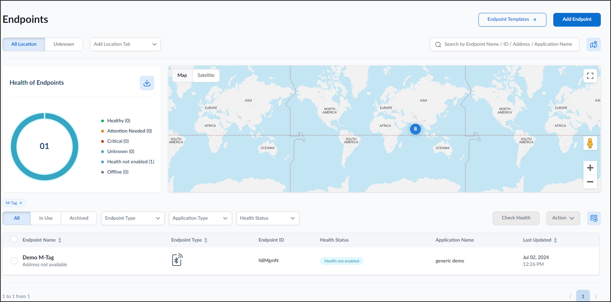
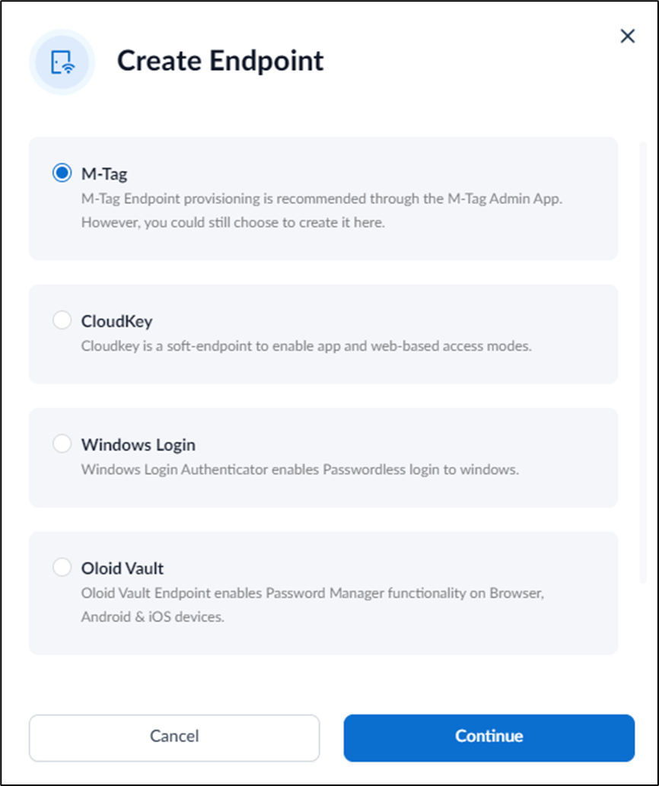
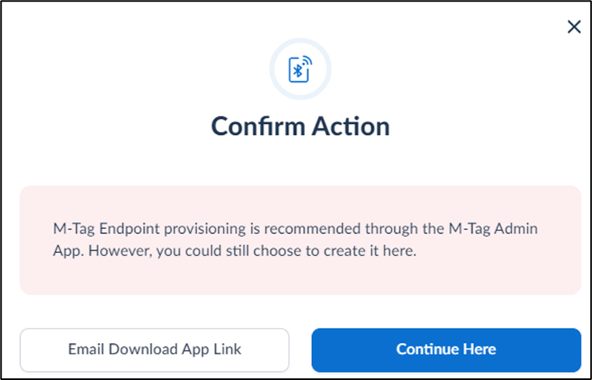
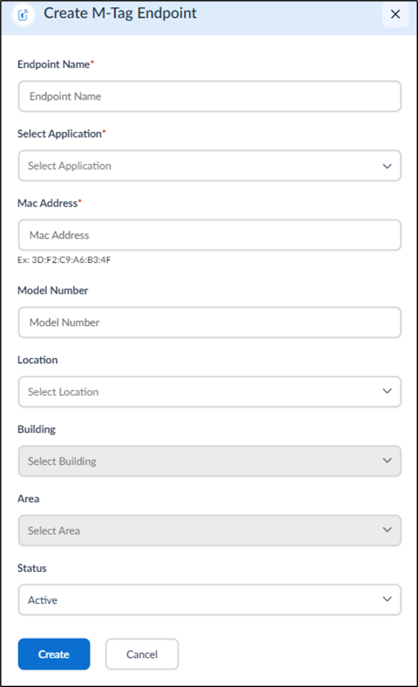

{/* Source: Intercom article 8263173 - https://oloid.help/en/articles/8263173-how-to-add-a-m-tag-endpoint */}
{/* Generated by intercom_to_mintlify.py - re-running overwrites this file. */}

Steps to add a M-Tag endpoint:

1. Log in to the **Oloid Portal**.
2. On the homepage of the portal, click **Endpoints** on the left panel menu.

   

   The **Endpoints** page is displayed.
3. On the top right, click **Add Endpoint**.

   

   The **Create Endpoint** pop-up box is displayed.
4. Select **M-Tag** and click **Continue**.

   

5. The **Confirm Action** pop-up box is displayed.
6. On the **Confirm Action** pop-up box, select **Continue Here** to create a M-Tag Endpoint.

   

   <Note>
     **Note:** Select **Email Download App Link** to send a link on email to download the app.
   </Note>

   The **Create M-Tag Endpoint** pop up box is displayed.

   

7. On the pop-up box, do the following:
   1. Enter **Endpoint name**.
   2. Select **Application** from **Application dropdown list.**
   3. Enter **Mac Address.**
   4. Enter **Model Number** (**optional**).
   5. Select **Location**. (**optional**)
   6. Select **Building**. (**optional**)
   7. Select **Area**. (**optional**)
   8. Select **Status** of Endpoint. (**optional**)
8. Click **Create**.
   The M-Tag Endpoint is created and listed on the **Endpoints** page.
