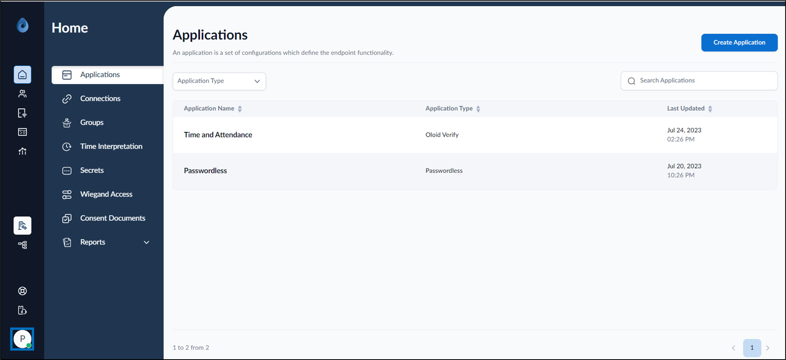
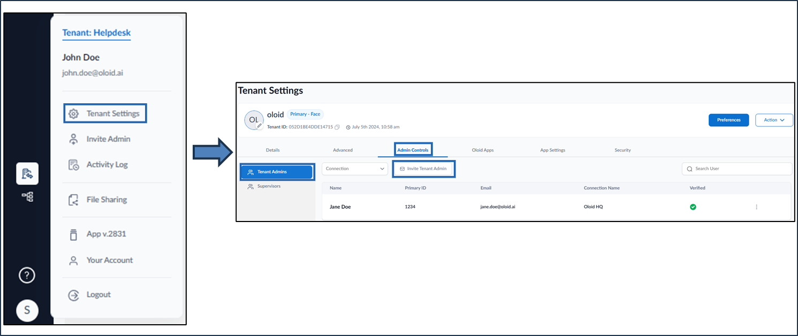
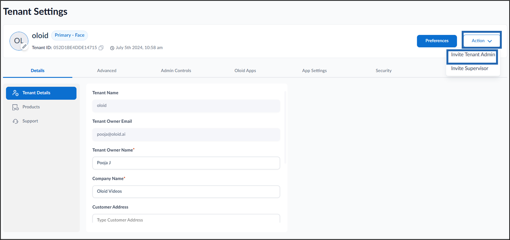
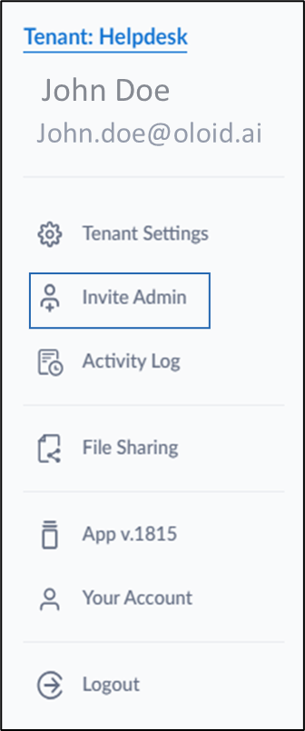
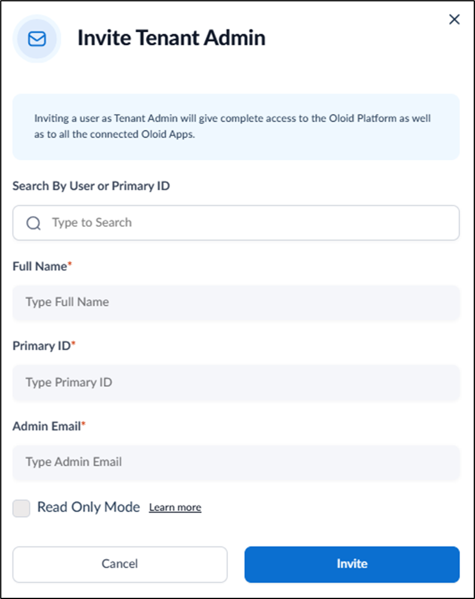
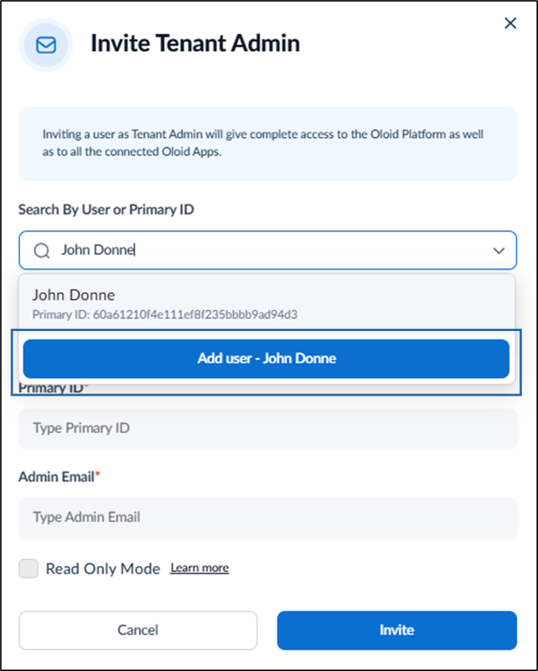
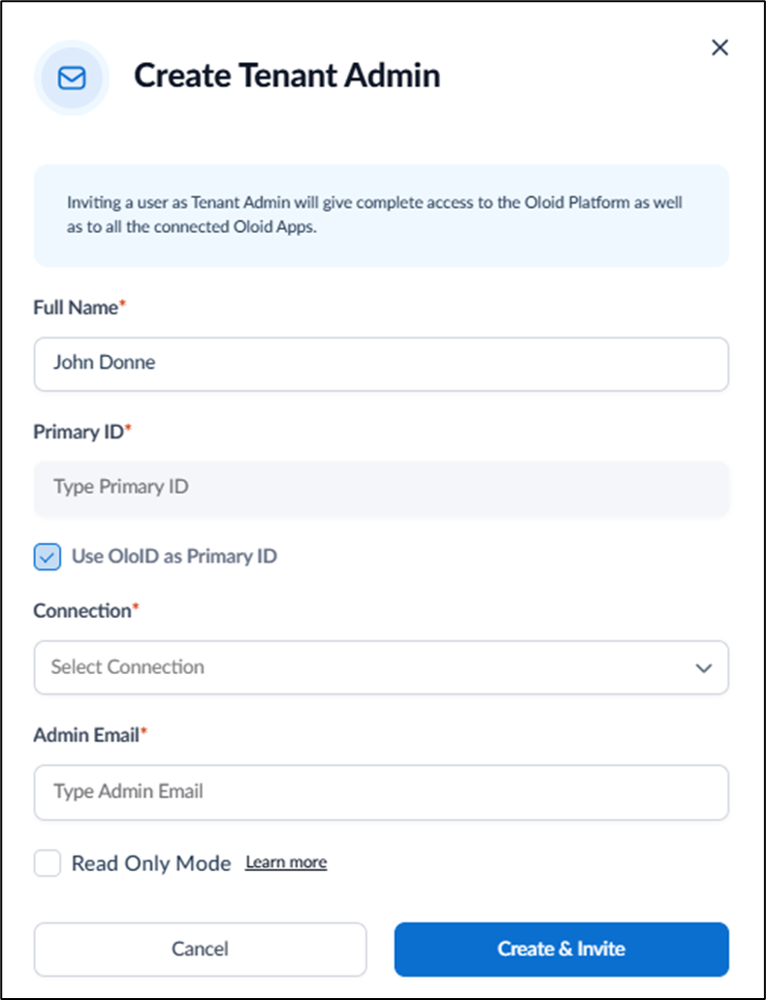
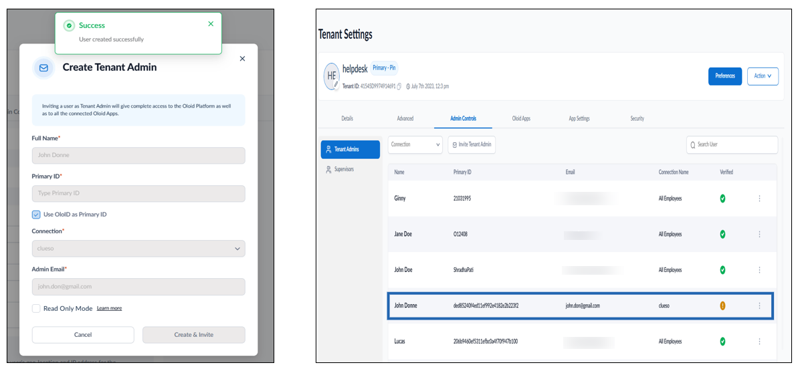

{/* Source: Intercom article 8254907 - https://oloid.help/en/articles/8254907-how-to-add-and-invite-a-tenant-admin */}
{/* Generated by intercom_to_mintlify.py - re-running overwrites this file. */}

**Introduction**

A Tenant Admin has complete access to Oloid platform and all the Oloid connected devices. You must be an Oloid user to be a Tenant Admin.

For adding an existing user as Tenant Admin, see [How to invite a Tenant Admin](/platform/tenant-admin-portal/how-to-invite-a-tenant-admin)

**Pre-requisite**

You must be a Tenant Admin to add and invite a new user as Tenant Admin.

Steps to add and invite a new user as Tenant Admin:

1. Log in to the **Oloid Portal**.
2. On the homepage of the portal, click **user profile icon** on the bottom left.

   

   The **user profile menu** is displayed.
3. Do one of the following:
   1. Go to **Tenant Settings** > **Admin Controls** tab >**Tenant admins** > **Invite Tenant Admin.**

      

      OR, go to **Tenant Settings** > **Action** > **Invite Tenant Admin.**

      

   2. Click **Invite Admin**.

      

      The **Invite Tenant Admin** pop-up box is displayed.

      

4. On the pop-up box, do the following:
   1. Enter the user name in the **Search By User or Primary ID** field.
      The search result lists down if there is any existing user.
   2. Click **Add user** to add a new user.

      

      The **Create Tenant Admin** screen is displayed for the new user and username is auto populated.

      

   3. Edit **Full Name**( if required).
   4. Enter **Primary ID** or select **Use OloID as Primary ID** to use OloID as your primary ID.
   5. Select connection from the **Connection** list.
   6. Enter **Admin Email.**
   7. Select **Read Only Mode** to restrict the Admin from performing any action in the Oloid Portal. (Optional)

Select **Create & Invite**.

The tenant admin is created and listed on the **Tenant Admins** tab.

<Note>
  **Note:** An email is sent to the user to verify the email ID.
</Note>

## Video Tutorial

5. Watch the video [How to add and invite a Tenant Admin in Tenant Admin Portal-Video Tutorial](/platform/tenant-admin-portal/videos/how-to-add-and-invite-a-tenant-admin-in-tenant-admin-portal-video)
