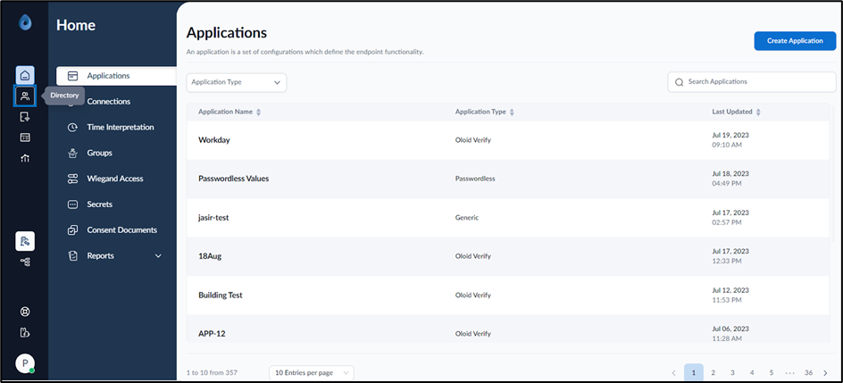
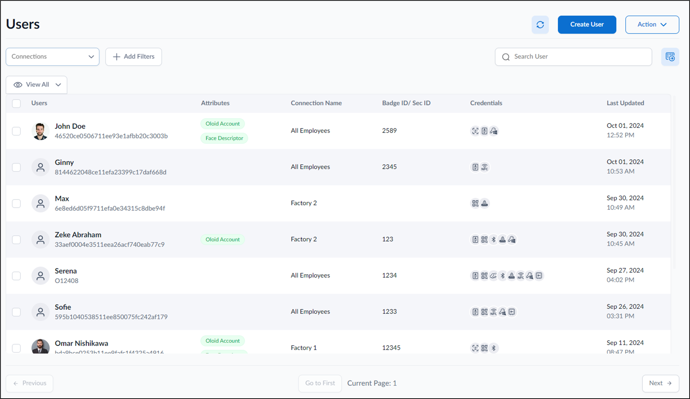
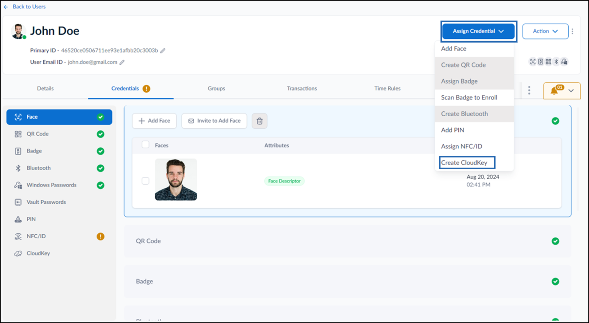
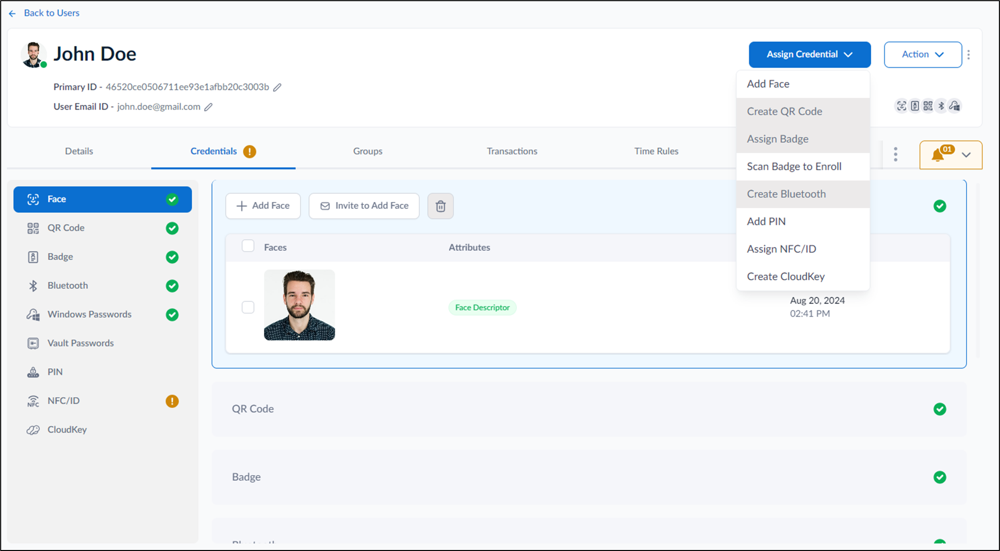
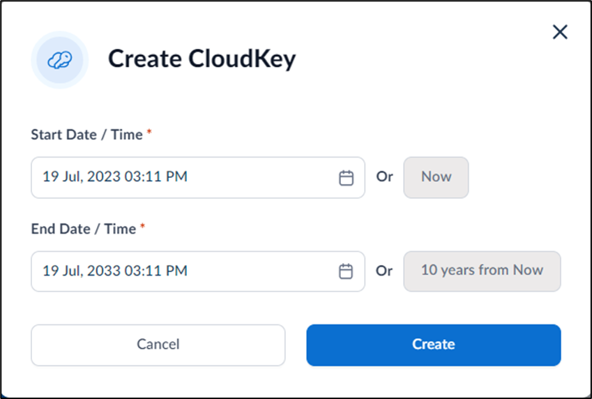
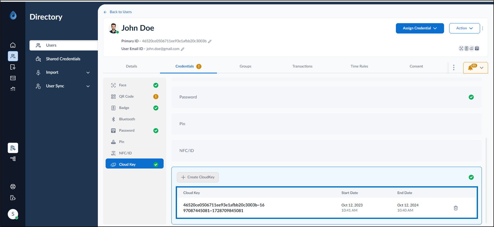

{/* Source: Intercom article 8290091 - https://oloid.help/en/articles/8290091-how-to-add-cloudkey-as-credential-to-users */}
{/* Generated by intercom_to_mintlify.py - re-running overwrites this file. */}

## Steps to create CloudKey

1. Log in to the **Oloid Portal**.
2. On the homepage of the portal, click **Directory** on the left panel menu.

   

   The **Users** page is displayed.
3. Click **user name** to edit.

   

   The user details page is displayed.
4. Do one of the following:
   1. Go to **Credentials** > **Cloud Key** > **+ Create CloudKey**.

      

   2. Go to **Assign Credential** > **Create CloudKey**.

      

      The **Create CloudKey** pop-up box is displayed.

      

5. Enter **Start Date / Time** and **End Date/Time.**

   <Note>
     **Note:** You can click **Now** to set the current date and time. The end date is automatically set to 1 year from the current date.
   </Note>

   You can also click **10 years from Now** to set the **End Date/Time** to 10 years from the current date/time.

Click **Create**.

The cloudkey is created and listed on the **Cloud Key** tab.

## Watch our video [How to add Cloudkey as credential to users.](/platform/tenant-admin-portal/videos/how-to-add-cloudkey-as-credential-to-users-video-tutorial)

##
