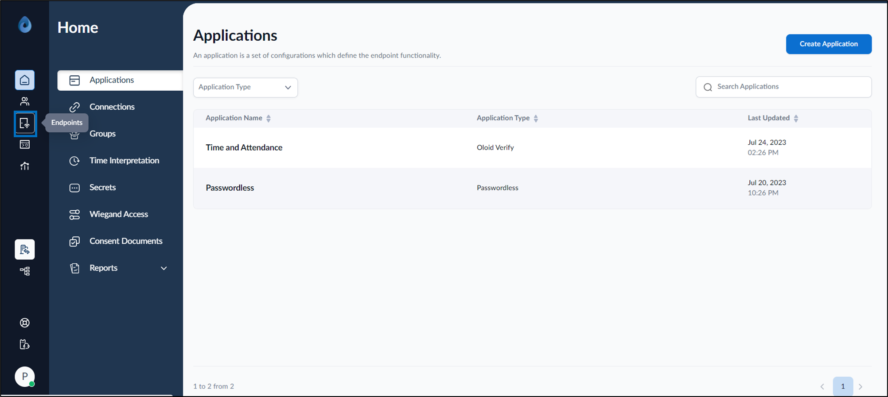
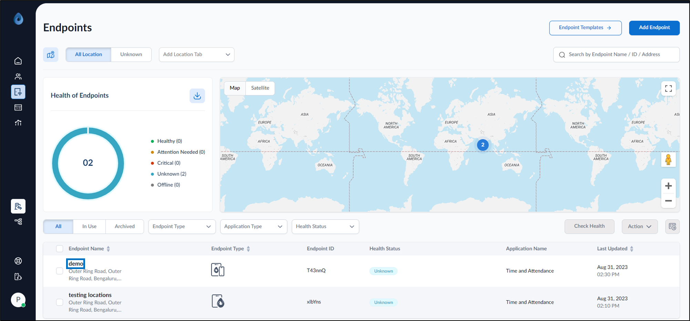
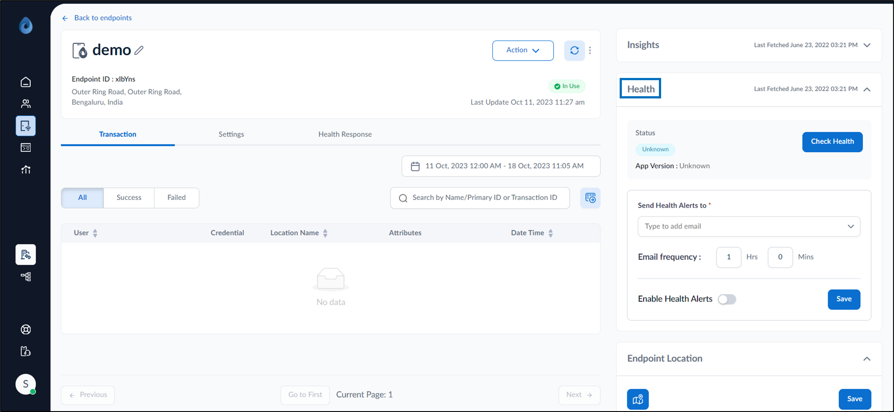

{/* Source: Intercom article 8245679 - https://oloid.help/en/articles/8245679-how-to-add-health-alerts-in-the-endpoint */}
{/* Generated by intercom_to_mintlify.py - re-running overwrites this file. */}

Steps to add health alerts:

1. Log in to the **Oloid Portal**.
2. On the homepage of the portal, click **Endpoints** on the left menu panel.

   

   The Endpoints page is displayed.
3. Click Endpoint Name to edit.

   

   The Endpoint detail page is displayed.
4. On the right panel of the endpoint detail page, locate **Health** section.

   

5. Do the following
   1. Click **Check Health** to check the health status of the endpoint.
   2. Enter the recipient's email id(s) in **Send Health Alerts to** field.
   3. Set **Email frequency** in Hours and Mins to adjust the frequency of email notifications.
   4. Turn on **Enable Heath Alerts** toggle button to receive health alerts of the endpoint at your configured email.
   5. Click **Save**.
      The health alert setup is configured. The email recipient receives the health alerts based on the alert frequency.
