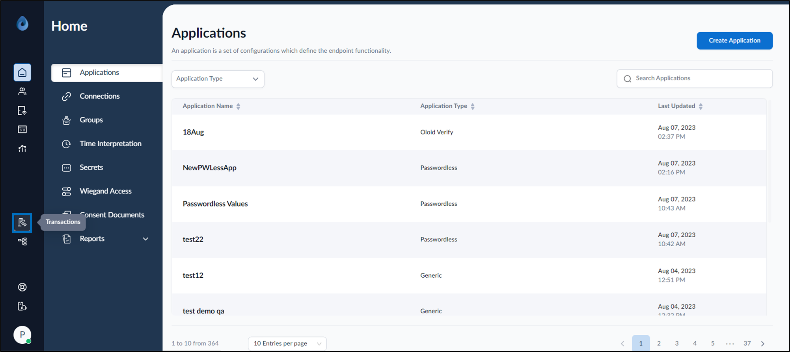
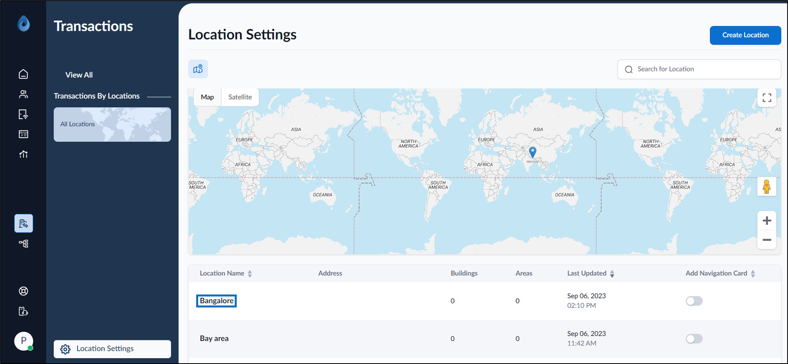
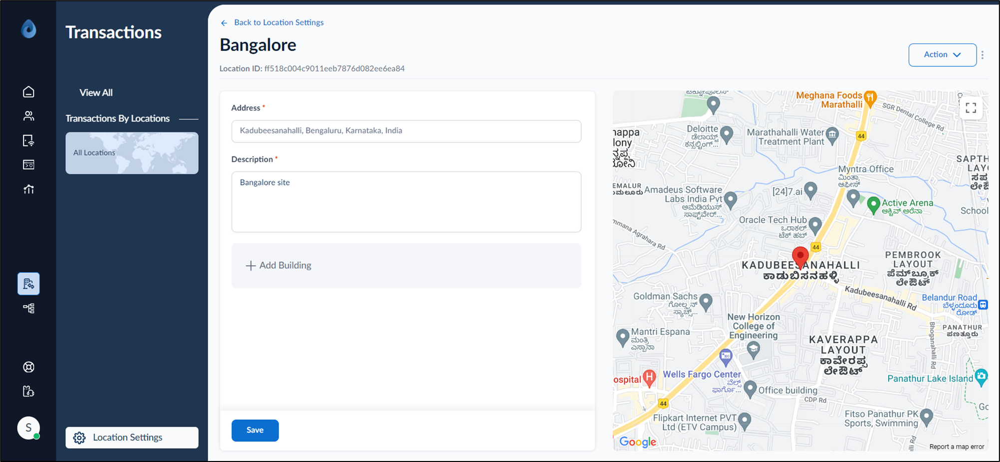
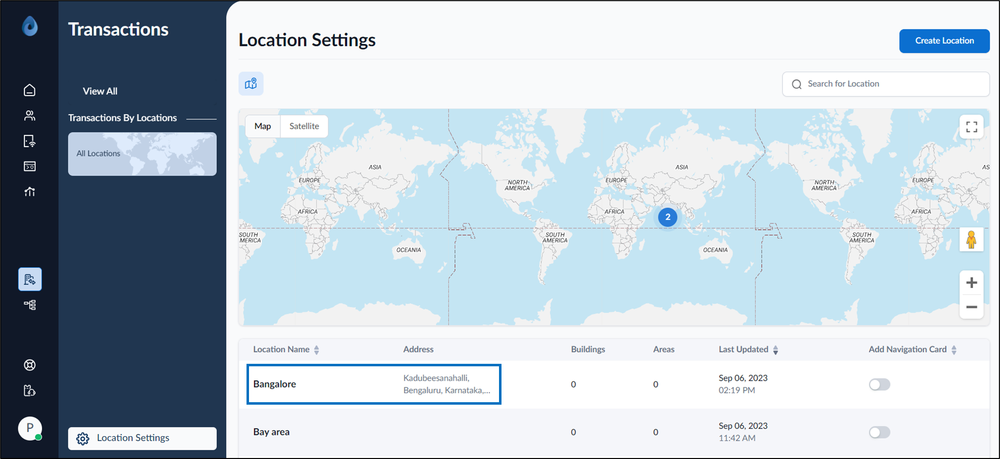

{/* Source: Intercom article 8498715 - https://oloid.help/en/articles/8498715-how-to-add-location-details */}
{/* Generated by intercom_to_mintlify.py - re-running overwrites this file. */}

Steps to add location details:

1. Log in to the **Oloid Portal**.
2. On the home page of the portal, click **Transactions** on the left menu panel.

   

   The **User Transaction Through Your Device** page is displayed.
3. Click **Location Settings** at the bottom of the left menu panel.
   The **Location Settings** page is displayed.
4. Select location name from the listed locations.

   

   The Location detail page is displayed.

   

5. Enter **Address**.
6. Enter **Description**.
7. Select **+ Add Building** to enter Building Name (Optional).
8. Click **Save**.
   The location address is updated.

   
