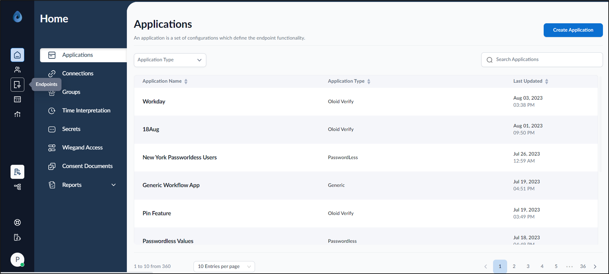
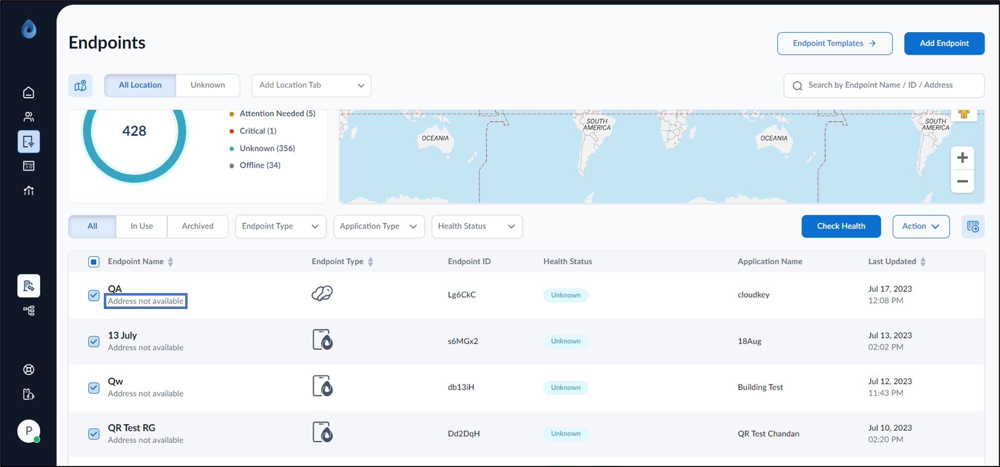
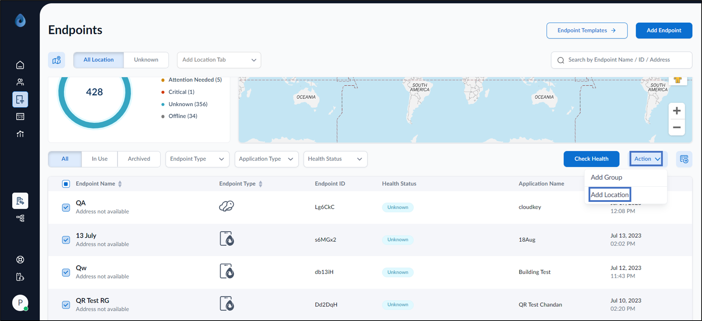
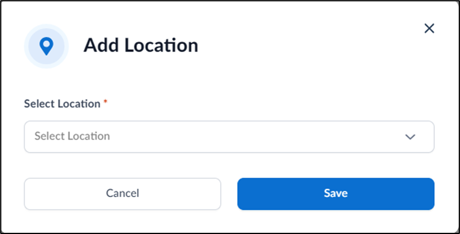
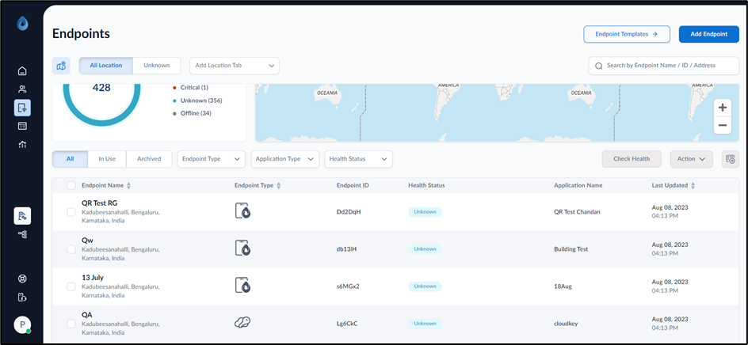

{/* Source: Intercom article 8227618 - https://oloid.help/en/articles/8227618-how-to-add-location-to-endpoints-in-bulk */}
{/* Generated by intercom_to_mintlify.py - re-running overwrites this file. */}

## Pre-requisite

Location must be created on the Location Settings page.

For more information on creating location, see **[How to create a new location and add location details](/platform/tenant-admin-portal/how-to-create-a-new-location-and-add-location-details)**.

### Steps to add location in bulk

1. Log in to the **Oloid Portal**.
2. On the home page of the portal, click **Endpoints** on the left panel menu.

   

   The endpoints page is displayed.
3. Select endpoints whose addresses are not updated.

   

4. Go to **Action** dropdown and select **Add Location**.

   

   The **Add Location** pop-up box is displayed.

   

5. Select appropriate location from **Select Location** dropdown.
6. Click **Save**.
   The location is successfully updated for the selected endpoints.

   

   <Note>
     **Note:** To update the address of a specific endpoint, navigate to the endpoint details page and make the necessary change.
   </Note>
