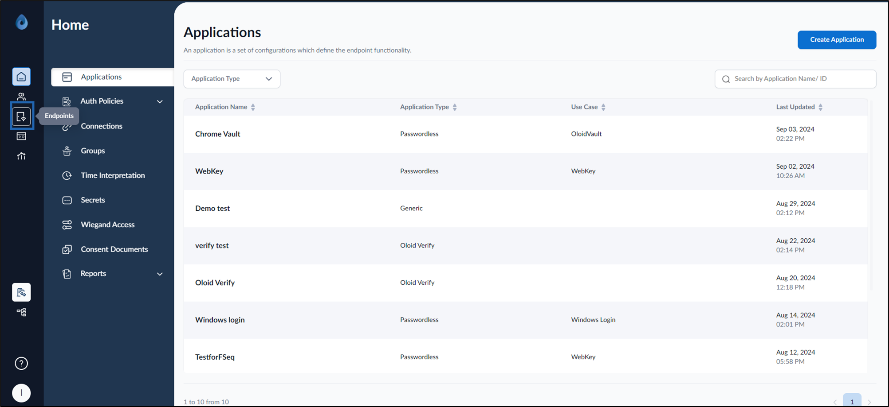
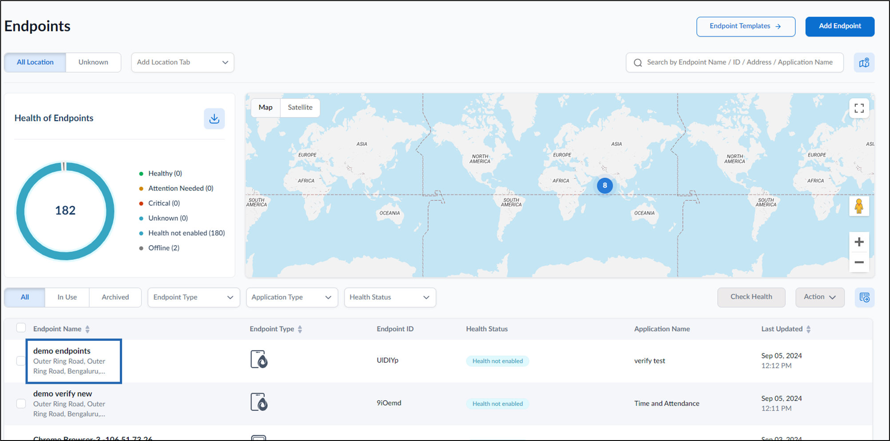
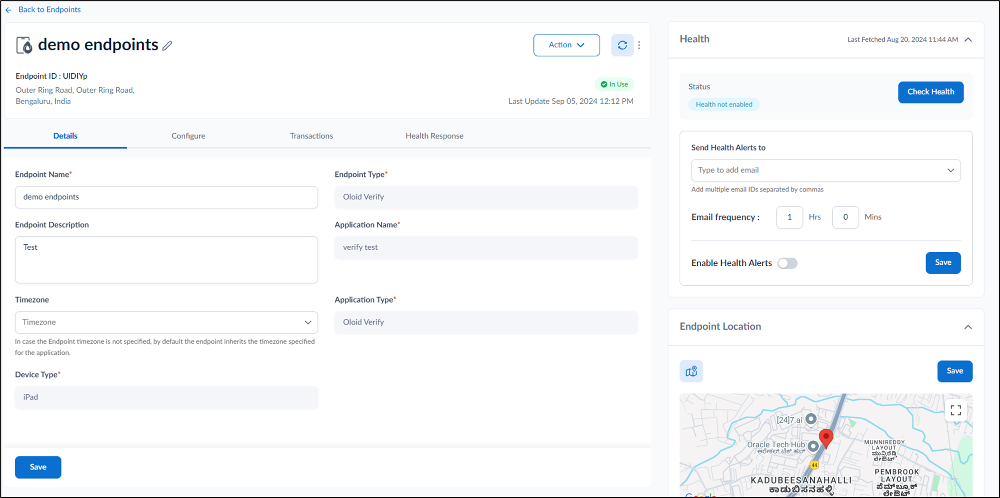
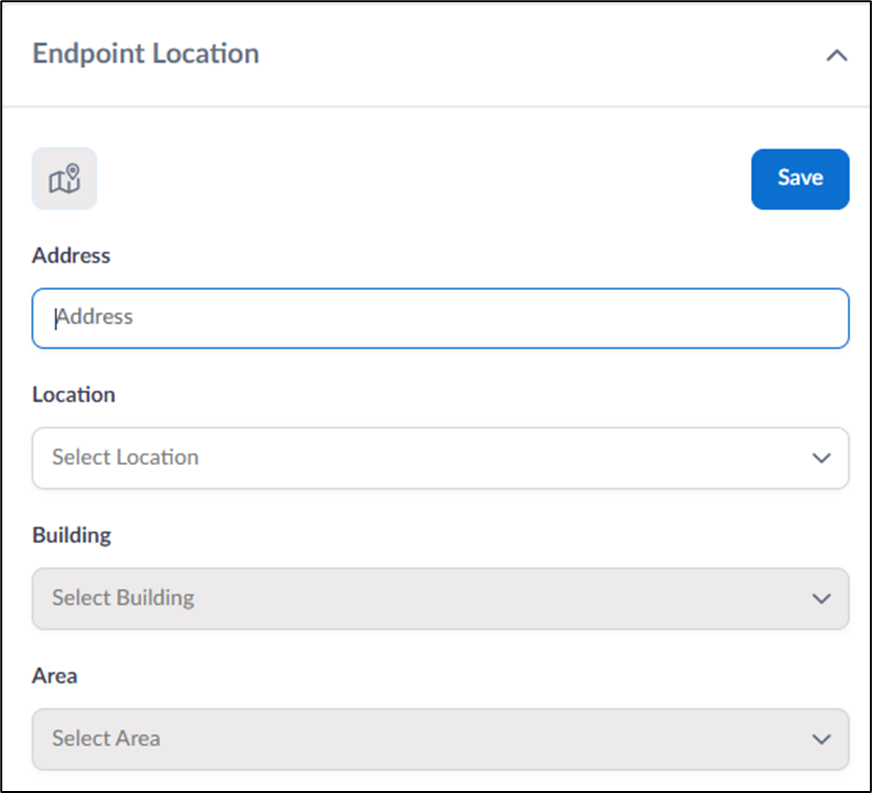
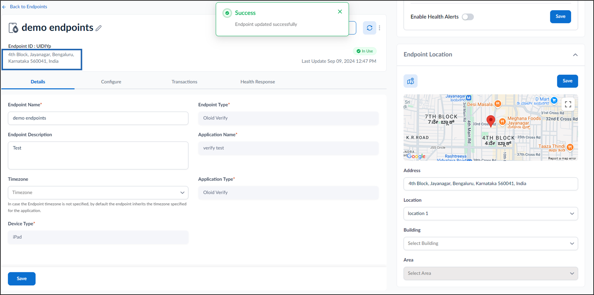

{/* Source: Intercom article 8223212 - https://oloid.help/en/articles/8223212-how-to-add-location-to-the-endpoint */}
{/* Generated by intercom_to_mintlify.py - re-running overwrites this file. */}

Steps to add Location to the Endpoint:

1. Log in to the **Oloid Portal**.
2. On the home page of the portal, click **Endpoints** on the left panel menu.

   

   The **Endpoints** page is displayed.
3. Click **Endpoint name** to edit.

   

   The **Endpoint detail** page is displayed.

   

4. On the bottom right corner, locate **Endpoint Location**.

   

5. Do the following:
   1. Select an **Address** from the dropdown list.

      <Note>
        **Note:** You can also fill in the address field on your own.
      </Note>

   2. Select **Location** from dropdown list.
   3. Select **Building** fromdropdown list.
   4. Select area from **Area** dropdown.
   5. Click **Save**.
      The endpoint address is successfully added to the endpoint detail page.

      
