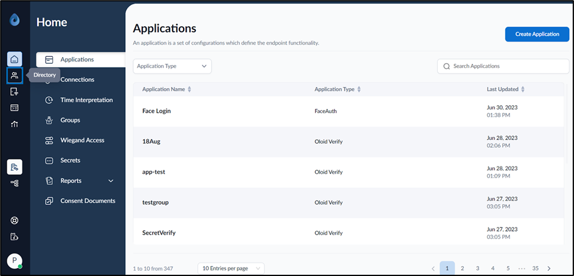
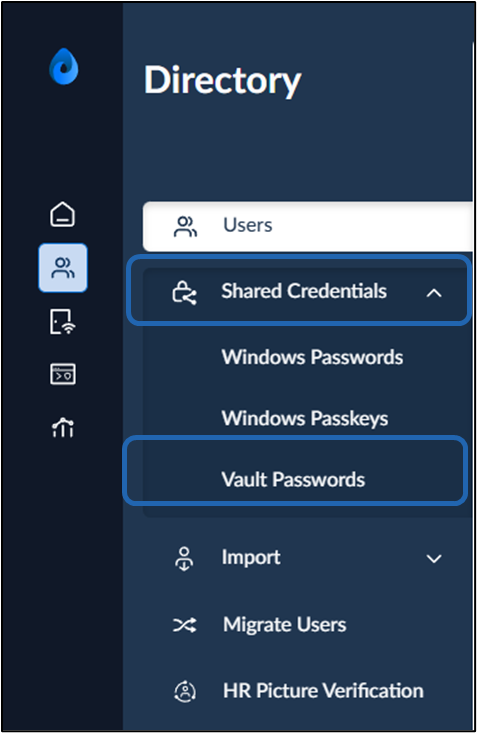
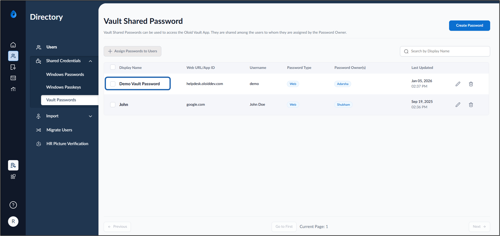
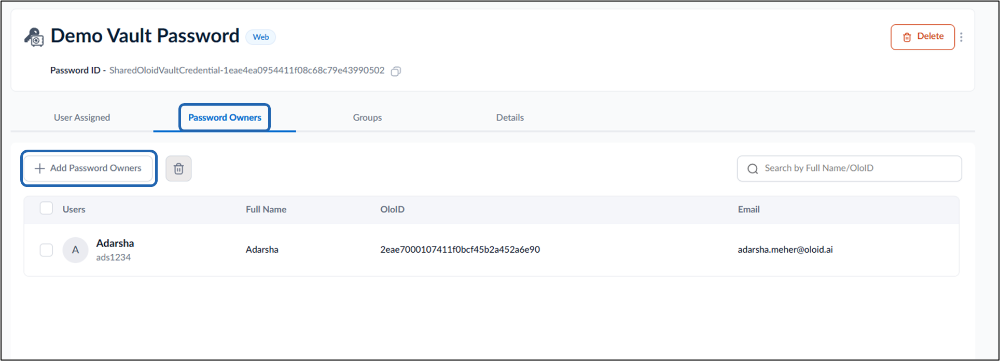
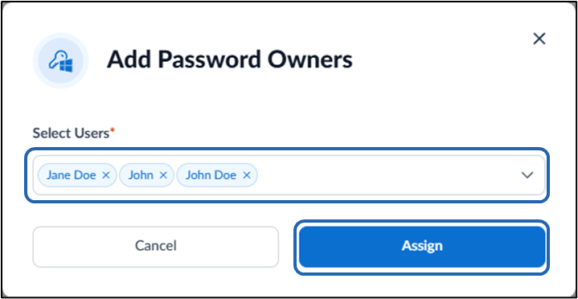
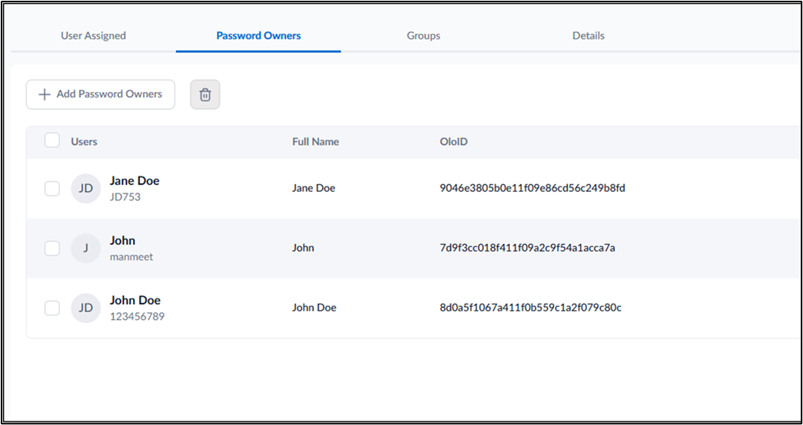

{/* Source: Intercom article 15053825 - https://oloid.help/en/articles/15053825-how-to-add-password-owners-for-vault-shared-password-in-the-tenant-admin-portal */}
{/* Generated by intercom_to_mintlify.py - re-running overwrites this file. */}

## Introduction

Adding **Password Owners** to a Vault Shared Password allows the Tenant Admin to assign specific users with ownership privileges for managing shared credentials.

## Prerequisites

- You must have access to a Tenant Admin account.
- The Vault Shared Password must be created. For more, refer: [Chrome Vault - How to Create Shared Password in the Tenant Admin Portal](/platforms/web/vault/chrome/oloid-vault-chrome-chromium-how-to-create-shared-password-in-the)

## Steps to add Password Owners

1. Log in to the **Tenant Admin Portal**.
2. On the home page of the portal, click **Directory** on the left menu panel.

   

   The **Users** page is displayed.
3. Select **Shared Credentials > Vault Password** on the left menu panel.

   

   The **Vault Shared Password** page is displayed.
4. Select the preferred Vault Shared Password name to edit.

   

5. Go to **Password Owners** tab > **+ Add Password Owners**.

   

   The **Add Password Owners** pop-up box is displayed.
6. On the pop-up box, enter user name(s) in the **Users** dropdown list.

   <Note>
     **Note:** Only users with Admin or Supervisor roles can be assigned as Password Owners.
   </Note>

7. Click **Assign**.

The password owners are successfully assigned.

