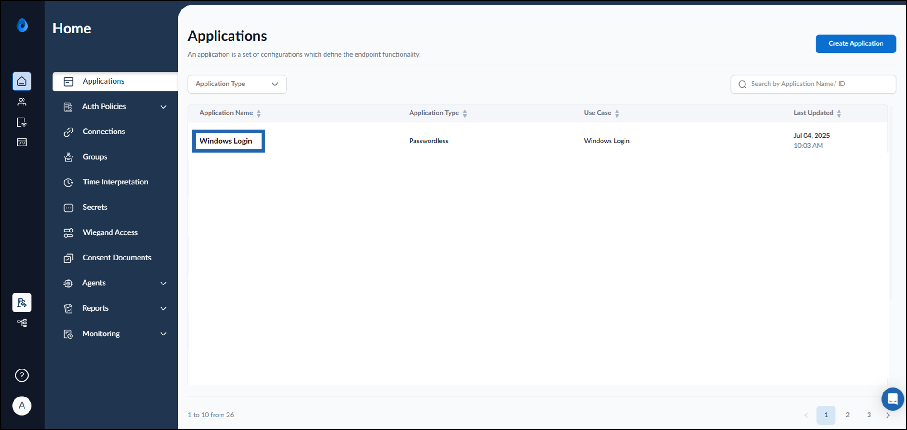
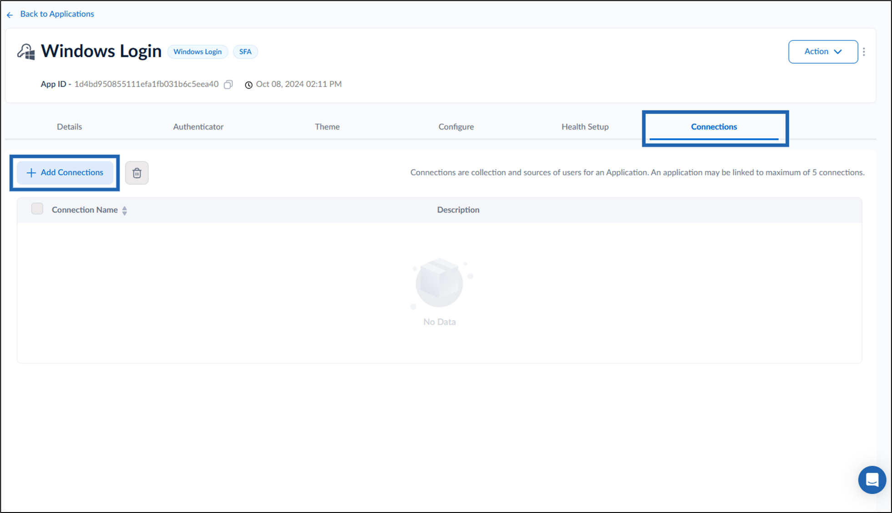
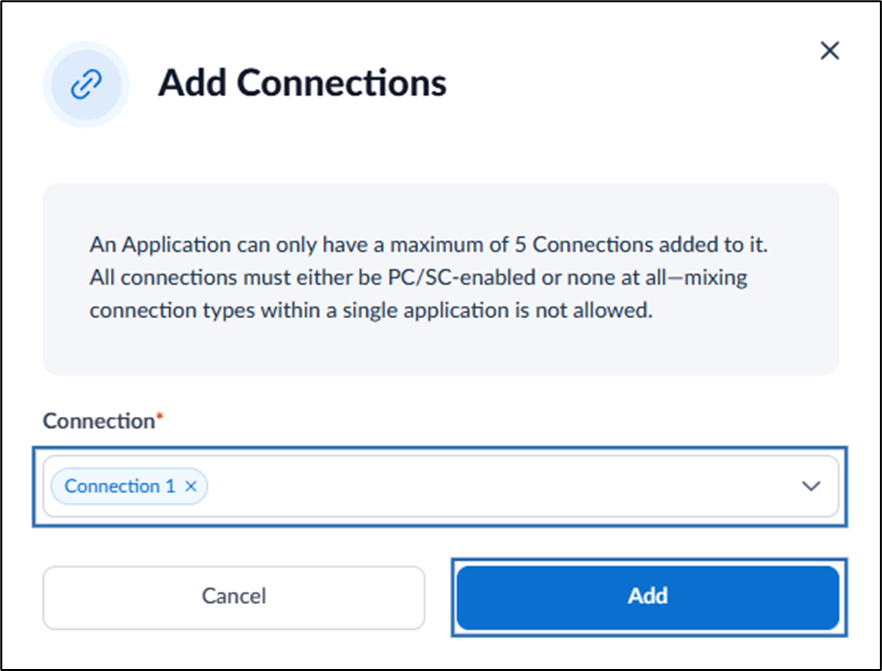
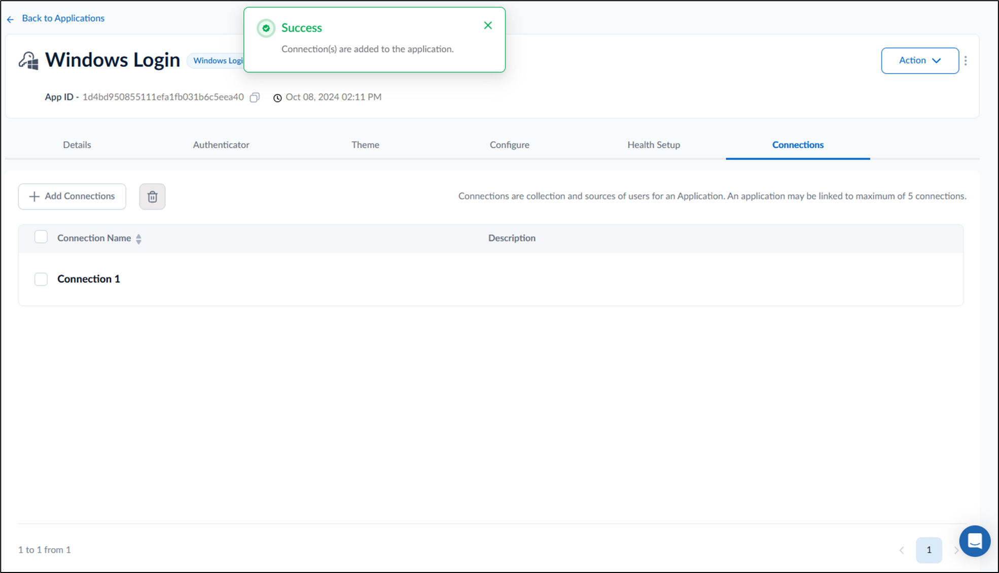

{/* Source: Intercom article 11710522 - https://oloid.help/en/articles/11710522-how-to-add-personal-computer-smart-card-pc-sc-badge-input-enabled-connection-to-the-application-in-the-tenant-admin-portal */}
{/* Generated by intercom_to_mintlify.py - re-running overwrites this file. */}

## Introduction

The Tenant Admin Portal allows administrators to add a PC/SC Badge Input-enabled Connection to an Application. This ensures that the Application can authenticate users through PC/SC-compatible badge readers (e.g., HID cards). Adding the created PC/SC-enabled Connection to the Application enables secure and consistent badge-based authentication.

## Prerequisite

PC/SC Badge input enabled connection must be created. For more details refer [How to create PC/SC Badge Input enabled Connections in the Tenant Admin Portal](/platform/tenant-admin-portal/tenant-admin-portal-how-to-create-personal-computer-smart-card-pc-sc).

## Steps to add PC/SC Badge input enabled Connection

1. Log in to the **Tenant Admin Portal**.
2. On the home page of the portal, click Application name to edit.

   

   The **Application** details page is displayed.
3. Go to **Connection** tab > select **Add Connections**.

   <Note>
     **Note:** Before adding a **PC/SC Badge input enabled connection**, ensure that the connection is already created and listed in the application list. To create a **PC/SC Badge input enabled connection**, refer to this link [How to create PC/SC Badge Input enabled Connections in the Tenant Admin Portal](/platform/tenant-admin-portal/tenant-admin-portal-how-to-create-personal-computer-smart-card-pc-sc).
   </Note>

   

   The **Add Connections** pop-up box is displayed.
4. On the pop-up box, do the following:
   1. Select the preferred **PC/SC Badge input enabled connection** from **Connection** dropdown menu.
   2. Click **Add**.

      <Note>
        **Note:** An application can have a maximum of **5 Connections**. All connections associated with a single application must be of the same type either all **PC/SC Badge input enabled** or all **non-PC/SC Badge input enabled**. Combining different connection types within the same application is not supported.
      </Note>

      

      The **PC/SC enabled connection** is added successfully.

      
