{/* Source: Intercom article 9749330 - https://oloid.help/en/articles/9749330-how-to-add-policy-rules-for-factor-sequencing */}
{/* Generated by intercom_to_mintlify.py - re-running overwrites this file. */}

To add policy rules:

1. Log in to Oloid Portal.
2. Go to **Auth Policies** > **Factor Sequencing**
3. Select the **Factor Sequence Name** to edit.

   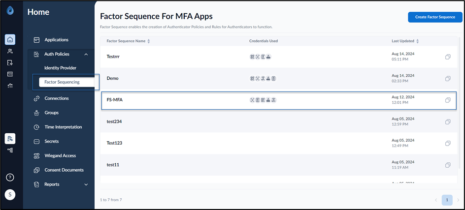

4. Select **Policy Rules** tab.

   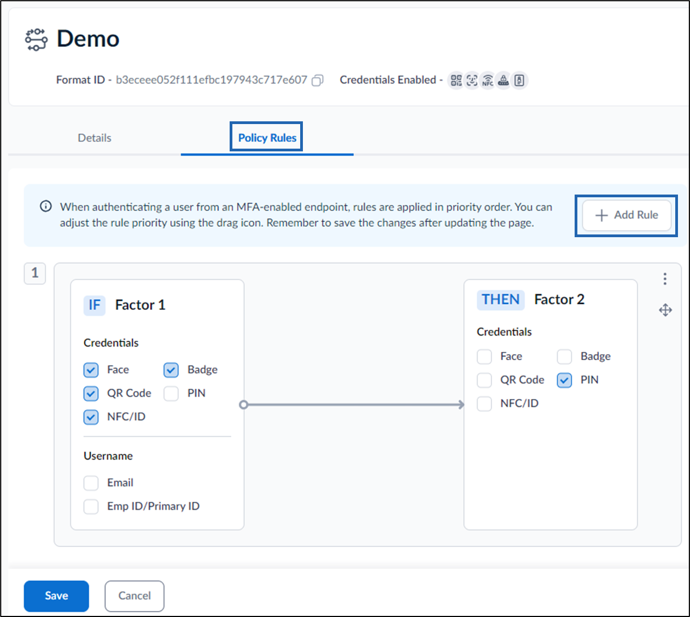

5. Click **Add Rule.**
   The screen to choose factors is displayed.

   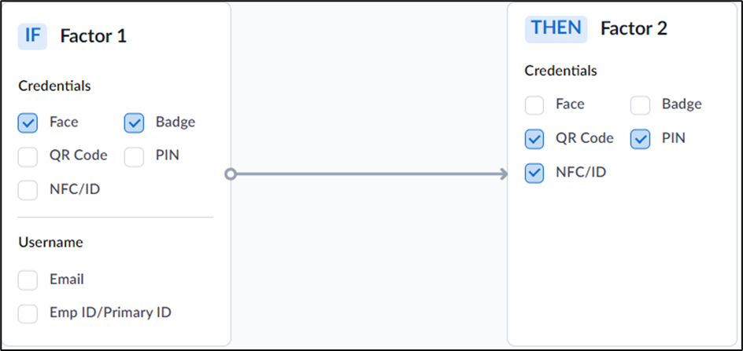

6. Select Factor 1 and Factor 2 credentials for the first rule.

   <Note>
     **Note:** You cannot select same credentials as both Factor 1 and Factor 2.
   </Note>

7. Click **Add Rule** to create next rule.

   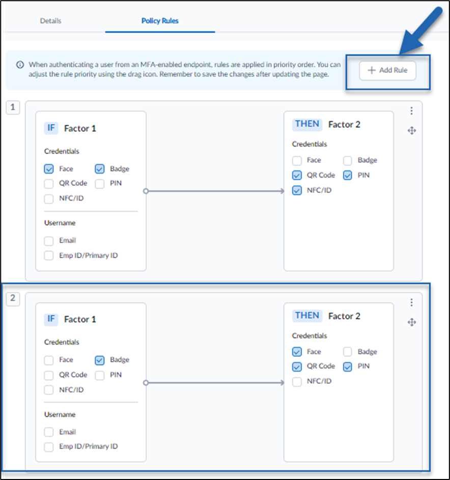

   <Note>
     **Note:** You can create as many rules as per your requirement. The first rule gets the first priority followed by the next rule. You can change the priority using the
   </Note>

   drag and drop functionality.

   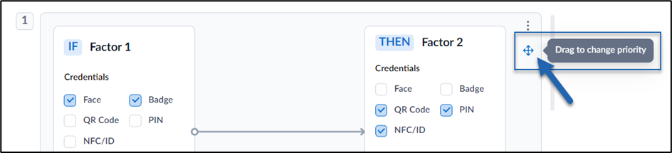

   You may also duplicate or delete the rules using the options.

   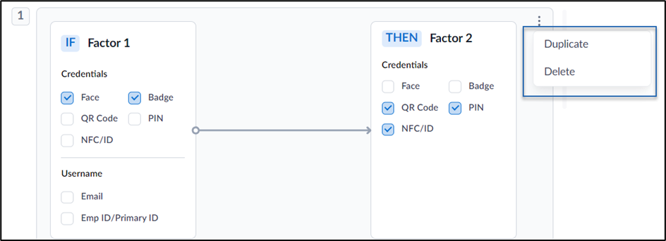

8. Click **Save**.
   The rule(s) are saved. The application follows the set rules for Multi-factor authentication. You can view the below table on how the MFA functions for set rules with factor 1 and factor 2.

|  | Factor 1 | Factor 2 | MFA |
| --- | --- | --- | --- |
| Scenario 1 | Rule 1 : **All credentials** 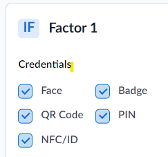 | Rule 1: **No credential** 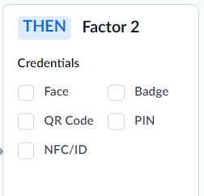 | Application behaves as Single factor authenticator |
| Scenario 2 | Rule 1 : **Face, Badge, QR Code, NFC/ID** 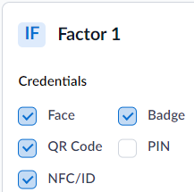 | Rule 1: **PIN** 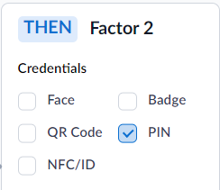 | Face +PIN Badge +PIN QR Code+PIN NFC/ID +PIN |
| Scenario 3 | Rule 1 : **Face, QR Code** 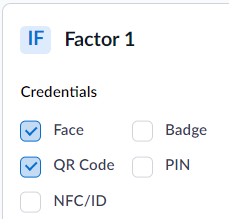 Rule 2: **Badge** 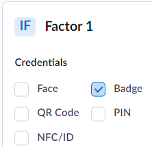 | Rule 1: **PIN**  Rule 2: **QR Code** 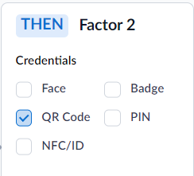 | Face +PIN QR Code +PIN Badge +QR Code |
| Scenario 4 | **No credential** | **All credentials**  | Shows error. First factor cannot be left empty. |
