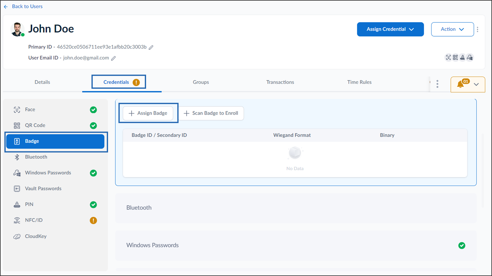
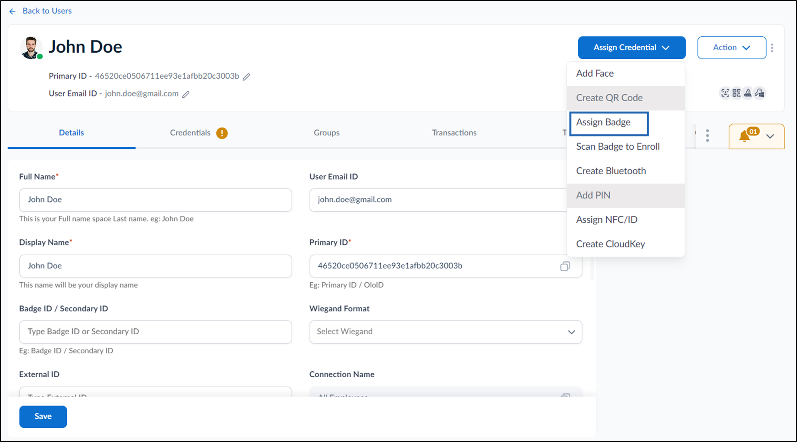
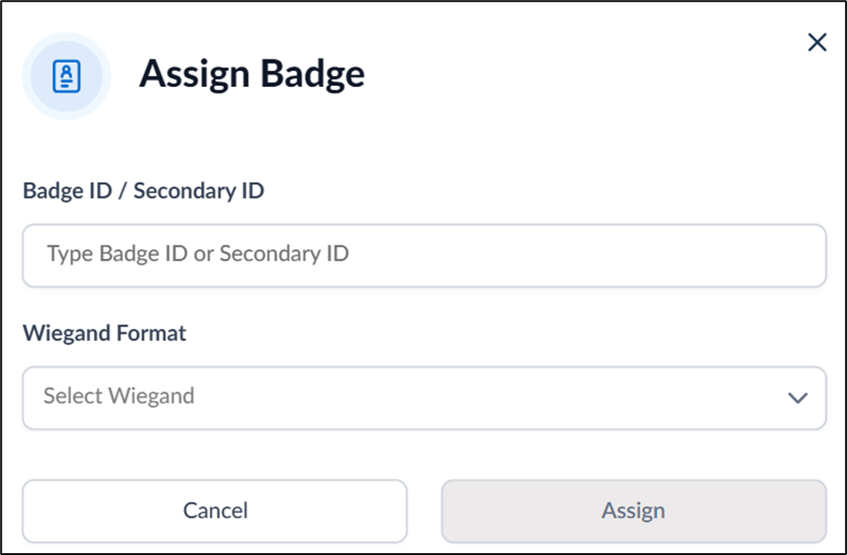
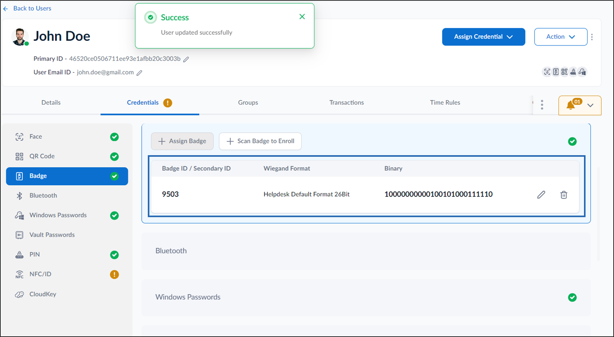

{/* Source: Intercom article 8379462 - https://oloid.help/en/articles/8379462-how-to-assign-badge-id-as-credential-to-users */}
{/* Generated by intercom_to_mintlify.py - re-running overwrites this file. */}

#### Introduction

This document provides step-by-step instructions to assign Badge ID as a credential to users in the Tenant Admin Portal, including how to set the Wiegand format and link the Badge ID to a user’s profile.

#### Steps to assign Badge

1. Log in to the **Tenant Admin Portal**.
2. On the home page of the portal, click **Directory** on the left menu panel.

   

   The **Users** page is displayed.
3. Click user name to edit.

   

   The **user details** page is displayed.

   

4. Do one of the following:
   1. Go to **Credentials** tab > **Badge** > **+ Assign Badge**.

      

   2. Go to **Assign Credential** > **Assign Badge**.

      

      The **Assign Badge** pop-up box is displayed.

      

5. Enter **Badge ID** and select **Wiegand Format**.
6. Click **Assign**.
   The badge ID is assigned and listed on the **Badge** tab.

   

## Video Tutorial

Watch the video [How to assign Badge ID as credential to users in the Tenant Admin Portal - Video Tutorial](/platform/tenant-admin-portal/videos/how-to-assign-badge-id-as-credential-to-users-in-the-tenant-admin)
