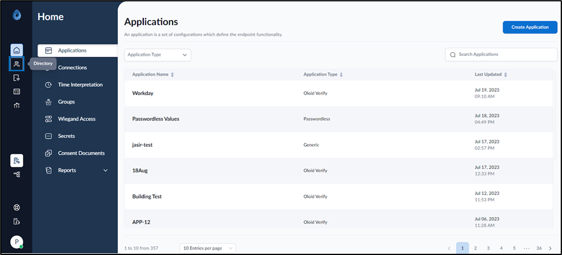
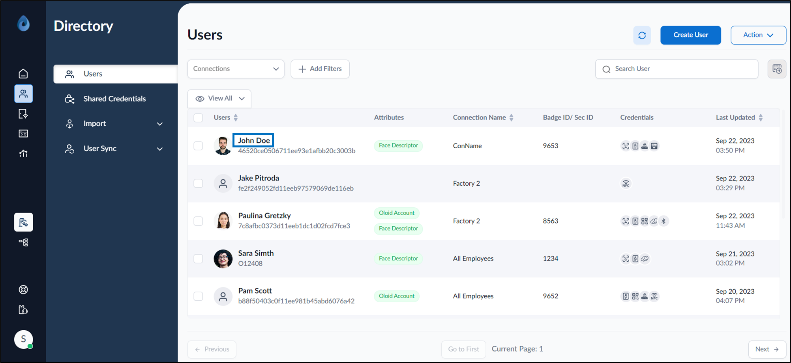
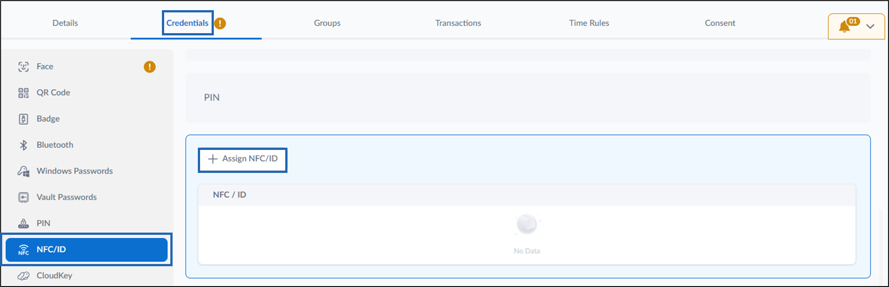
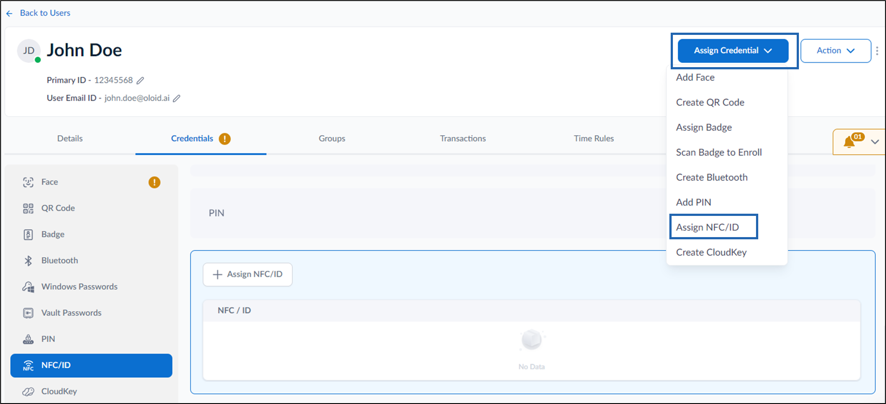
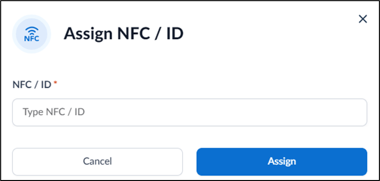
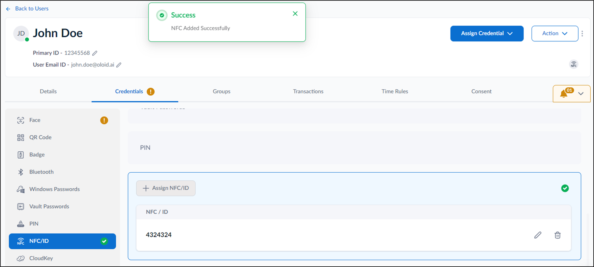

{/* Source: Intercom article 8403103 - https://oloid.help/en/articles/8403103-how-to-assign-nfc-id-as-a-credential-to-the-user */}
{/* Generated by intercom_to_mintlify.py - re-running overwrites this file. */}

Steps to assign NFC/ID:

1. Log in to the **Oloid Portal**.
2. On the home page of the portal, click **Directory** on the left menu panel.

   

   The **Users** page is displayed.
3. Click user name to edit.

   

   The user details page is displayed.

   

4. Do one of the following:
   1. Go to **Credentials** > **NFC/ID** tab> **+ Assign NFC/ID**.

      

   2. Go to **Assign Credential** > **Assign NFC/ID**.

      

      The **Assign Badge** pop-up box is displayed.

      

5. On the pop-up box, do the following:
   1. Enter your unique **NFC/ID** security number.

      <Note>
        **Note:** You can tap the **NFC/ID** tag on the **Reader** to scan it.
      </Note>

   2. Click **Assign**.
      The NFC/ID security number is assigned and listed on the **NFC/ID** tab.

      
