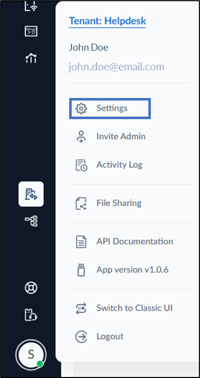
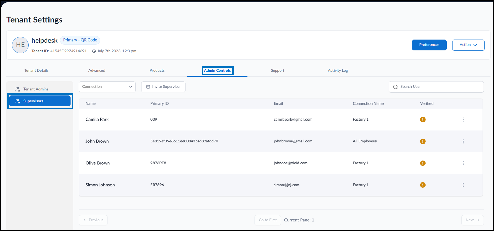
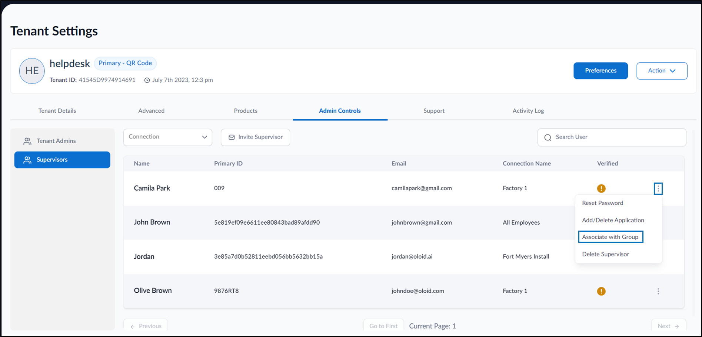
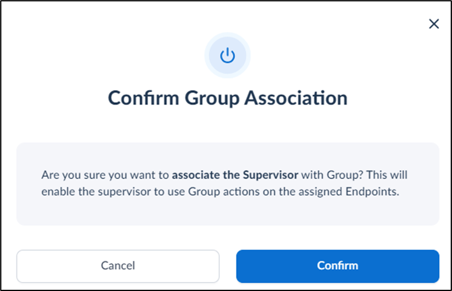

{/* Source: Intercom article 8836666 - https://oloid.help/en/articles/8836666-how-to-associate-group-with-supervisor */}
{/* Generated by intercom_to_mintlify.py - re-running overwrites this file. */}

Steps to associate group with Supervisor:

1. Log in to the **Oloid Portal**.
2. On the homepage of the portal, click **user profile icon** on the bottom left corner of the menu panel.

   

   The user profile menu is displayed.
3. Click **Settings**.

   

   The **Tenant Settings** page is displayed.
4. Go to **Admin Controls** > **Supervisors**.

   

5. Click **kebab menu** (three vertical dots) and select **Associate with Group** for a supervisor.

   

   The **Confirm Group Association** pop-up box is displayed.

   

6. Click **Confirm**.
   Now, the supervisor can view the users associated with the group and perform required actions on the assigned endpoints.
