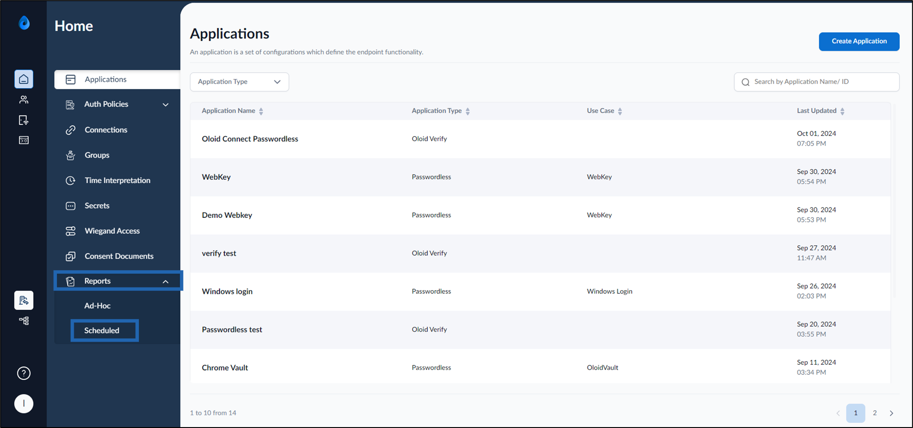
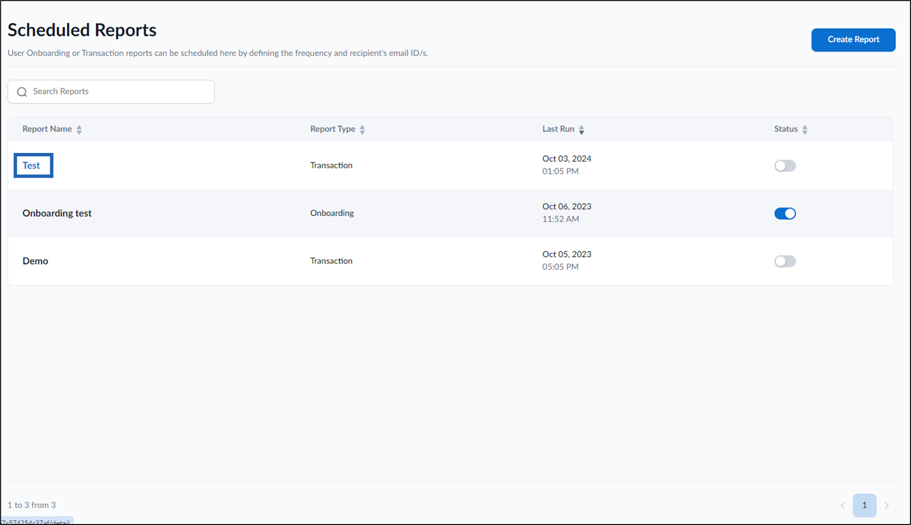
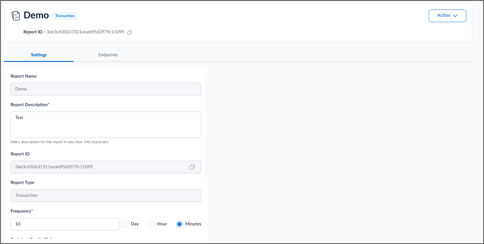
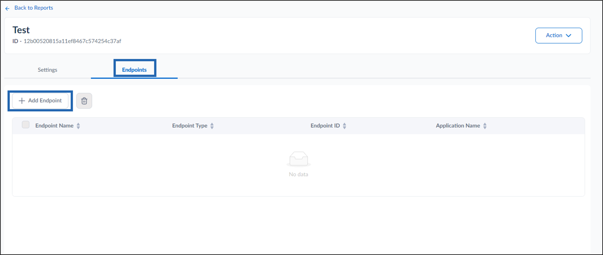
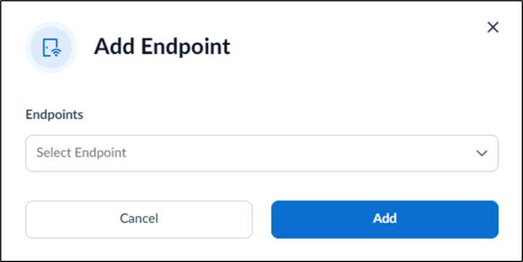
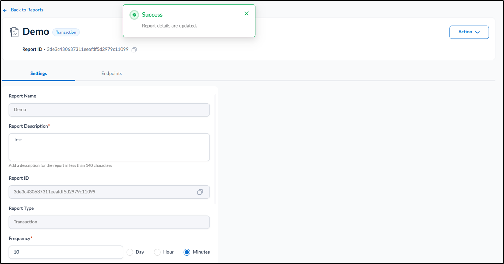
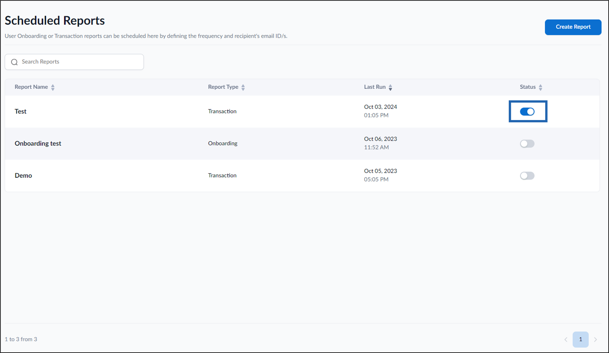

{/* Source: Intercom article 8455213 - https://oloid.help/en/articles/8455213-how-to-configure-a-scheduled-transaction-report */}
{/* Generated by intercom_to_mintlify.py - re-running overwrites this file. */}

## Introduction

A Scheduled Transaction Report can be configured to schedule the report generation frequency and send it to the customers through email.

## Prerequisite

- You must have a Tenant Admin account.
- The Scheduled Transaction Report must be created. Refer: **[How to create a scheduled Transaction Report](/platform/tenant-admin-portal/tenant-admin-portal-how-to-create-a-scheduled-transaction-report)**

## Steps to configure Scheduled Transaction Report

1. Log in to the **Tenant Admin Portal**.
2. On the homepage, click **Reports > Scheduled** on the left menu panel.

   

   The **Scheduled Reports** page is displayed.
3. Select a report name of transaction **Report Type** to edit.

   

   The report type detail page is displayed.

   

4. Do the following:
   1. **Settings** tab:
      1. Enter **Report Description**.
      2. Enter time unit for **Frequency**.
      3. Select a supported frequency: **Day**, **Hour**, **Minutes**.
      4. Enter **Recipient Emails**.
   2. **Endpoints** tab:
      1. Click **+ Add Endpoint**.

         

         The **Add Endpoint** pop-up box is displayed
      2. Select **Endpoint**(s) to send transaction reports to the recipient emails.

         <Note>
           **Note:** Multiple endpoints can be added from the dropdown.
         </Note>

      3. Click **Add**.

         

5. Click **Save**.
   The transaction report is configured.

   

On the **Scheduled Reports** page, turn on the **Status** option to send scheduled transaction reports to the specified email address(es) of recipients.

