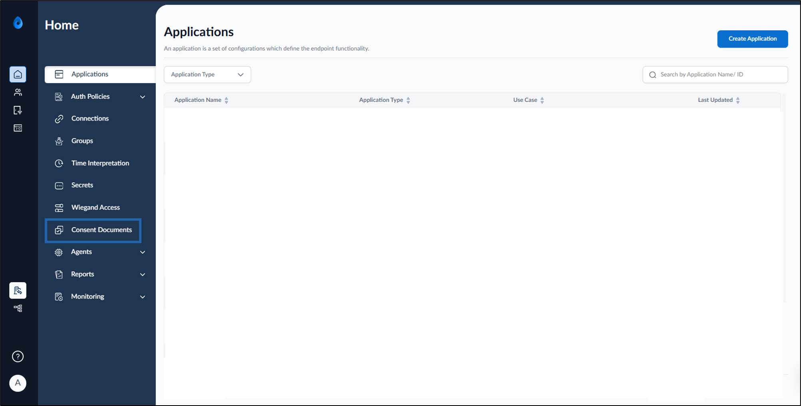
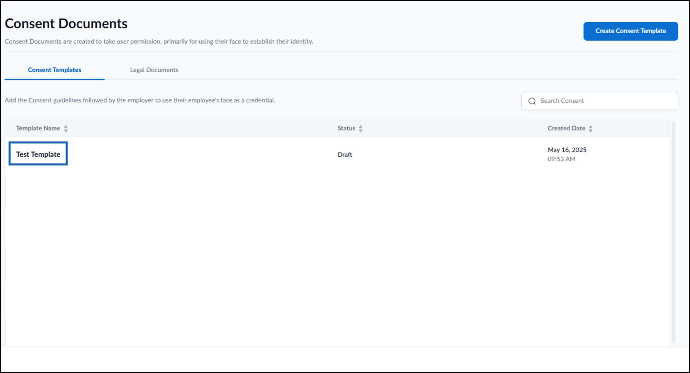
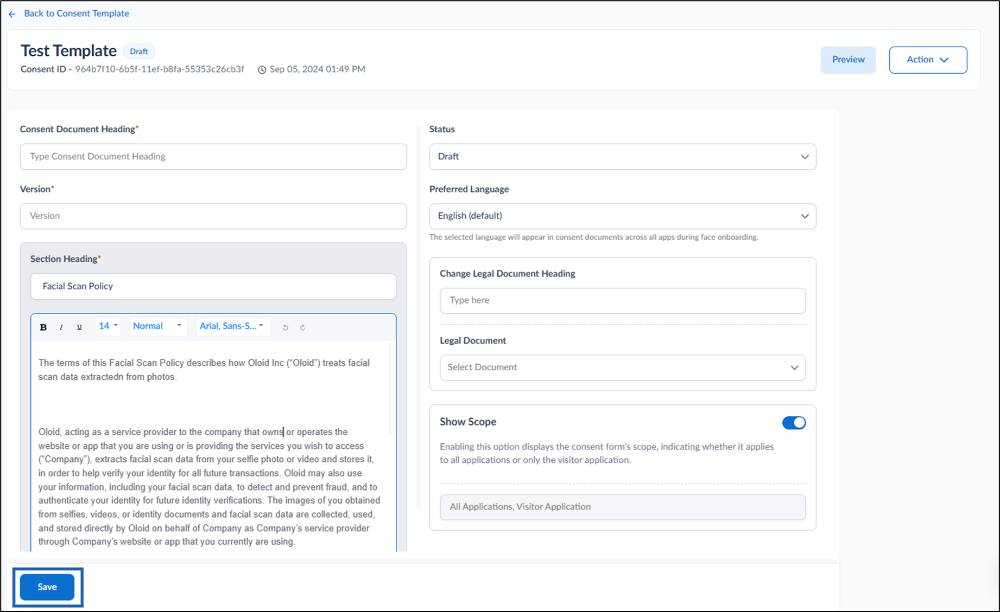
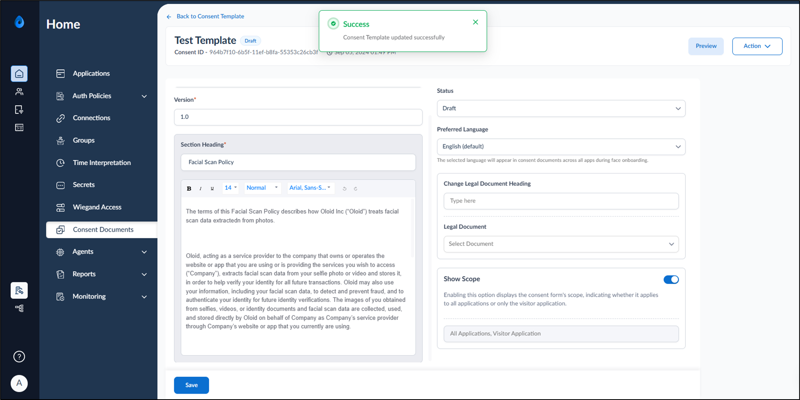

{/* Source: Intercom article 8329629 - https://oloid.help/en/articles/8329629-how-to-configure-consent-template-for-user-face-onboarding-in-the-tenant-admin-portal */}
{/* Generated by intercom_to_mintlify.py - re-running overwrites this file. */}

## Introduction

The Tenant Admin Portal allows admins to configure Consent Templates for user face onboarding, which define the way consent information is presented to users for acknowledgment.

## Prerequisite

- You must have a Tenant Admin account
- You must create a Consent Template. To create Consent Template refer [How to create a consent template](/platform/tenant-admin-portal/tenant-admin-portal-how-to-create-and-configure-consent-template).

## Steps to configure Consent Template

1. Log in to the **Tenant Admin Portal**.
2. On the home page of the portal, click **Consent Documents** on the left panel menu.

   

   The **Consent Documents** page is displayed.
3. Click **Template Name** to edit.

   

   The template detail page is displayed.
4. On the template detail page, do the following:
   1. Enter **Consent Document Heading**.
   2. Edit **Version** number.
   3. Edit **Section Heading**.
   4. Edit **Consent Description**.
   5. Select template status from **Status** dropdown.
   6. Select language from **Preferred Language** dropdown.

      <Note>
        **Note:** The selected language will appear in consent documents across all apps during face onboarding.
      </Note>

   7. Change **Legal Document Heading**. (optional)
   8. Select legal document(s) from **Legal Document** dropdownlist.

      <Note>
        **Note:** If unavailable, click **Create Legal Document** to upload a new legal document. Refer **[How to create Legal Document](/platform/tenant-admin-portal/tenant-admin-portal-how-to-create-legal-document)**.
      </Note>

   9. Enable **Show Scope** toggle.

      <Note>
        **Note:** Enabling this toggle displays the consent form's scope, indicating whether it applies to all applications or only the visitor application.
      </Note>

   10. Click **Save**.

The Consent Template is configured successfully.

