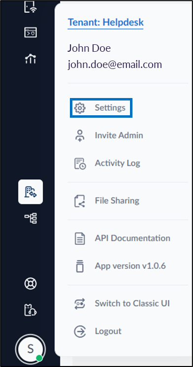
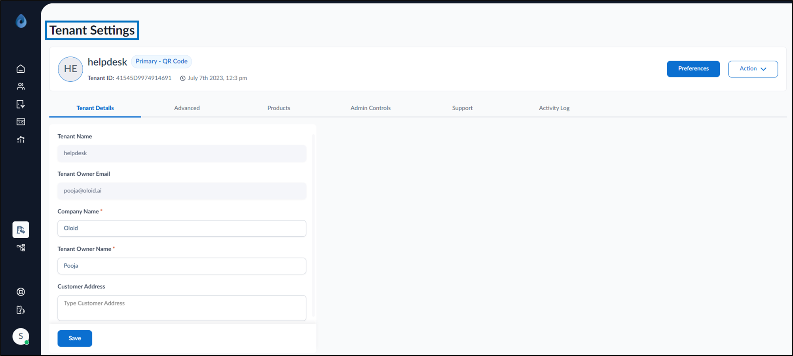
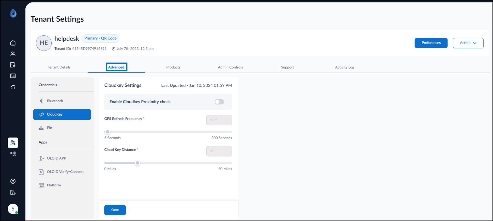
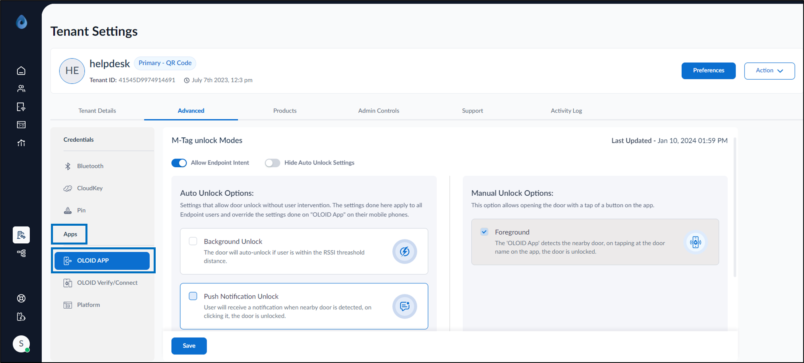

{/* Source: Intercom article 8804661 - https://oloid.help/en/articles/8804661-how-to-configure-oloid-app */}
{/* Generated by intercom_to_mintlify.py - re-running overwrites this file. */}

To configure Oloid app follow the below steps:

1. Log in to the **Oloid Portal**.
2. On the homepage of the portal, click **user profile icon** on the bottom left corner of the menu panel.

   

   The user profile menu is displayed.
3. Select **Settings**.

   

   The **Tenant Settings** page is displayed.

   

4. Go to **Advanced** tab and do the following:

   

   1. Under **Apps** section select **OLOID APP**.

      

      The **M-Tag unlock Modes** page is displayed.
   2. Enable **Allow Endpoint Intent** to use the Oloid app in the background mode.
   3. Disable **Hide Auto Unlock Settings** to select preferred modes of auto unlock options in the Oloid app.

      <Note>
        **Note:** The user can select an option from the available choices. You can also enable **Hide Auto Unlock Settings** to hide the auto unlock options from the Oloid app.
      </Note>

   4. **Manual Unlock Options**: The default value is preconfigured.
5. Click **Save**.
   The OLOID app is set up for background mode and is ready to use.
