{/* Source: Intercom article 12838654 - https://oloid.help/en/articles/12838654-how-to-configure-security-assertion-markup-language-saml-idp-in-okta-admin-console */}
{/* Generated by intercom_to_mintlify.py - re-running overwrites this file. */}

## Introduction

This document explains how to configure Security Assertion Markup Language (SAML) as an Identity Provider (IdP) using **Okta** for Oloid application. The configuration involves creating a SAML IdP in the Okta Admin Console and configuring Oloid application with the SAML.

## Prerequisites

- You must have Admin access to the Okta Admin Console.
- Ensure Webkey application is created. To create Webkey application, refer [How to create and configure WebKey Application in Tenant Admin Portal](/platforms/web/webkey/webkey-how-to-create-and-configure-a-webkey-application-in-tenant).
- Ensure the SAML IDP application is created. To create SAML application, refer [How to Create IDP Profile for Security Assertion Markup Language (SAML) in the Tenant Admin Portal](/platform/tenant-admin-portal/tenant-admin-portal-how-to-create-idp-profile-for-security-assertion).

## Steps to Add Identity Provider

1. On the home page of the Okta Admin Console, go to **Security** > **Identity Providers**.

   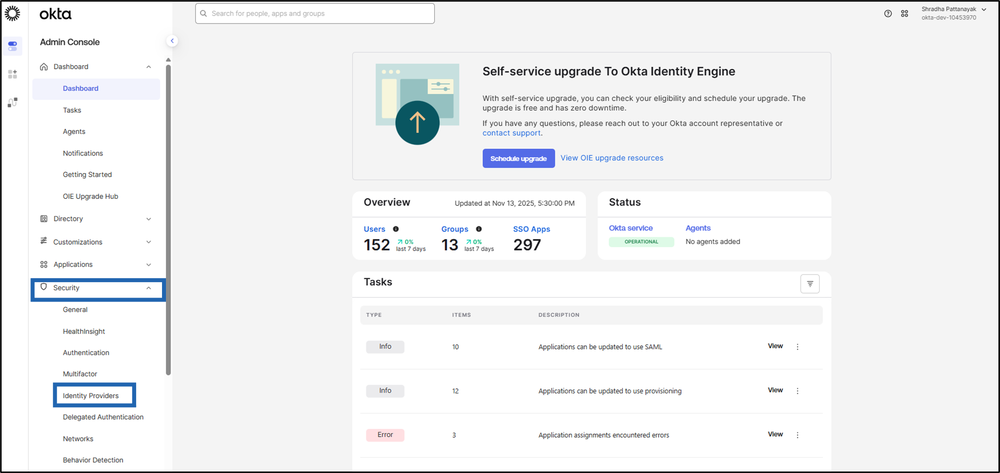

   Identity Providers page is displayed.
2. Click **Add Identity provider**.

   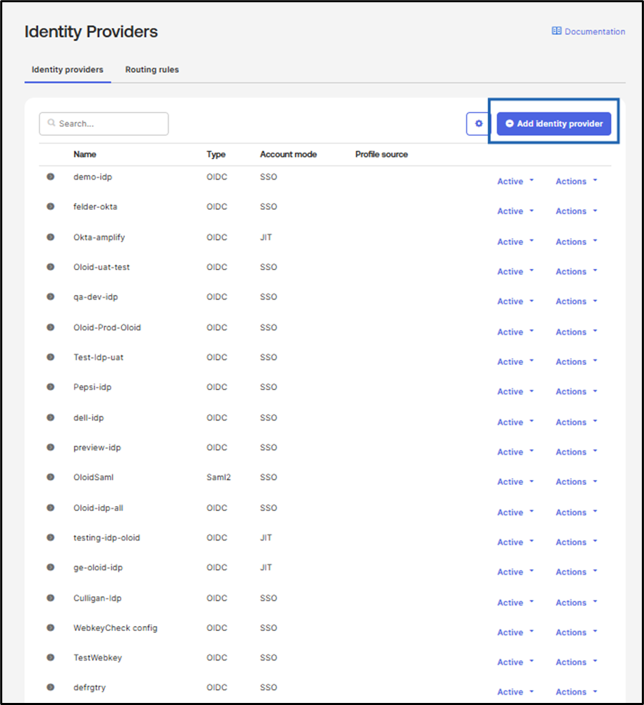

   The identity provider list is displayed.
3. Select **SAML** and click **Next**.

   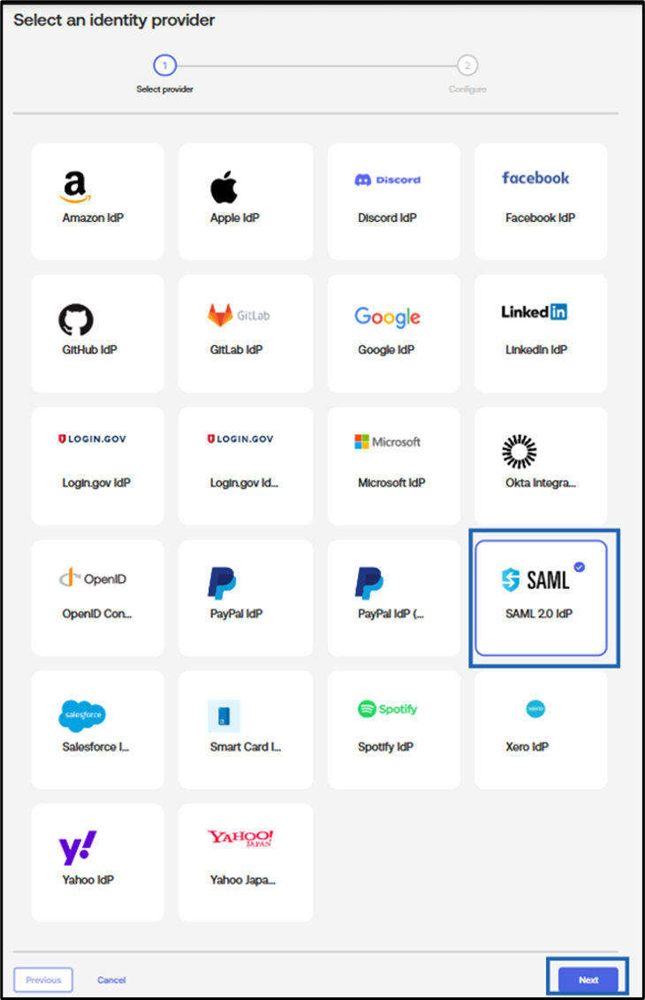

   The **Configure SAML 2.0 IdP** popup box is displayed.
4. Do the following:
   1. Under **General settings** section, enter **Name** for the Identity Provider configuration.

      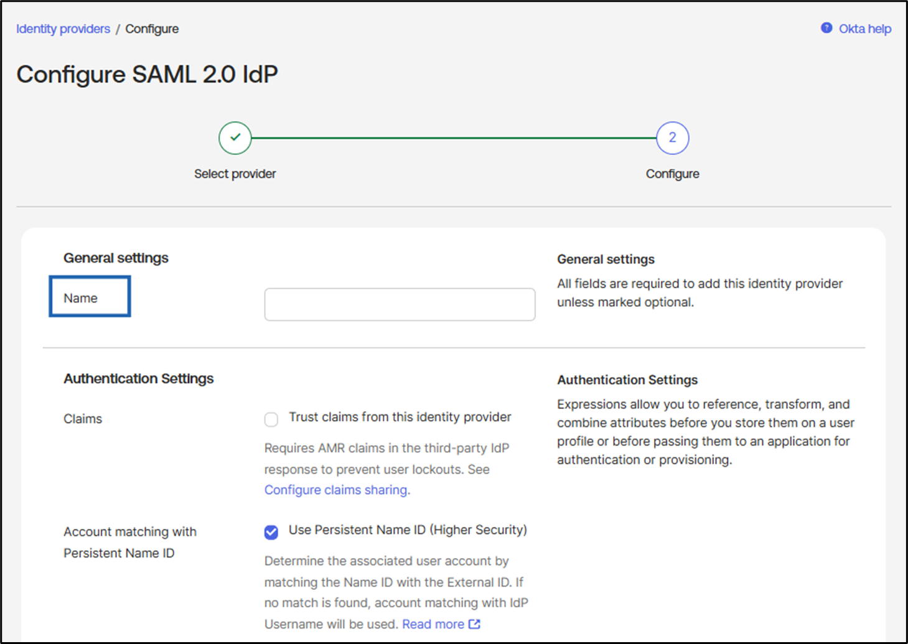

   2. Under **Account matching with IdP Username** section:
      1. Select the **IdP username** from the dropdown list**.**

         <Note>
           **Note:** It is recommended to select **idpuser.subjectNameId** in the idP username field.
         </Note>

      2. Select **Enable automatic linking** in **Account link policy** to allow Okta to automatically link the IdP user to an existing Okta user account.
      3. In the **If no match is found** section, select **Redirect to Okta Sign-in page**.

         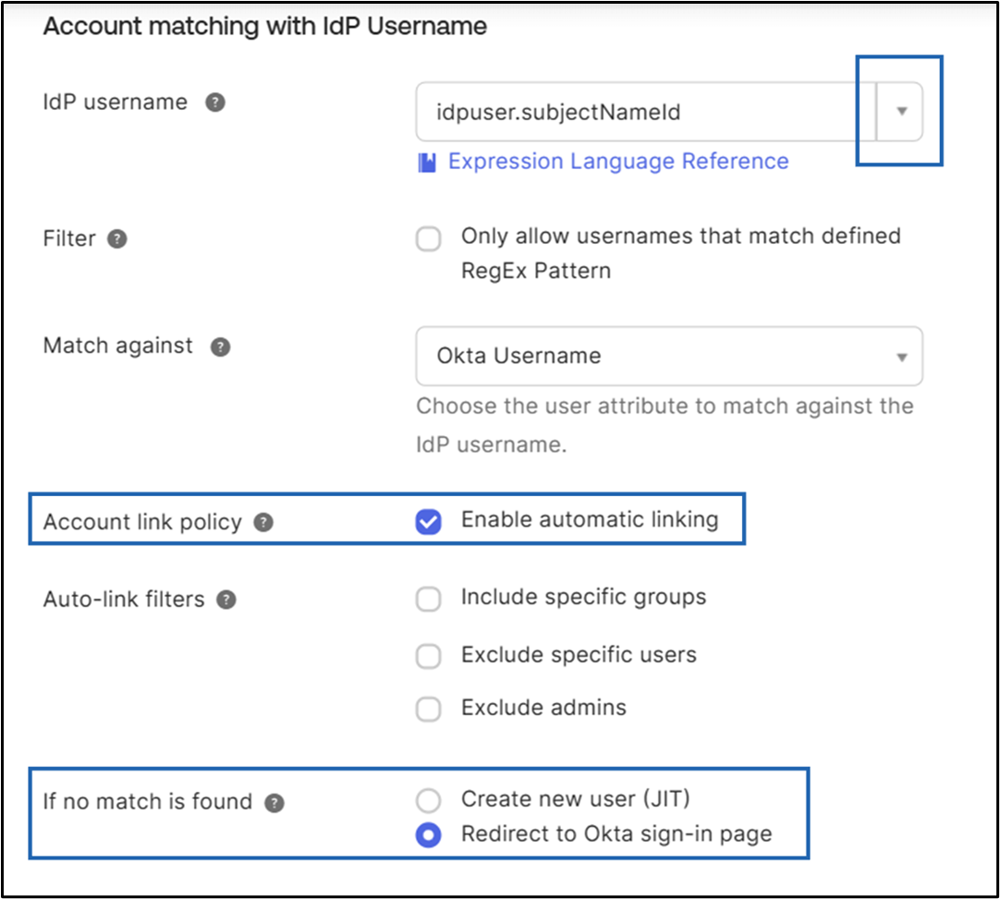

5. Under **SAML Protocol Settings** sections:
   1. Enter the **IdP Issuer URL**.
      See **Tenant Admin Portal > Identity Provider > SAML Application > Oloid Metadata** tab and copy **Entity ID**.
   2. Enter the **IdP Single Sign-On URL**.
      See **Tenant Admin Portal > Identity Provider > SAML Application > Oloid Metadata** tab and copy **Sign-on URL**.
   3. Upload the **IdP Signature Certificate**.
      To download, go to **Tenant Admin Portal > Identity Provider > SAML Application > Oloid Metadata** tab and select **Download Certificate**.
   4. Request Signature, **Unselect** the **Sign SAML Authentication Request**.
   5. Select Response in Response Signature Verification.
   6. Click **Finish**.

      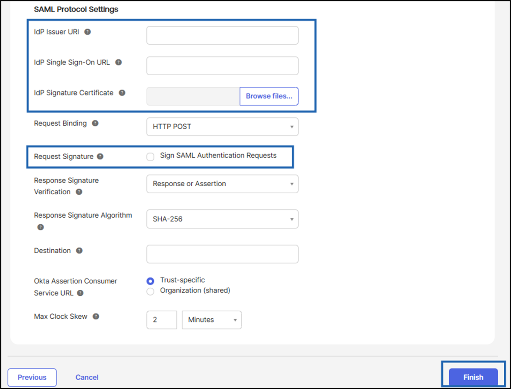

      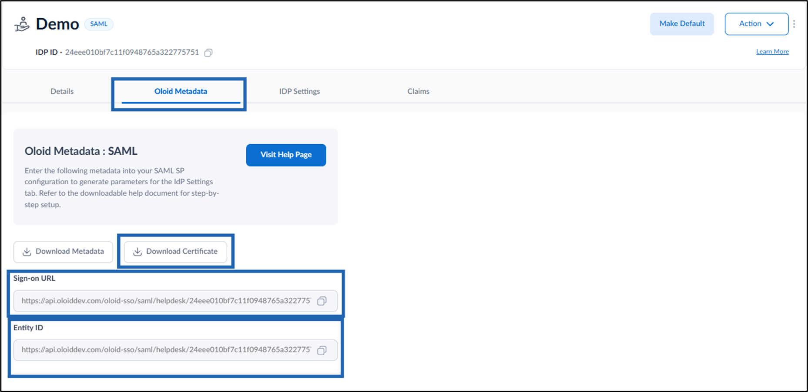

      IDP created successfully and listed under **Security** > **Identity Providers.**

      <Note>
        **Note:** In the search bar, you can search using identity provider name.
      </Note>

      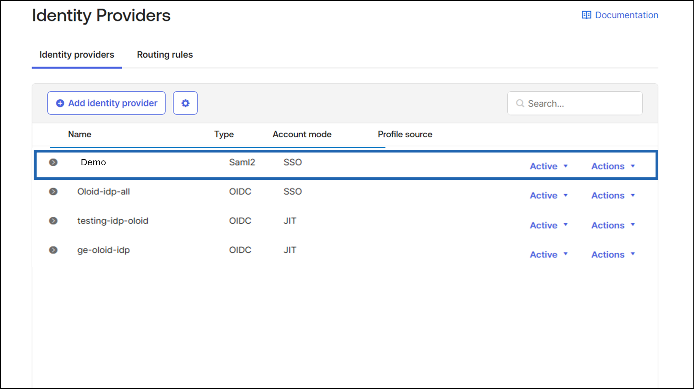

6. Go to IDP details and do the following:
   1. Download the Metadata file and upload it in the Metadata field under **Tenant Admin Portal > Identity Provider > SAML Application > IDP Settings > Metadata.**
      OR
   2. Copy **IDP ID** and enter it in **Tenant Admin Portal > Identity Provider > SAML Application > IDP Settings > Entity ID**.
   3. Copy **Assertion Consumer Service URL** and enter it in **Tenant Admin Portal > Identity Provider > SAML Application > IDP Settings > ACS URL**.

      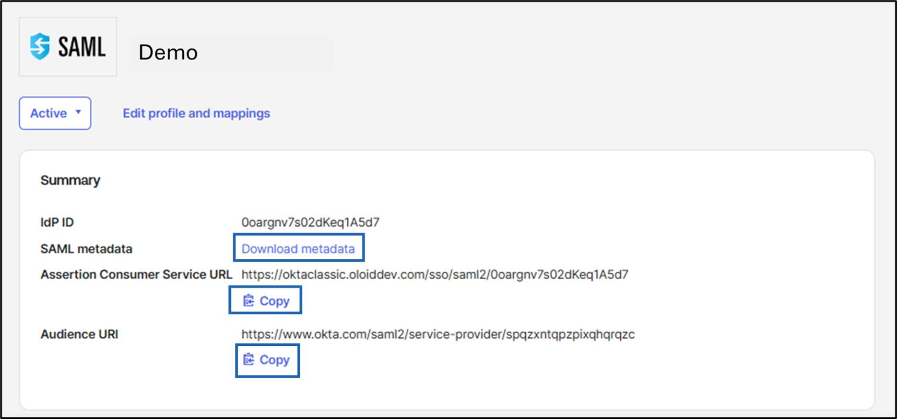

      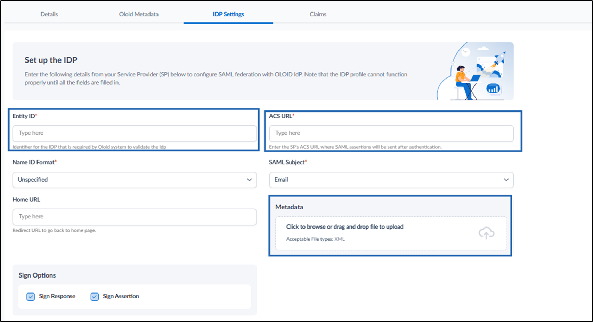

## Add Routing Rules

### Steps to add Routing Rules

1. In the Okta Admin Console, on Identity Providers Screen, go to **Routing rules >** Click **Add Routing Rule.**

   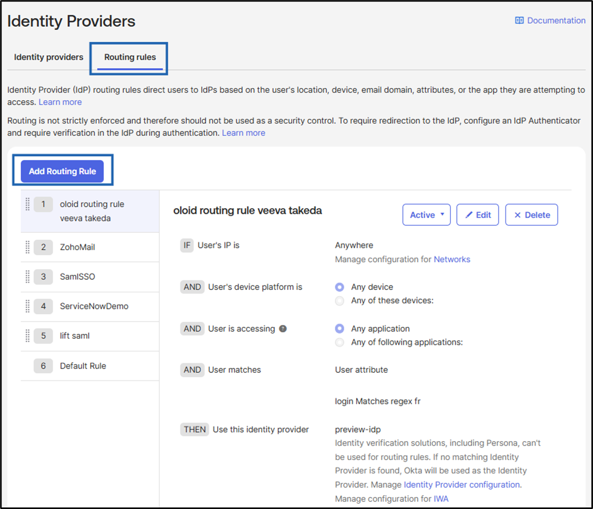

   The Add Rule pop-up box is displayed.
2. Do the following:
   1. Enter **Rule Name.**
   2. Select **User matches** from the Dropdown list.

      <Note>
        **Note:** Select **Regex on Login and enter the mail.**
      </Note>

   3. Select **Use this Identity provider** from the drop-down list.

      <Note>
        **Note:** Select the Identity Provider added in **Step 1**.
      </Note>

   4. Click **Create rule**.

      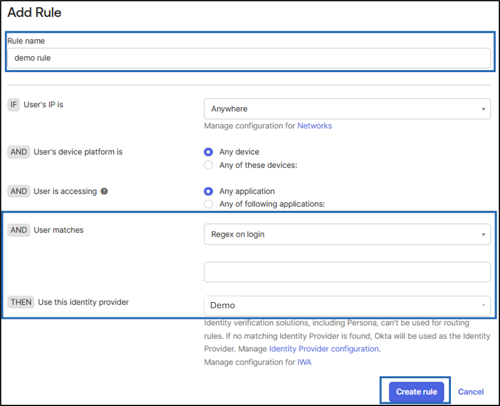

      The rule is created successfully and added on the Routing Rule list.

      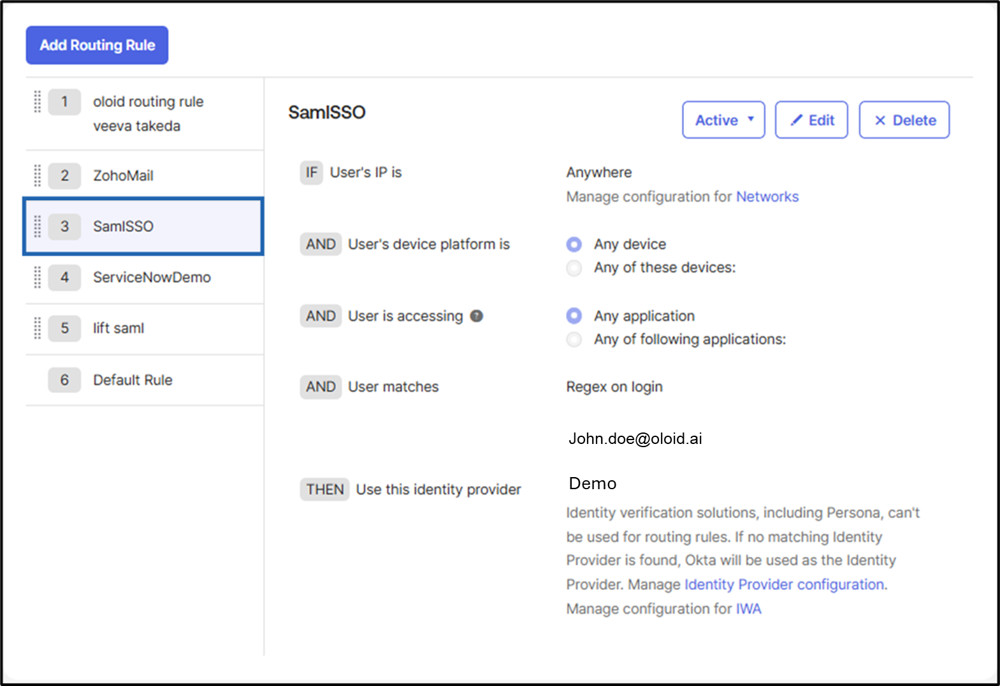

3. Configure the IDP Profile in the Tenant Admin Portal.
   1. On the homepage of the portal, select the preferred IDP to edit.
   2. On the IDP details page, select the WebKey Application from **Select WebKey Application** dropdown.
   3. Click **Save**.

      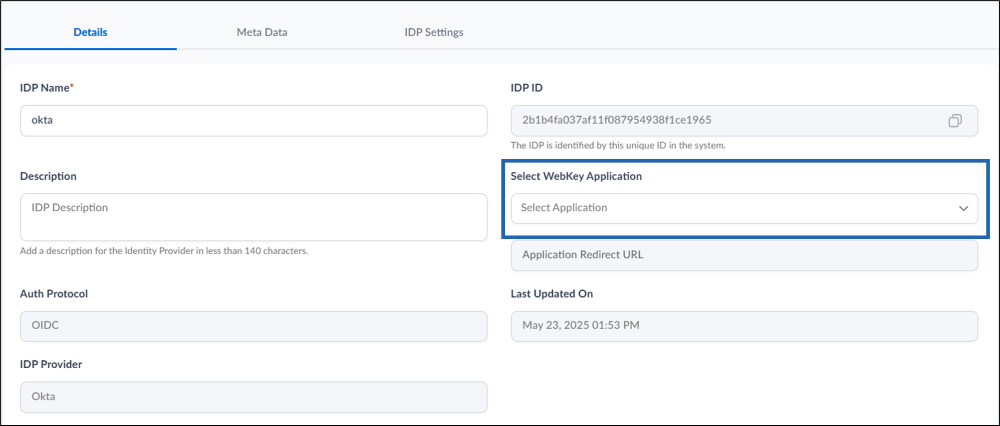

---

##### Related Articles

[How to Configure Security Assertion Markup Language (SAML) - Okta IDP Profile in the Tenant Admin Portal](/platform/tenant-admin-portal/tenant-admin-portal-how-to-configure-security-assertion-markup)
