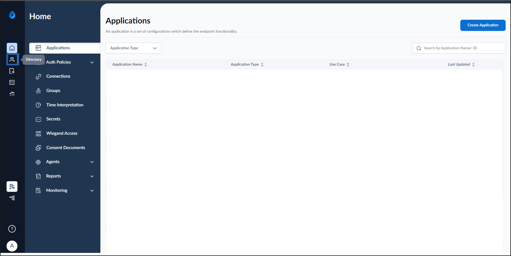
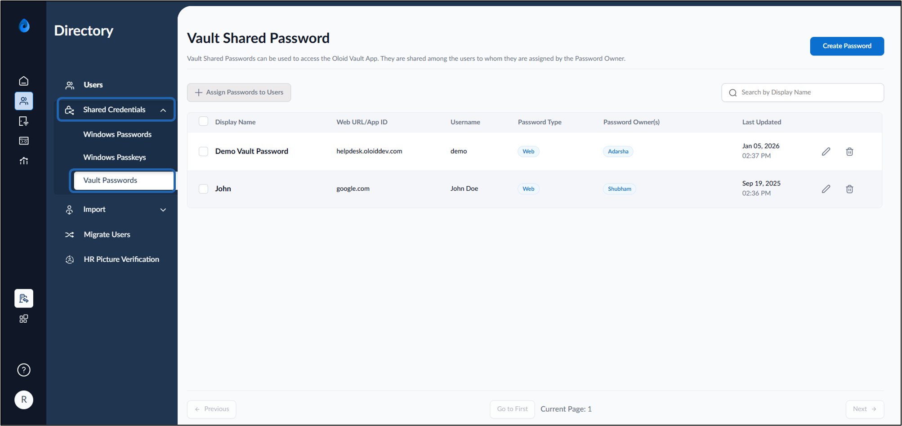
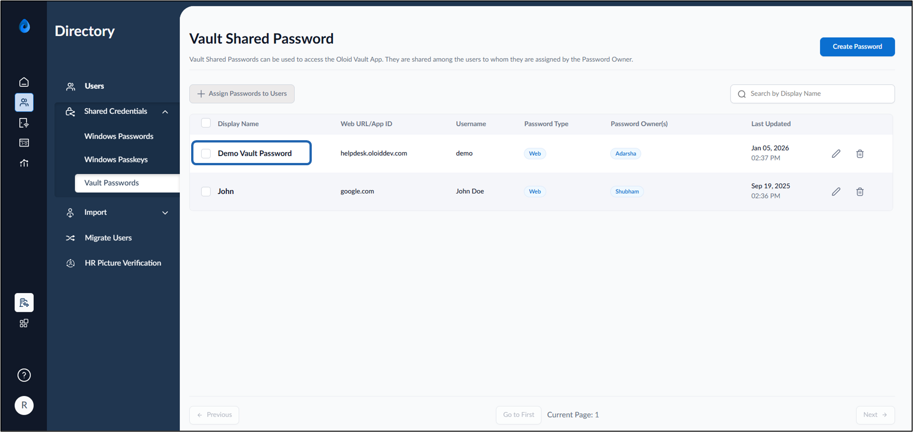
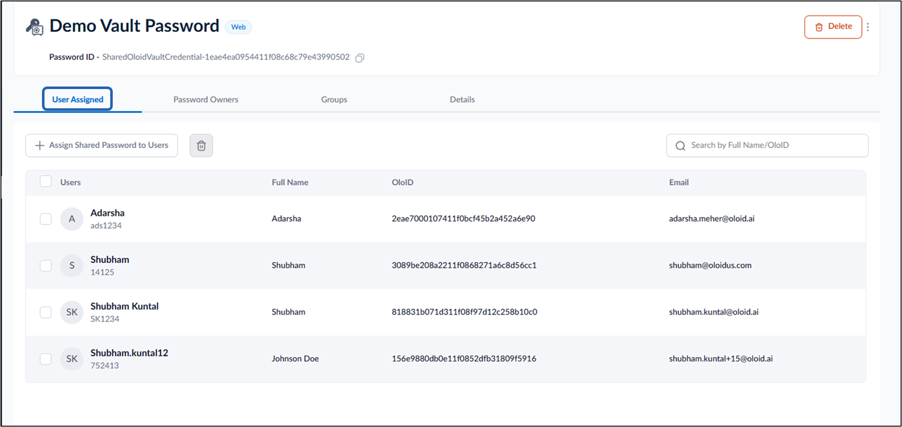
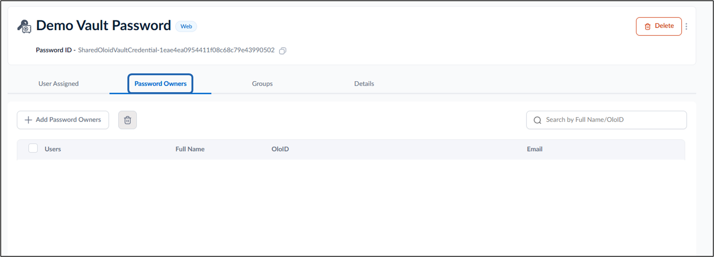
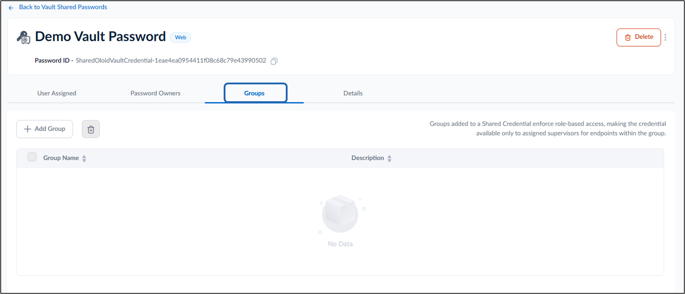
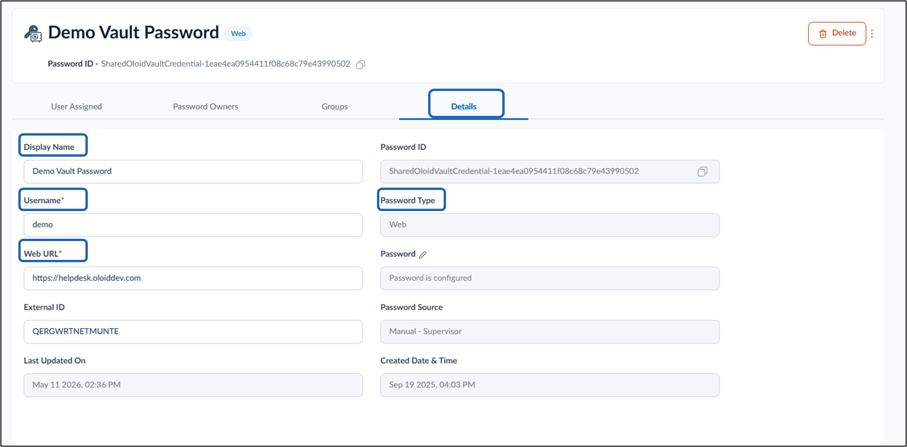

{/* Source: Intercom article 15053473 - https://oloid.help/en/articles/15053473-how-to-configure-vault-shared-passwords-in-the-tenant-admin-portal */}
{/* Generated by intercom_to_mintlify.py - re-running overwrites this file. */}

## Introduction

The Admin can assign users, designate password owners, associate groups, and define credential details to ensure secure and structured access management.

## Prerequisites

- You must have access to a Tenant Admin account.
- Group must be created in the Tenant Admin portal. For more, refer: [How to create group](/platform/tenant-admin-portal/tenant-admin-portal-how-to-create-group)
- Vault shared password must be created. For more, refer: [Chrome Vault - How to Create Shared Password in the Tenant Admin Portal](/platforms/web/vault/chrome/oloid-vault-chrome-chromium-how-to-create-shared-password-in-the)

## Steps to Configure to Vault Shared Password

1. Log in to the **Tenant Admin Portal**.
2. On the home page of the portal, click **Directory** on the left menu panel.

   

   The **Users** page is displayed.
3. Click **Shared Credentials > Vault Passwords** on the left menu panel.

   

   The **Vault Shared Password** page is displayed.

   

4. Select Shared Password from the list.
   The Vault shared password details page is displayed.
5. Do the following:
   1. [Users Assigned](#users-assigned)
   2. [Password Owners](#password-owners)
   3. [Configure Groups Tab](#configure-groups-tab)
   4. [Configure Details Tab](#configure-details-tab)
6. Click **Save** after configuration changes.
   The Vault shared password is successfully configured.

### Users Assigned

This tab displays users who are assigned to use the shared password. Multiple users can be assigned shared Vault passwords. For more, refer: [How to assign Vault Shared Password to Users in the Tenant Admin Portal](/platform/tenant-admin-portal/how-to-assign-vault-shared-password-to-users-in-the-tenant-admin)

### Password Owners

This tab displays users who have ownership privileges over the shared password. More password owners can be added from the tenant admin portal. For more, refer: [How to add password owners for Vault Shared password in the Tenant Admin Portal](/platform/tenant-admin-portal/how-to-add-password-owners-for-vault-shared-password-in-the-tenant)

<Note>
  **Note:** Only users with Admin or Supervisor roles can be assigned as Password Owners.
</Note>

### Configure Groups Tab

Displays groups associated with the shared password, adding the shared password to a group allows the all users in the group to use the shared Vault password. for more information, please refer: [How to Add a Group to Vault Shared Passwords in the Tenant Admin Portal](/platform/tenant-admin-portal/how-to-add-a-group-to-vault-shared-passwords-in-the-tenant-admin)

### Configure Details Tab

This tab displays configuration details of the shared password.

To configure the Details tab do the following:

1. Edit **Display Name** (If required)
   Name assigned to the shared password.
2. Edit **Username** (If required)
   Username associated with the credential.
3. Edit **Web URL / App ID / Domain ID** (If required)
   Web URL refers to the website link associated with the stored credential.
4. Edit **Password** (If required)
   Indicates whether the password is configured.

   <Note>
     **Note:** Use the edit option to update the password.
   </Note>

5. Edit **External ID** (Optional)
6. Click **Save**.

The Details tab is configured.
