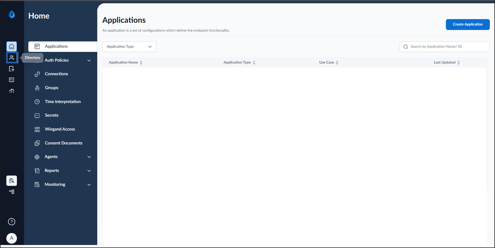
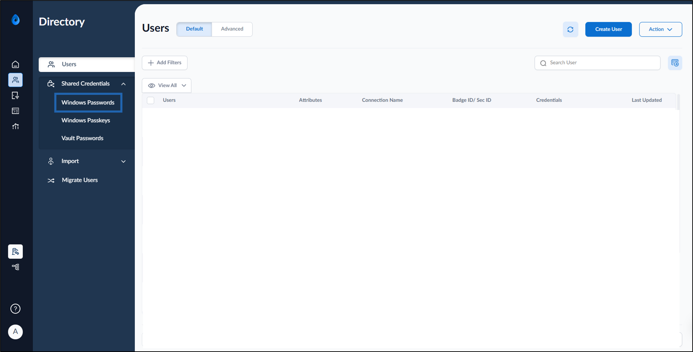
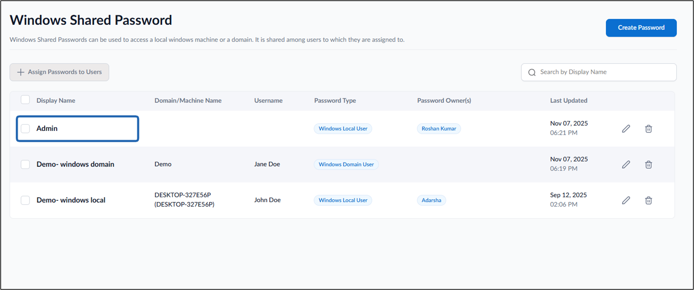
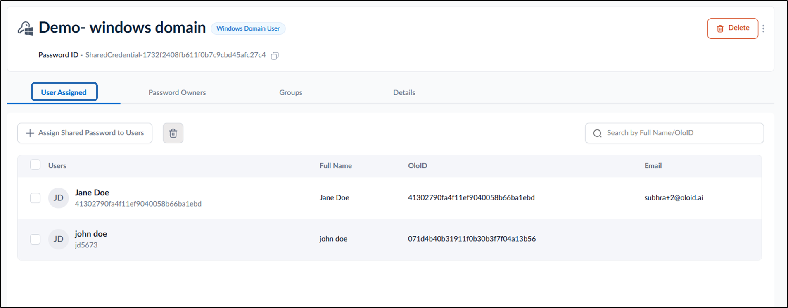
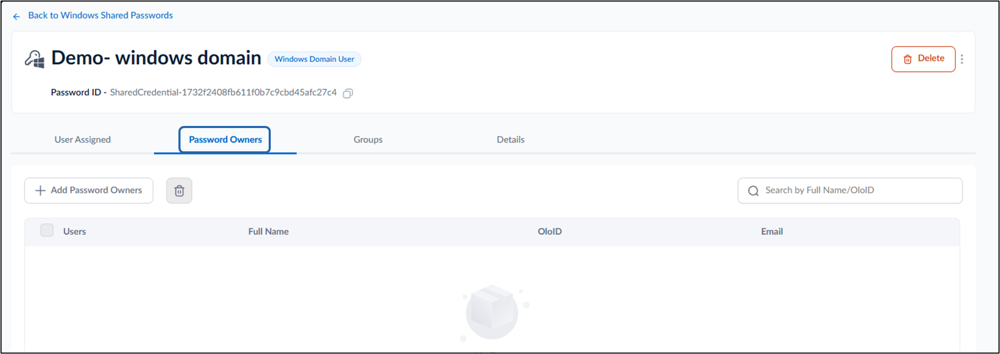
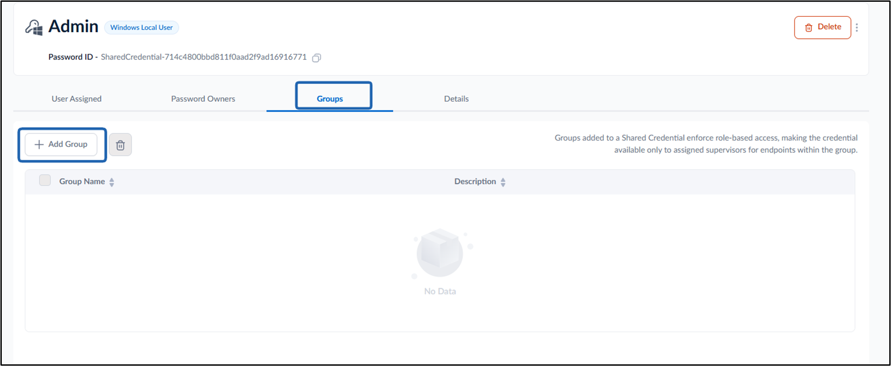
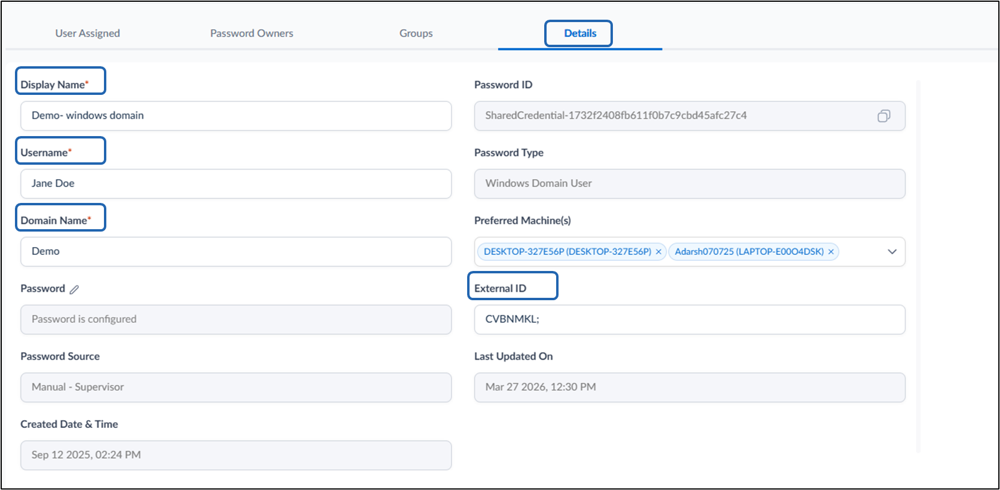

{/* Source: Intercom article 14430451 - https://oloid.help/en/articles/14430451-how-to-configure-windows-shared-passwords-in-the-tenant-admin-portal */}
{/* Generated by intercom_to_mintlify.py - re-running overwrites this file. */}

## Introduction

The Tenant Admin Portal allows admins to manage Windows Shared Passwords and control access using users, groups, and ownership assignments. Adding groups to a Windows Shared Password enables multiple users to inherit access through group membership

## Prerequisites

- You must have a Tenant Admin account.
- Group must be created in the Tenant Admin portal. For more, refer: [How to create group](/platform/tenant-admin-portal/tenant-admin-portal-how-to-create-group)
- Windows shared password must be created. For more, refer: [How to create shared Password for Windows login application in the Tenant Admin Portal](/platform/tenant-admin-portal/how-to-create-shared-password-for-windows-login-application-in-the)

## Steps to Configure to Windows Shared Password

1. Log in to the **Tenant Admin Portal**.
2. On the home page of the portal, click **Directory** on the left menu panel.

   

   The **Users** page is displayed.
3. Click **Shared Credentials > Windows Password** on the left menu panel.

   

   The **Windows Shared Password** page is displayed.

   

4. Select Shared Password from the list.
   The Windows shared password details page is displayed.
5. Do the following:
   1. [Configure Users Assigned](#users-assigned)
   2. [Configure Password Owners](#password-owners)
   3. [Configure Groups Tab](#configure-groups-tab)
   4. [Configure Details Tab](#configure-details-tab)
6. Click **Save** after configuration changes.
   The Windows shared password is successfully configured.

### Users Assigned

This tab displays users who are assigned to use the shared password. Multiple users can be assigned shared windows passwords. For more, refer: [How to associate users with shared credentials](/platform/tenant-admin-portal/tenant-admin-portal-how-to-associate-users-with-window-shared)

### Password Owners

This tab displays users who have ownership privileges over the shared password. More password owners can be added from the tenant admin portal. For more, refer: [How to add password owners for Windows shared password in the Tenant Admin Portal](/platform/tenant-admin-portal/how-to-add-password-owners-for-windows-shared-password-in-the-tenant)

<Note>
  **Note:** Only users with Admin or Supervisor roles can be assigned as Password Owners.
</Note>

### Configure Groups Tab

Displays groups associated with the shared password, adding the shared password to a group allows the all users in the group to use the shared windows password. for more: [How to Add a Group to Windows Shared Passwords](/platforms/windows/windows-login/windows-login-how-to-add-a-group-to-windows-shared-passwords)

### Configure Details Tab

This tab displays configuration details of the shared password.

To configure the Details tab do the following:

1. Enter **Display Name**
   Name assigned to the shared password.
2. Enter **Username**
   Username associated with the credential.
3. Enter **Domain Name**
   Domain in which the credential is valid.
4. Enter **Password**
   Indicates whether the password is configured.

   <Note>
     **Note:** Use the edit option to update the password.
   </Note>

5. Enter **Password Source**
   Displays how the password was configured (for example, Manual - Supervisor).
6. Select **Password Type**
   Type of password (for example, Windows Domain User).
7. Select **Preferred Machine(s)**
8. Enter **External ID** (Optional)
9. Click **Save**.

The Details tab is configured.
