{/* Source: Intercom article 8227103 - https://oloid.help/en/articles/8227103-how-to-create-a-new-location-and-add-location-details */}
{/* Generated by intercom_to_mintlify.py - re-running overwrites this file. */}

This document comprises of the following:

- [Create location using Transaction](#create-location-using-transaction)
- [Create location using Endpoint](#create-location-using-endpoint)
- [Adding location details](#adding-location-details)

## Create location using Transaction

Steps to create a new location through transaction:

1. Log in to the **Oloid Portal**.
2. On the home page of the portal, click **Transactions** on the left menu panel.

   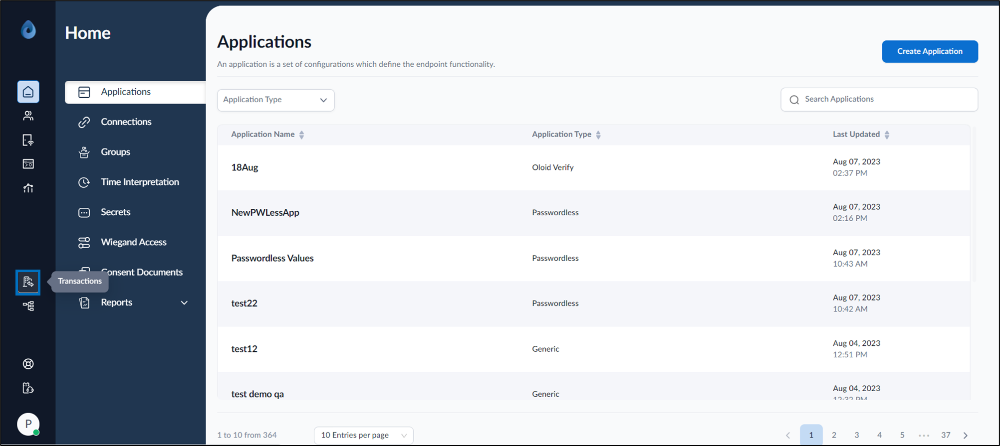

   The **User Transaction Through Your Device** page is displayed.
3. Click **Location Settings** at the bottom of the left menu panel.

   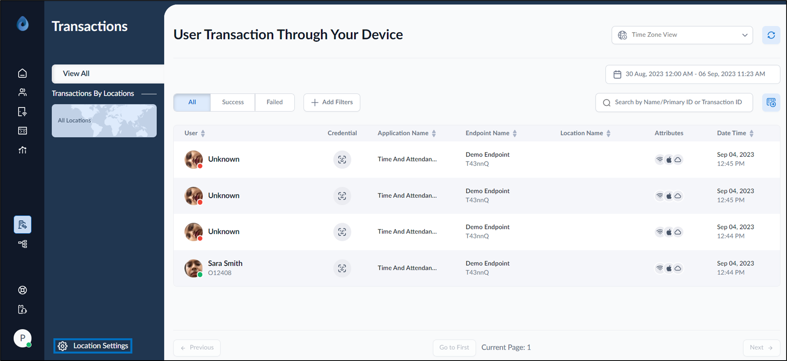

   The **Location Settings** page is displayed.
4. Click **Create Location** on the right corner of the page.

   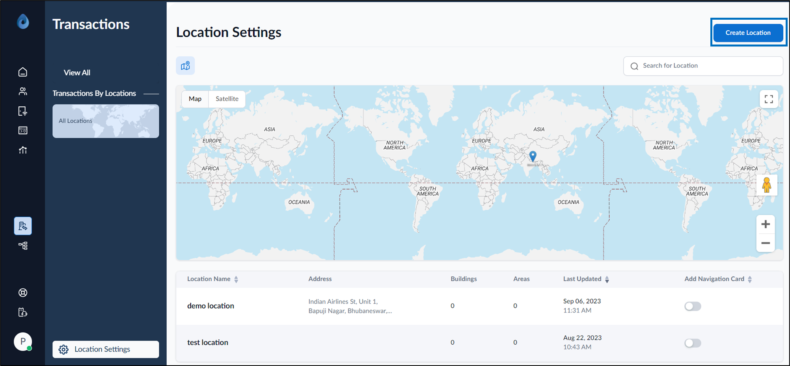

   The **Create Location** pop-up box is displayed.

   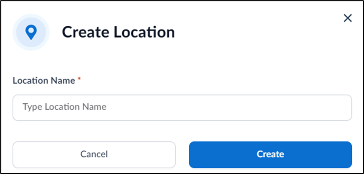

5. Enter **Location Name**.
6. Click **Create**.
   The location is created and listed on the **Location Settings** page.

   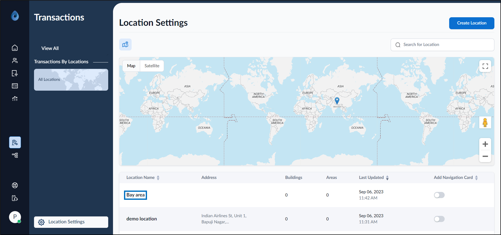

   <Note>
     **Note:** You can enable the toggle button for **Add Navigation Card.** This creates a card view on the right menu panel for that location.
   </Note>

## Create location using Endpoint

Steps to create a new location through endpoint:

1. Log in to the **Oloid Portal**.
2. On the home page of the portal, click **Endpoints** on the left menu panel.

   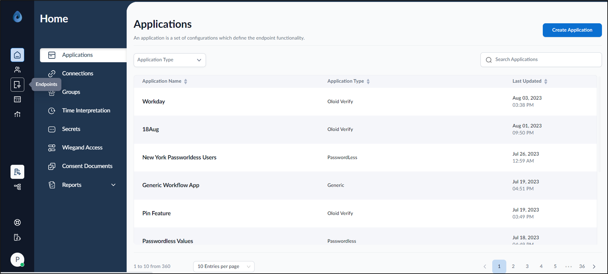

   The **Endpoints** page is displayed.
3. Select endpoint name(s) from the listed endpoints.

   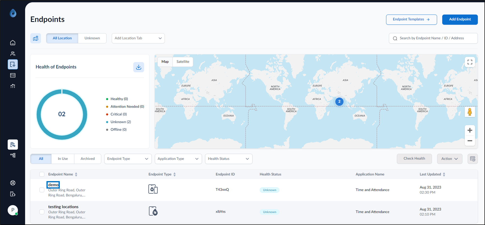

4. Go to **Action** dropdown and select **Add Location**.

   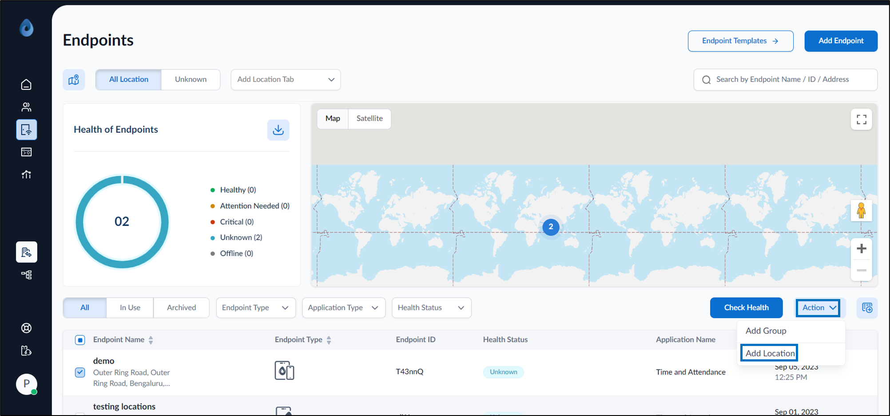

   The **Add Location** pop-up box is displayed.

   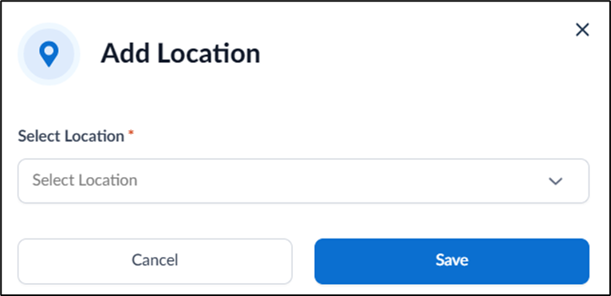

5. On the pop-up box do the following:
   1. Click **Select Location** field.
      The search result lists existing locations.

      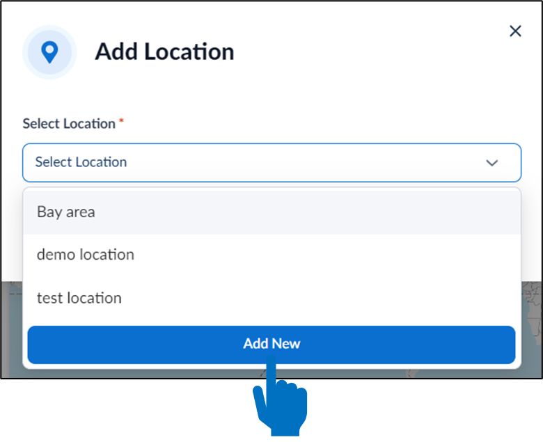

   2. Click **Add New**.
      The **Create Location** pop-up box is displayed.

      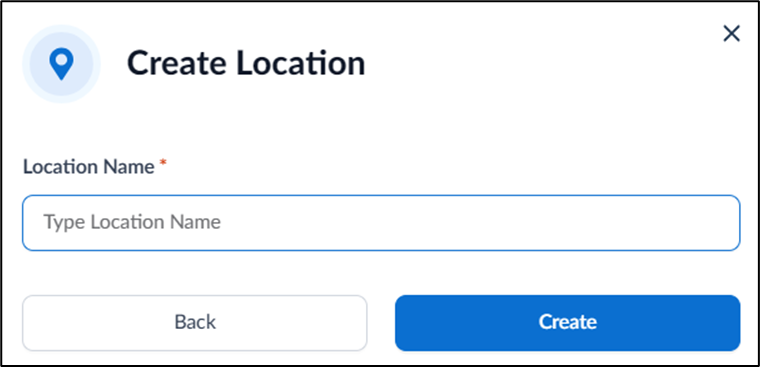

   3. Enter **Location Name**.
   4. Click **Create**.
      The location name is created and listed on the **Location Settings** page.

      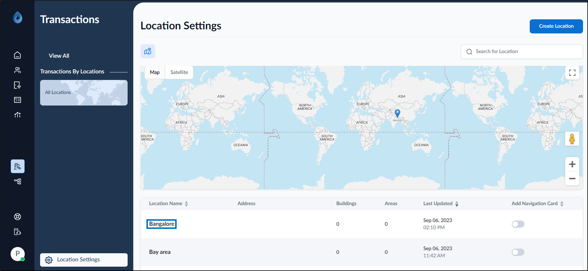

## Adding location details

1. Log in to the **Oloid Portal**.
2. On the home page of the portal, click **Transactions** on the left menu panel.

   

   The **User Transaction Through Your Device** page is displayed.
3. Click **Location Settings** at the bottom of the left menu panel.

   

   The **Location Settings** page is displayed.
4. Select location name from the listed locations.

   

   The Location detail page is displayed.

   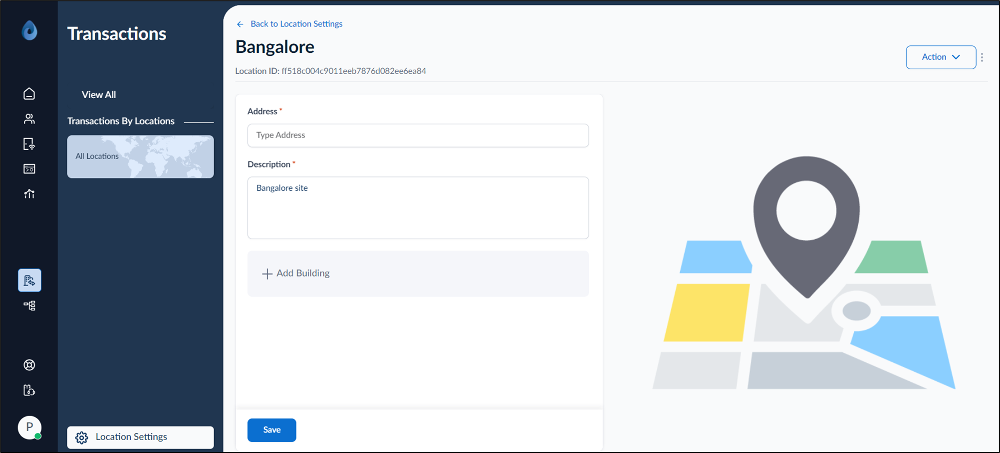

5. Enter **Address**.
6. Enter **Description**.
7. Click **+ Add Building** to enter Building Name (optional).
8. Click **Save**.
   The location address is updated.

   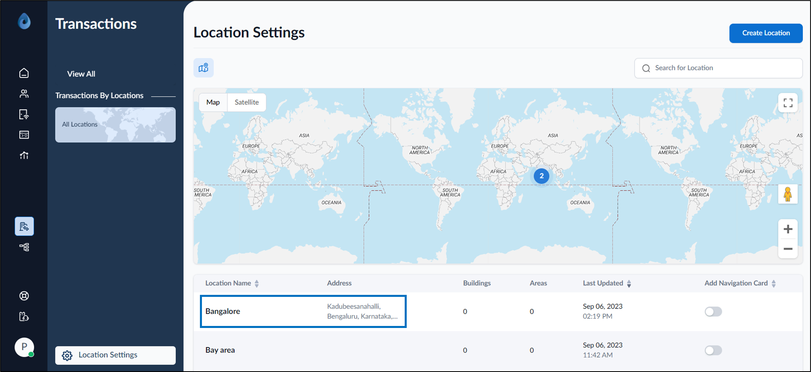
