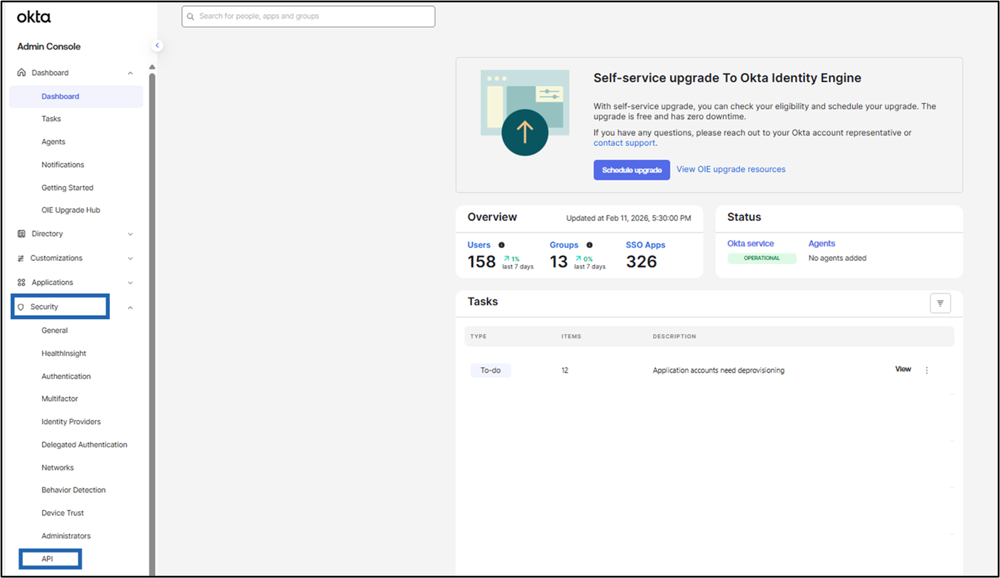
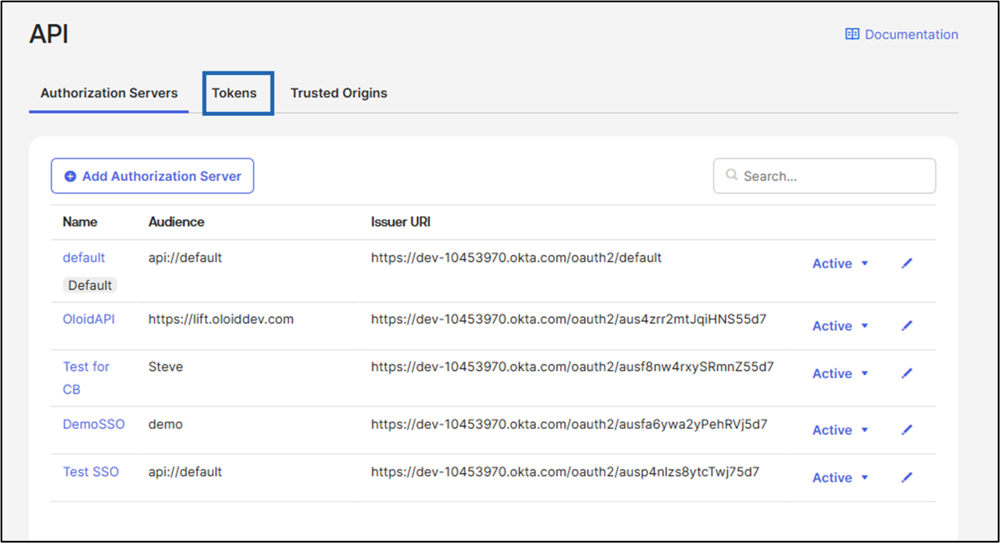
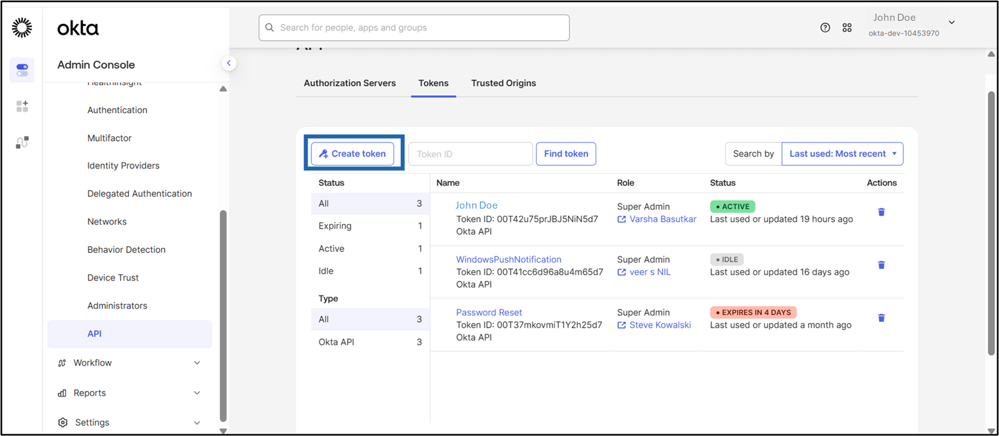
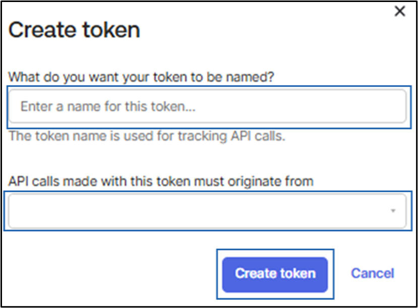
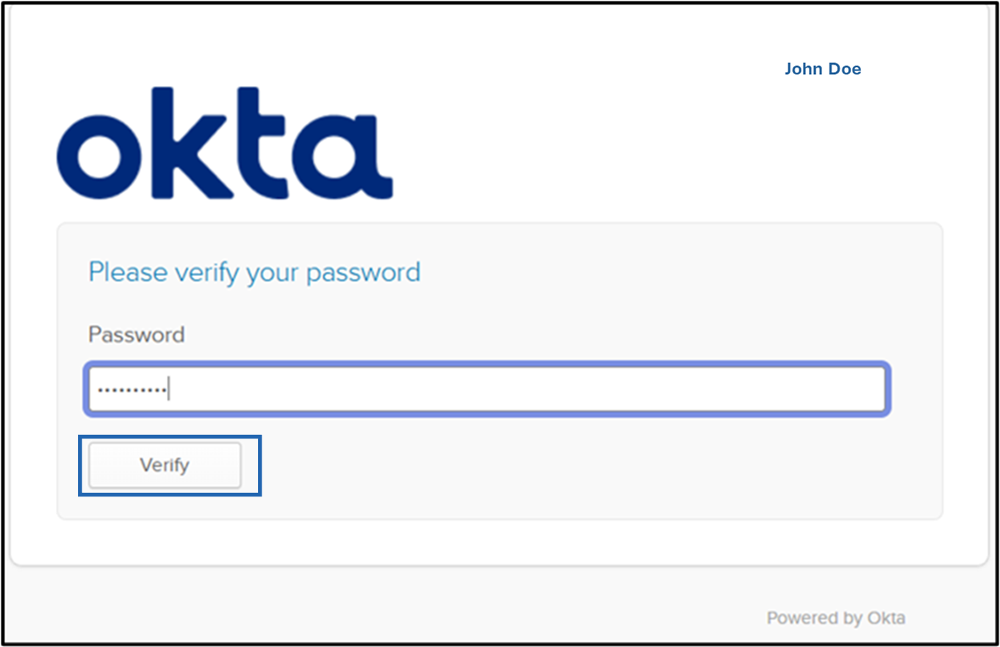
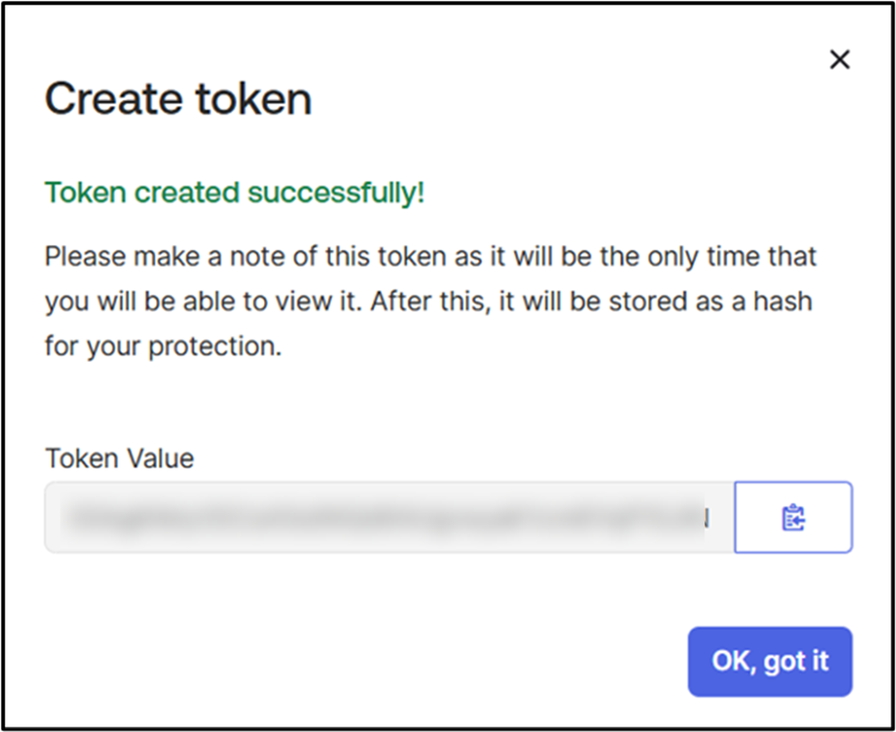

{/* Source: Intercom article 13701658 - https://oloid.help/en/articles/13701658-how-to-create-a-token-id-for-advanced-user-sync-okta-inbound-in-the-okta-admin-console */}
{/* Generated by intercom_to_mintlify.py - re-running overwrites this file. */}

## Introduction

This document explains how to create a Token ID in the Okta Admin Console.
The Token ID is required to securely authenticate and authorize API access for Okta integrations.

## Prerequisite

You must have **admin access** to the Okta Admin Console.

## Steps to Create Token ID

1. Log in to the **Okta Admin Account**.
2. On the left menu panel, go to **Security** > **API.**

   

   The **API** screen is displayed.
3. Click **Tokens**.

   

   The API Token page is displayed.
4. Click **Create token**.

   

   The **Create token** pop-up box is displayed.
5. Do the following:
   1. Enter **Token name**.
   2. Select the API calls from the drop-down.

      <Note>
        **Note:** Select **Any IP**.
      </Note>

   3. Click **Create token**.

      

      The **Verify your Password** screen is displayed.
6. Enter **OKTA Password** and click **Verify**.

   

   The Token ID is created successfully. You can use this Token ID in the Tenant Admin Portal when configuring Advanced User Sync for Okta – Inbound.

   

##### Related Articles

[How to Configure Advanced User Sync for Okta - Inbound in the Tenant Admin Portal](/platform/tenant-admin-portal/tenant-admin-portal-how-to-configure-advanced-user-sync-for-okta)
