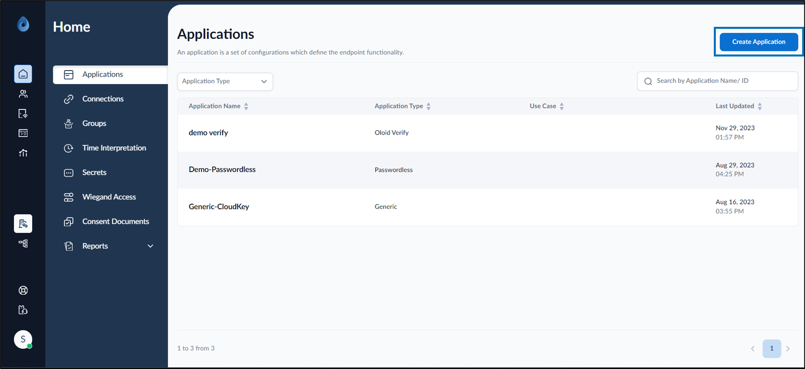
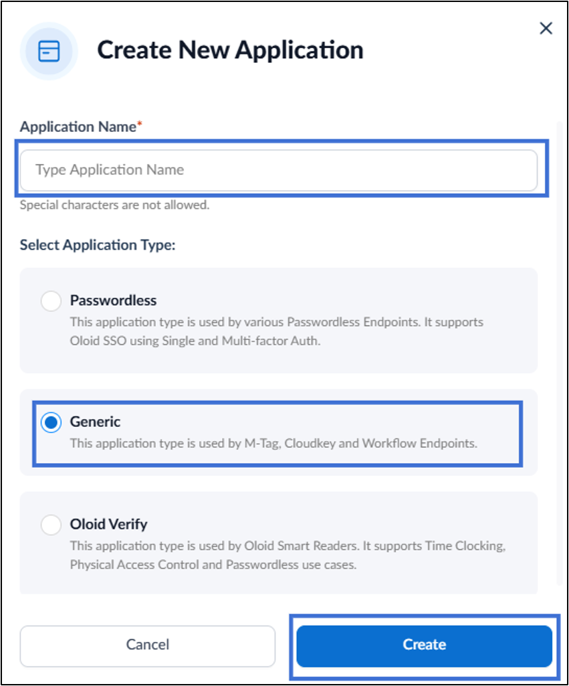
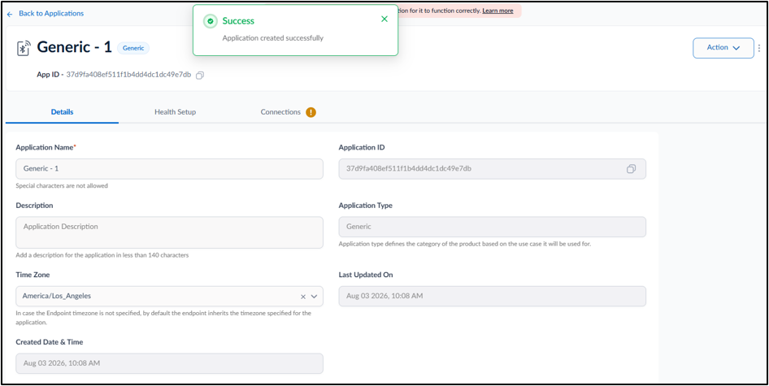
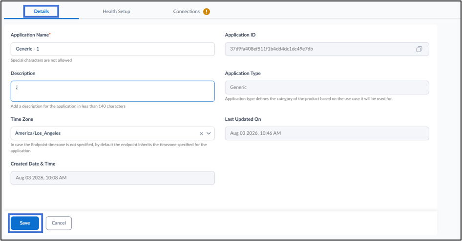
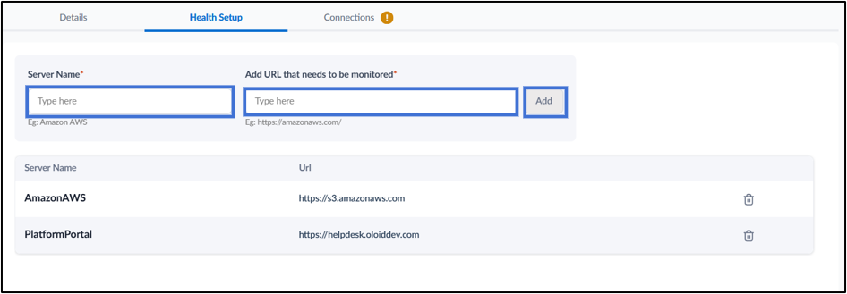
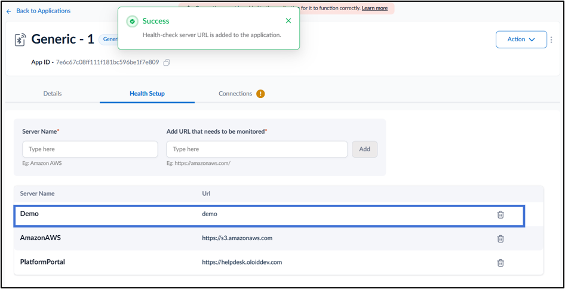
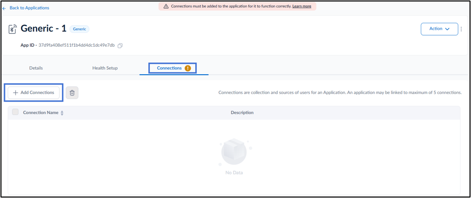
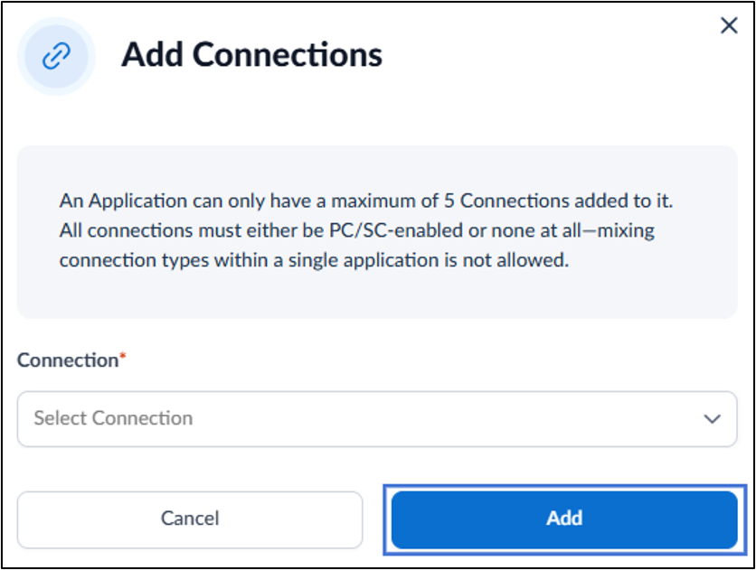

{/* Source: Intercom article 8300397 - https://oloid.help/en/articles/8300397-how-to-create-and-configure-application-type-generic */}
{/* Generated by intercom_to_mintlify.py - re-running overwrites this file. */}

### Introduction

This document provides instructions to create and configure a Generic application in the Tenant Admin Portal.

### Prerequisites

- You must have **Admin** access to the Tenant Admin Portal.
- The required **Connection** must already be created before mapping it to the application. For more, refer to [How to create Connections in the Tenant Admin Portal](/platform/tenant-admin-portal/tenant-admin-portal-how-to-create-connection)

## Steps to Create and Configure Generic Application

1. Log in to the **Tenant Admin Portal**.
2. On the **Applications** page, click **Create Application** in the top right corner.

   

   The **Create New Application** pop-up box is displayed.
3. On the pop-up box, do the following:
   1. Enter **Application Name** and select **Application Type** as **Generic**.
   2. Click **Create**.

      

      The **Generic** application is created and application details page is displayed.
4. Configure the following tabs:
   1. [Details tab](#configure-details-tab)
   2. [Health Setup](#configure-health-setup-tab)
   3. [Connections tab](#configure-connections-tab)

      <Note>
        **Note:** These settings need to be configured only once, and it is recommended to keep the default values.
      </Note>

      

### Configure Details Tab

The **Details** tab is used to configure the basic application information, such as the application name, description, and time zone.

Do the following:

1. Update the **Application Name** (if needed).
2. Add the **Description** (Optional).
3. Select the **Time Zone** from the drop-down menu.
4. Click **Save**.

   

### Configure Health setup Tab

The **Health Setup** tab is used to configure servers and URLs that the application monitors. Health checks help verify the availability and accessibility of the configured servers.

<Note>
  **Note:** The default health monitoring servers are created automatically recommended. to add server, do the following:
</Note>

1. Enter the **Server Name**.
   **Example:** Amazon AWS
2. Enter the **URL that needs to be monitored**.
   **Example:** `https://amazonaws.com/`
3. Click **Add**.

   

   The server is added to the Health Setup list successfully.
   The following details are displayed in the table:
   - **Server Name:** Displays the configured server name.
   - **URL:** Displays the URL configured for health monitoring.

     

### Configure Connections Tab

Do the following:

1. Select **+ Add Connections** to map a connection to the application.

   

   The **Add Connections** pop-up box is displayed.
2. Select connection from the drop-down list and click **Add**.

   

   The connection is added to the application successfully.
