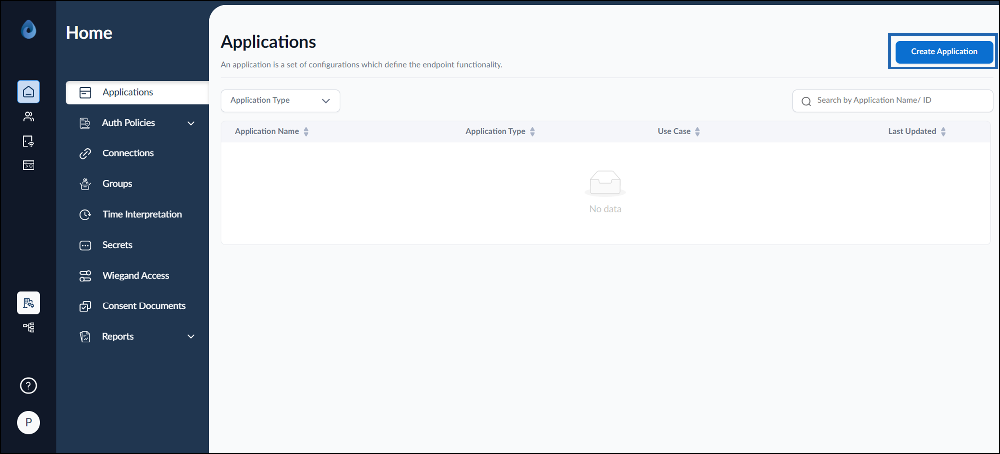
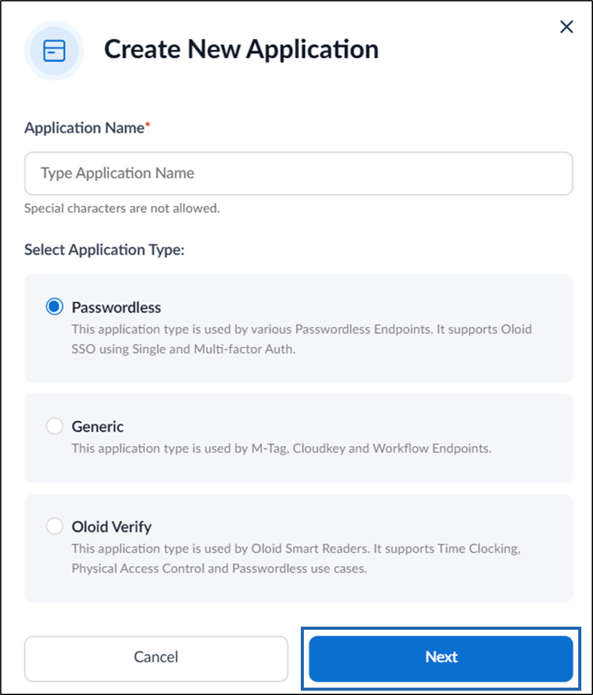
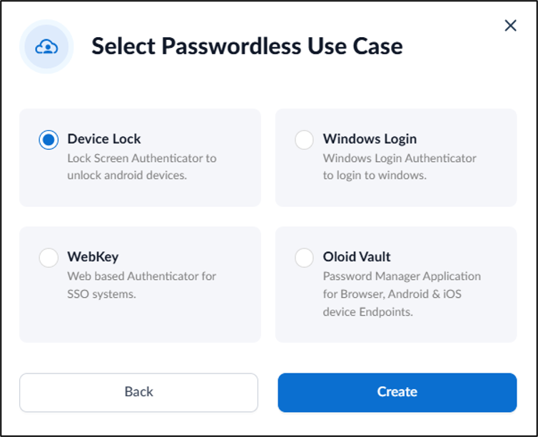

{/* Source: Intercom article 8300330 - https://oloid.help/en/articles/8300330-how-to-create-and-configure-application-type-passwordless */}
{/* Generated by intercom_to_mintlify.py - re-running overwrites this file. */}

## Introduction

Oloid Passwordless Authenticator is a simple, seamless, secure, and scalable authentication application that provides secure, password-free access to Windows desktops and laptops, Android tablets, iPads, and workforce/HRMS platforms.

## Prerequisite

You must have admin access to Tenant Admin Portal.

## Steps to Create Passwordless Application

1. Log in to the **Tenant Admin Portal**.
2. On the **Applications** page, click **Create Application** in the top right corner.

   

   The **Create New Application** pop-up box is displayed.

   

3. On the pop-up box, do the following:
   1. Enter **Application Name** and select **Application Type** as **Passwordless**.
   2. Click **Next**.
      The **Select Passwordless Use Case** pop-up box is displayed.
4. Select the Passwordless Use Case.

   

5. Click **Create**.
   The selected Passwordless application type is created and the configuration page is displayed.
   Depending on your application type, click the links below for detailed information on creating and configuring Passwordless Applications.

[How to create and configure Webkey application](/platforms/web/webkey/webkey-how-to-create-and-configure-a-webkey-application-in-tenant)

[How to create and configure Device Lock application](/platforms/windows/windows-login/devicelock-app-how-to-create-and-configure-devicelock-application-in)

[How to create and configure Windows Login application](/platforms/windows/windows-login/windows-login-how-to-create-and-configure-windows-login-application)
