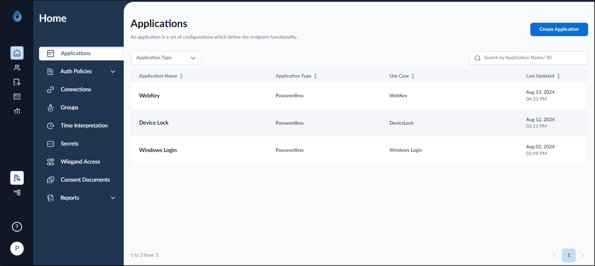
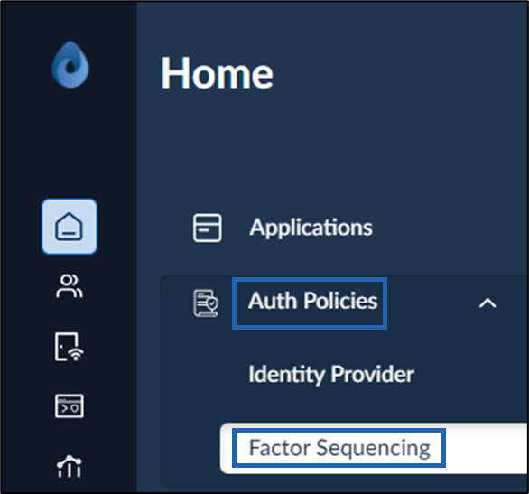
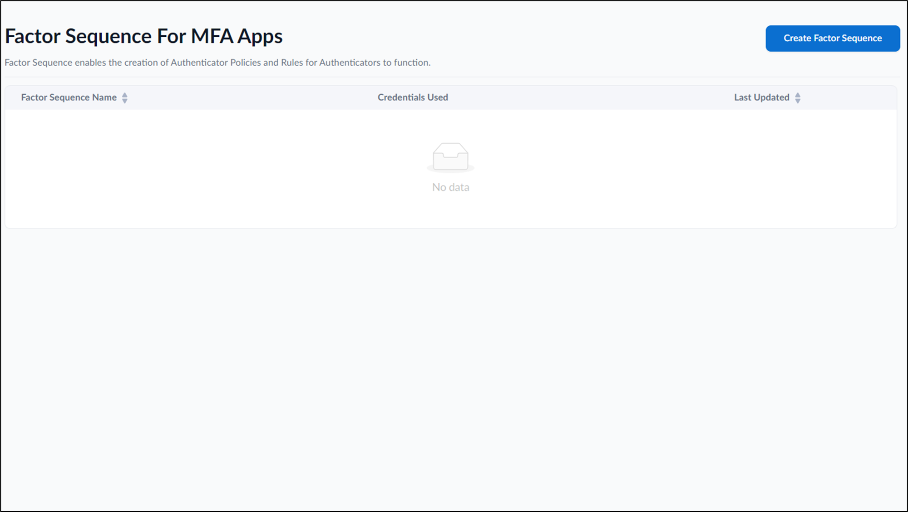
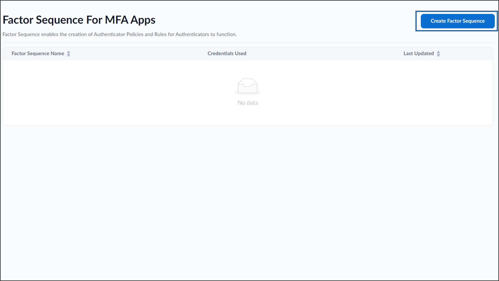
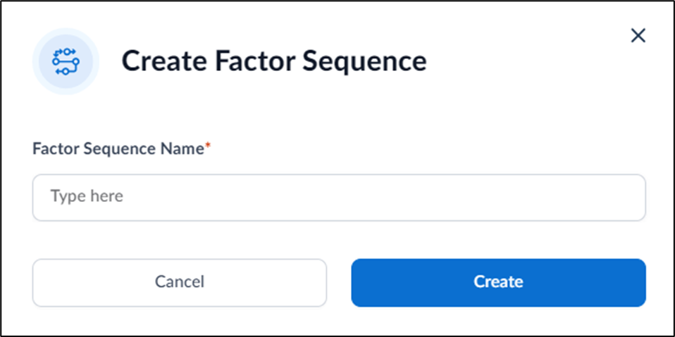
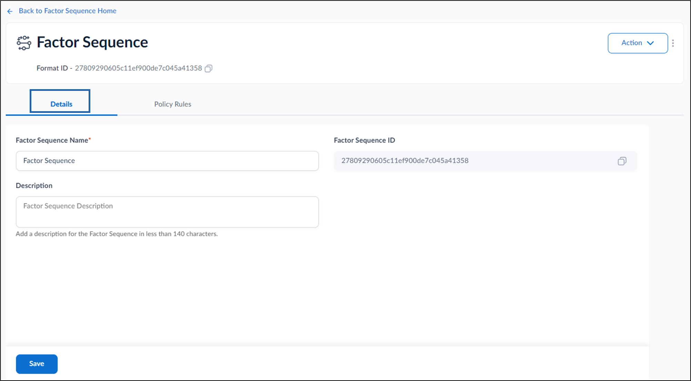
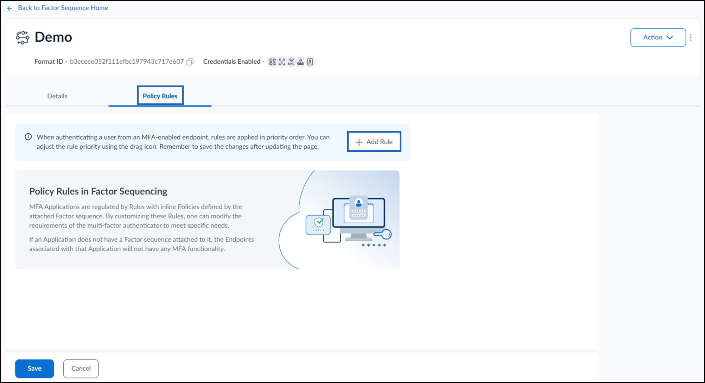
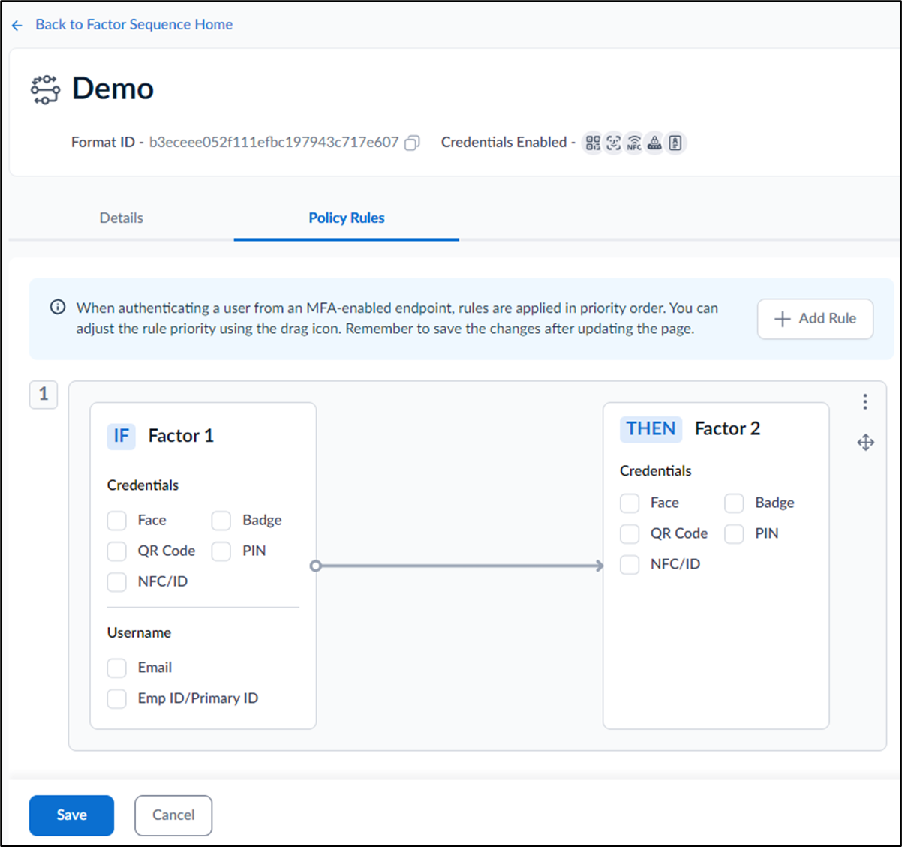

{/* Source: Intercom article 9699393 - https://oloid.help/en/articles/9699393-how-to-create-and-configure-factor-sequence */}
{/* Generated by intercom_to_mintlify.py - re-running overwrites this file. */}

Factor Sequence helps set up rules for *multi-factor authentication in Oloid applications. It determines the order and combination of these methods to make sure that the authentication process is effective and secure.

*Multi-Factor Authentication (MFA) is a security process that requires users to authenticate their identity using two or more verification methods.

## Steps to create Factor Sequence

1. Log in to the **Oloid Portal**.
   The homepage is displayed.

   

2. Click **Auth Policies** > **Factor Sequencing** from the menu panel.

   

   The **Factor Sequence for MFA Apps** page is displayed.

   

3. Click **Create Factor Sequence** in the top right.

   

   The **Create Factor Sequence** pop-up box is displayed.

   

4. Enter **Factor Sequence Name** in the text field.
5. Click **Create**.
   The Factor Sequence is created and the configuration page is displayed.
6. Do the following to configure Factor Sequence:
   1. [Configure Details tab](#configure-details-tab)
   2. [Configure Policy Rules tab](#configure-policy-rules-tab)
      The Factor Sequence is configured.

### Configure Details Tab

1. Enter **Factor Sequence Name**.
2. Enter **Factor Sequence Description**.(Optional)
3. Click **Save**.

   

### Configure Policy Rules Tab

1. Go to **Policy Rules** > **Add Rule** to create a new policy rule.

   

   The **IF Factor 1** and **THEN Factor 2** section is displayed

   

2. Select preferred credentials under **Factor 1** and **Factor 2**.
3. Click **Save**.
   The **Policy Rules** is saved Successfully. For detailed instructions, refer [How to add Policy Rules for Factor Sequencing](/platform/tenant-admin-portal/how-to-add-policy-rules-for-factor-sequencing)
