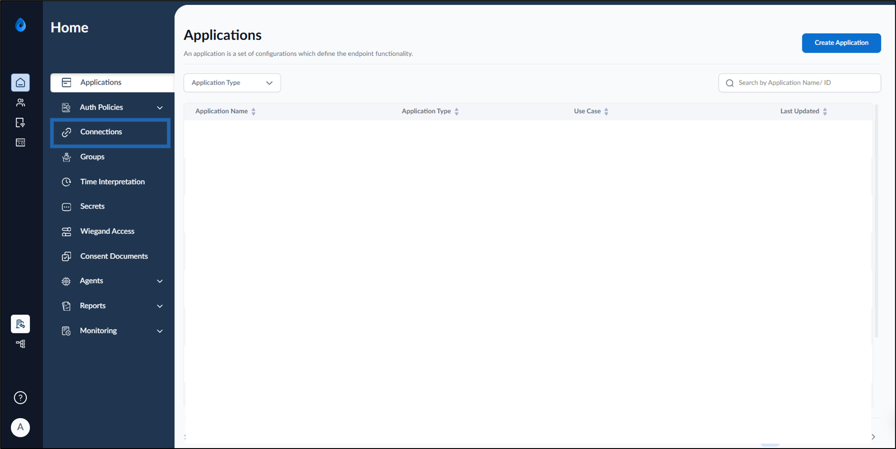
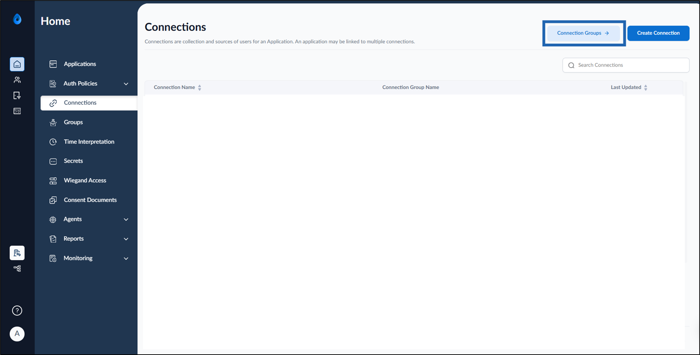
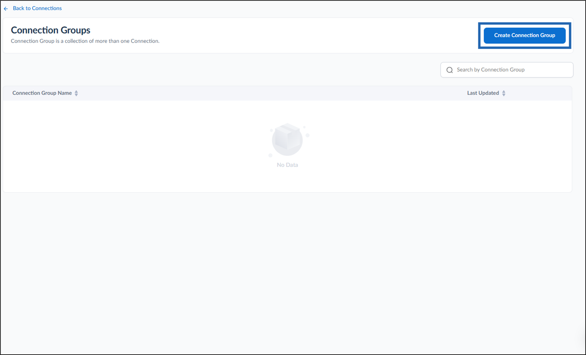
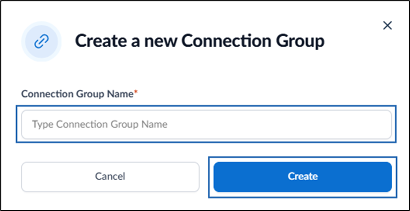
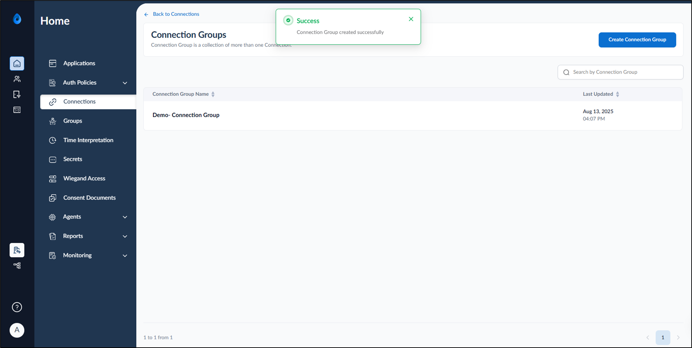

{/* Source: Intercom article 8304214 - https://oloid.help/en/articles/8304214-how-to-create-connection-groups-in-the-tenant-admin-portal */}
{/* Generated by intercom_to_mintlify.py - re-running overwrites this file. */}

## Introduction

The Tenant Admin Portal allows admin to create Connection Groups, which are logical groupings of multiple connections. These groups help organize and manage complex access policies across different locations, enabling shared configurations, policies, and permissions to be applied efficiently.

## Prerequisite

- You must have a Tenant Admin account.

  <Note>
    **Note:** You must have Connection Groups access to see this feature in Tenant Admin Portal. Contact Oloid Support for more information.
  </Note>

## Steps to Create Connection Groups

1. Log in to the **Tenant Admin Portal**.
2. On the home page of the portal, click **Connections** on the left menu panel.

   

   The **Connections** page is displayed.
3. Click **Connection Groups** on the top right corner of the page.

   <Note>
     **Note:** If the **Connection Groups** option is not displayed on the Connections page, contact Oloid Support. This feature must be enabled by Oloid to be available.
   </Note>

   

   The **Connection Groups** page is displayed.
4. On the top right, click **Create Connection Group**.

   

   The **Create a new Connection Group** pop-up box is displayed.
5. On the pop-up box, do the following:
   1. Enter a connection group name in the **Connection Group Name** text field.
   2. Click **Create**.

      

      A new connection group is created and listed on the **Connection Groups** page.

      
