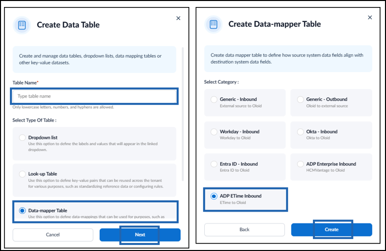
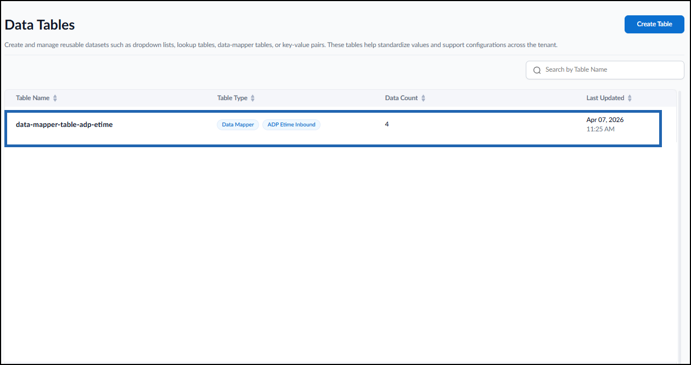

{/* Source: Intercom article 14468332 - https://oloid.help/en/articles/14468332-how-to-create-data-mapper-table-for-adp-etime-inbound-in-the-tenant-admin-portal */}
{/* Generated by intercom_to_mintlify.py - re-running overwrites this file. */}

## Introduction

The Data Mapper Table in the Tenant Admin Portal allows admins to map employee data from external systems such as ADP ETime Inbound to Oloid. This document provides instructions on how to create the Data Mapper table for ADP ETime Inbound.

## Prerequisite

You must have access to the Tenant Admin Portal.

## Steps to Create Data Mapper Table

1. Log in to **Tenant Admin Portal**.
2. Go to **Agents** tab > click **Data Tables**.

   

   The Data Tables page is displayed.
3. Click **Create Table**.

   

   The **Create Data Table** pop-up box is displayed.
4. Do the following:
   1. Enter **Table Name**.
   2. Select **Data-mapper Table** in Type of Table.
   3. Click **Next**.
   4. Select **ADP ETime Inbound** as a Category.
   5. Click **Create**.

      

      The data mapper table is created successfully.

      

##### Related Article

[How to Configure Data Mapper Table for ADP ETime Inbound in the Tenant Admin Portal](/platform/tenant-admin-portal/tenant-admin-portal-how-to-configure-data-mapper-table-for-adp-etime)
